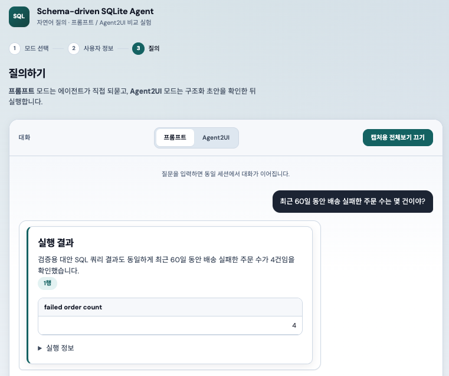
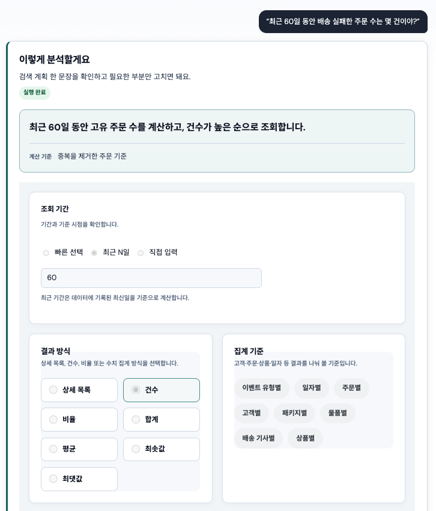
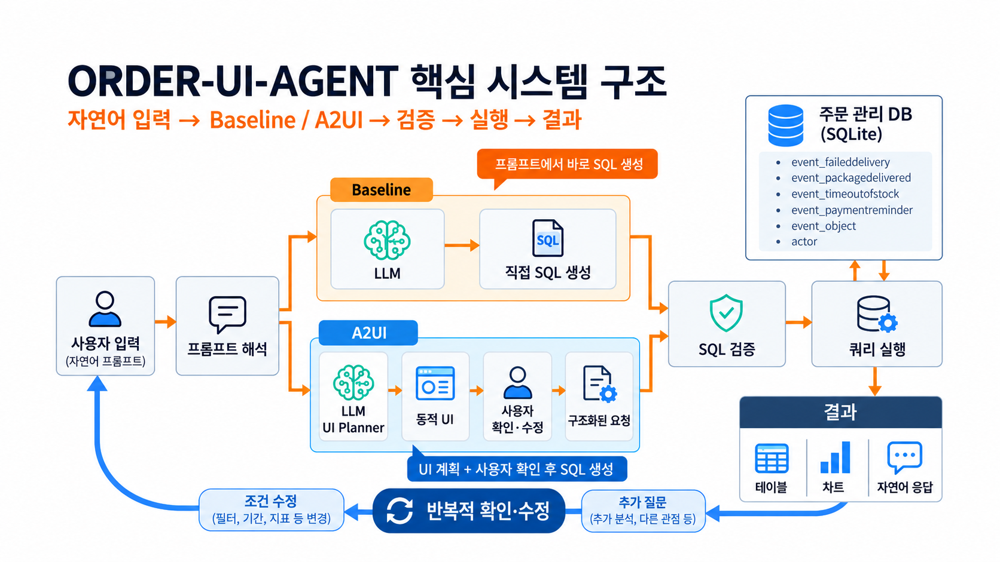
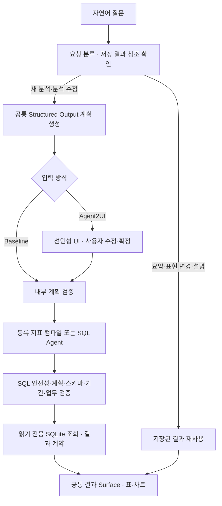

# Agent2UI · 실행 전 분석 계획을 검토하는 데이터 분석 UI

[](https://github.com/kim-chanhee/order-ui-agent/actions/workflows/ci.yml)

**자연어 질문 → 분석 계획 UI → 사용자 수정·확정 → SQL 검증·실행 → 결과**

SQL을 모르는 사용자가 AI의 해석을 확인하고 수정할 수 있도록 만든 연구용 웹 시스템입니다. 물류·주문 데이터 분석을 대상으로, 질문을 즉시 실행하는 프롬프트 방식과 실행 전에 분석 계획을 검토하는 Agent2UI 방식을 비교합니다.

[데이터와 시작](#데이터-출처와-실행-준비) · [사용 화면](docs/system-guide.md#사용-화면) · [구조와 설계](#시스템-구조) · [설치·문제 해결](docs/getting-started.md) · [API](app/routes/README.md)

## 처음 읽는다면

**질문을 바로 실행하기 전에, AI가 이해한 분석 조건을 사람이 확인하는 프로젝트입니다.**

처음에는 아래 예시와 두 모드의 차이만 읽어도 됩니다. 구현이 궁금하면 [계획 만들기](app/planning/README.md) → [SQL 실행하기](app/execution/README.md) → [화면 보여주기](app/static/README.md) 순서로 읽으세요. 각 문서의 첫 요약으로 역할을 파악하고, 필요한 코드만 펼쳐 볼 수 있습니다.

### 질문 하나로 보는 동작

“최근 60일 동안 배송에 실패한 주문은 몇 건인가?”라는 질문을 예로 들어보겠습니다. 아래는 처리 방식을 설명하는 예시이며 특정 조회 결과를 뜻하지 않습니다.

1. 질문을 **기간·실패 조건·집계 대상**으로 나눠 분석 계획을 만듭니다.
2. Agent2UI는 이 계획을 화면에 보여줍니다. 사용자가 조건을 확인하고 바꿀 수 있습니다.
3. 사용자가 확정하면 SQL을 만듭니다. 등록된 지표에 해당하면 정의된 규칙을 사용합니다.
4. SQL에 확정한 조건이 반영됐는지 검사합니다. 실패 이력 수와 중복을 뺀 주문 수가 같은 뜻은 아닙니다.
5. 검사를 통과한 SQL을 읽기 전용으로 조회하고 결과를 보여줍니다.

Baseline도 내부 계획을 만들지만, 사용자에게 계획을 검토받는 단계는 생략합니다.

### 자주 나오는 용어

| 용어 | 짧은 설명 |
|---|---|
| 분석 계획 | 무엇을, 어떤 기간과 조건으로, 어떻게 집계할지 정한 데이터 |
| 스키마(Schema) | DB에 어떤 테이블과 컬럼이 있는지 나타낸 구조 |
| Tool Calling | 모델이 함수 이름과 인자를 요청하면 앱이 해당 함수를 실행하는 방식 |
| AST | SQL을 테이블·조건·집계 등의 구성 요소로 나눠 읽기 위한 구조 |
| SQL 계약(Contract) | 분석 계획의 조건이 SQL에도 반영돼야 한다는 규칙 |
| Surface | 서버가 브라우저에 보내는 화면 설명 데이터 |
| revision | 계획 화면의 버전 번호. 오래된 화면에서 보낸 요청을 구분하는 기준 |

## 어떤 문제를 해결하나요?

“최근 60일 배송 실패 주문 건수”라는 질문도 기준일, 실패 조건, 주문 중복 처리에 따라 답이 달라집니다. 결과만 보면 사용자가 AI의 해석을 확인하기 어렵습니다.

Agent2UI는 기간·필터·지표·집계 기준을 편집 가능한 UI로 먼저 보여줍니다. 사용자가 계획을 확정하면, 그 계획과 생성 SQL의 일치 여부를 검사한 뒤 조회합니다.

| 단계 | 프롬프트 모드(Baseline) | Agent2UI 모드 |
|---|---|---|
| 질문 | 자연어 입력 | 자연어 입력 |
| 분석 계획 | 내부 생성 | 내부 생성 후 편집 UI로 표시 |
| 수정 | 후속 질문 | 입력 요소 수정·자연어 조건 추가 |
| 실행 | 검토 단계 없이 실행 | 사용자 확정 후 실행 |
| 결과 | 설명·표·차트 | 설명·표·차트 |

**두 모드는 같은 계획 생성기·SQL 실행 계층·결과 렌더러를 공유합니다.** 이 프로젝트의 핵심 설계는 실행 전 계획 검토, 사용자 수정 내용의 실행 반영, 계획과 SQL의 일치 검증입니다.

일반 조회는 LLM이 SQL을 생성하고, 사전 등록된 모집단·부분집합 지표는 공통 설정 기반 컴파일러로 실행할 수 있습니다. 실행 기록에서 두 경로를 구분합니다. [새 데이터 연결·코드 수정 안내](docs/data-profiles.md)와 [논문 기술·재현 범위](docs/research-reproducibility.md)를 참고하세요.

| 프롬프트 모드 · 바로 조회 | Agent2UI 모드 · 계획 검토 |
|---|---|
|  |  |

기존 주문 DB로 시연한 화면입니다. 오른쪽은 계획 화면 일부이며, 상세 기능과 전체 화면은 [화면 갤러리](docs/system-guide.md#사용-화면)에서 볼 수 있습니다.

## 데이터 출처와 실행 준비

주문 데이터는 RWTH Aachen 연구진이 만든 **Order Management OCEL 2.0 이벤트 로그**입니다. 주문 접수·결제·포장·배송 과정을 시뮬레이션한 데이터로, 실기업 거래 자료와 사용자 연구 설문은 서로 구분합니다. [Zenodo 고정 레코드·DOI](https://zenodo.org/records/18373906)에서 SQLite 원본을 직접 받을 수 있습니다.

**GitHub에는 `.sqlite` 파일을 넣지 않습니다.** 데이터의 출처·객체·사건·관계·집계 시 주의점과 프로젝트 가공 계층을 [Data 안내](Data/README.md)에 정리했습니다. 원본과 가공 DB의 차이 및 현재 재현 범위도 확인할 수 있습니다.

```bash
git clone https://github.com/kim-chanhee/order-ui-agent.git
cd order-ui-agent
uv sync --dev --locked
cp -n .env.example .env
# Data/README.md에 따라 DB를 내려받고 경로·스키마 설정을 맞춥니다.
# .env에 API 키와 모델 설정을 입력한 뒤 실행합니다.
uv run order-ui-agent
```

Python 3.13+, [uv](https://docs.astral.sh/uv/getting-started/installation/), 모델 API 연결 설정이 필요합니다. <http://127.0.0.1:8000>에서 관리자 모드로 시작합니다. 원본 다운로드만으로 가공된 연구 DB가 완성되지는 않으므로 먼저 데이터 준비 안내를 확인하세요. 간단한 앱 점검은 [선택 사항인 합성 데모](docs/getting-started.md)로도 할 수 있습니다.

## A2UI 연구 분석 노트북

`Data/A2UI`에는 신뢰도·기술통계·상관분석·이원분산분석·가정 검정·Box–Cox 재분석·행동 로그 분석 **노트북 7개**와 공통 모듈을 제공합니다. 실행 출력과 원자료 링크는 제거했으며, 참가자 설문·명단·개별 로그는 배포하지 않습니다. 원자료가 필요하므로 코드 열람과 전체 실행 가능 여부를 구분합니다.

[노트북 목록·입력 데이터·실행 순서 보기](Data/A2UI/README.md)

## 시스템 구조



발표 구조도의 Baseline “직접 SQL 생성”은 사용자 검토 단계를 생략한 흐름입니다. 현재 코드에서는 Baseline도 내부 계획을 생성합니다.

| 설계 | 구현 방식과 이유 | 코드 |
|---|---|---|
| 구조화된 분석 계획 | 질문을 기간·필터·지표·집계 기준으로 표현해 UI와 실행의 공통 기준으로 사용 | [planning](app/planning/analysis_models.py) |
| 계획과 SQL 일치 검사 | 사용자가 확정한 조건이 실행 쿼리에 반영됐는지 AST 기반 검사 | [SQL 계약](app/execution/sql/sql_contract.py) |
| 읽기 전용 조회 | SQL 검사와 SQLite authorizer·읽기 전용 연결로 데이터 변경 차단 | [SQL 안전성](app/execution/sql/sql_safety.py) |
| 계획 화면 버전 관리 | 이전 화면의 확정 요청을 거절해 수정 내용과 실행 상태의 충돌 방지 | [검토 API](app/routes/a2ui/review.py) |
| 공통 실행·결과 계층 | 두 방식의 차이를 사용자 검토 단계에 두고 실행·표시 체계 공유 | [백엔드 구조](app/README.md) |

**기술:** Python · FastAPI · Pydantic · LangChain OpenAI 연동 · SQLGlot · SQLite · JavaScript ES Modules

`app/planning`은 계획 생성, `app/execution`은 SQL 검증·실행, `app/a2ui`와 `app/static`은 화면 정의와 렌더링, `app/runtime`은 대화·실행 상태를 담당합니다. 여기서 Agent2UI는 본 프로젝트의 인터랙션 방식 이름이며, 화면 전송 모델과 렌더러는 저장소 내부에 구현되어 있습니다. 외부 A2UI 표준과의 완전한 호환성을 검증한 프로젝트는 아닙니다.

[분석 계획 JSON → UI 생성 예시와 상세 구조](docs/system-guide.md#분석-계획에서-확인-ui로)

## 전체 처리 흐름



이는 계층의 개념 흐름입니다. 저장 결과의 표현 변경은 새 SQL 실행과 구분하고, SQL 생성·실행 전에 사용하는 스키마 검색과 각 단계의 실제 호출 관계는 아래 기술 문서에서 설명합니다.

## 핵심 기술 및 구현 상세

각 문서는 실제 소스의 짧은 발췌와 함께 목적·동작 원리·설계 근거·입출력 예·검증 한계를 설명합니다.

| 기술·설계 | 실제 구현 내용 | 상세 문서 |
|---|---|---|
| Structured Output · Pydantic | 공급자별 구조화 전송, 초안 정규화, 분석 계획·선택지 검증 | [계획](app/planning/README.md) · [LLM 계획 생성기](app/planning/planner/README.md) |
| 동적 UI · 제한된 편집 패치 | UiBlock의 편집 경로, 서버 카탈로그, 종속 지표 정규화 | [계획 수정](app/planning/a2ui/README.md) · [화면 모델](app/a2ui/README.md) |
| ReAct · Tool Calling | 모델-도구 반복, 성공 후보 선택, 시간·반복·재시도 제한 | [SQL Agent](app/execution/agent/README.md) |
| SQL AST · 실행 계약 | CTE 스코프, 지표·필터·그룹 검사, 읽기 전용 authorizer | [SQL 검증](app/execution/sql/README.md) |
| Schema Retrieval · BFS | 문자열·값 관련도와 그래프 연결 후보 검색 | [스키마·SQL Tool](app/execution/tools/README.md) |
| 업무 의미 · Temporal Anchor | 식별자 역할, 비율 모집단, 데이터 최대 날짜 기준 기간 | [업무·기간·집계](app/execution/semantics/README.md) |
| 결과 계약 | 표시 이름·제외 속성·확인 가능한 고유 키 중복 검사 | [결과 검증](app/execution/results/README.md) |
| 대화 라우팅 · 문맥 압축 | 실제 결과 ID 검증, 조건 상속, 저장 결과 재표시 | [대화](app/chat/README.md) |
| 프로세스 실행 · 상태 저장 | spawn·Queue·취소, SQLite 상태, 승인된 SQL 사례 구분 | [런타임](app/runtime/README.md) |
| 낙관적 동시성 제어 | 서버 화면 revision과 조건부 UPDATE로 편집 충돌 감지 | [화면 상태](app/runtime/a2ui/README.md) · [검토 API](app/routes/a2ui/README.md) |
| ES Modules · 컴포넌트 레지스트리 | 계획·결과 상태 분리, 등록 렌더러·텍스트 중심 DOM | [프론트엔드](app/static/README.md) · [계획 UI](app/static/js/a2ui/plan/README.md) |
| 모델 호출 계측 · 데이터 프로필 | 요청별 호출/입력 크기 상한, 사용량, DB·메타데이터 동시 선택 | [공통 설정](app/core/README.md) · [DB 경로](app/data/README.md) |
| 연구 기록 · 통계 분석 | 세션 상태 기계·편집 시간·행동 로그, 공통 ANOVA·진단 | [실험](app/experiment/README.md) · [연구 분석](Data/A2UI/README.md) |

## 검증 범위와 현재 한계

```bash
uv run pytest -q
node --test tests/js/*.test.js
```

- Python 테스트는 임시 SQLite와 대체 LLM 응답으로 쓰기·다중 문장 차단, 검사 순서, 계획과 SQL 불일치, 기간 처리, 모드별 실행 경로를 검증합니다. 현재 CI는 Python 테스트를 실행합니다.
- Node 테스트는 계획 스냅샷·지표 의존성·확정 전 검사·결과 컬럼과 차트 라벨 등의 순수 함수를 확인합니다. 실제 브라우저 전체 흐름 테스트와는 구분합니다.
- 실제 모델의 자연어 해석 정확도, 응답 시간, 브라우저 전체 동작은 이 테스트만으로 보장하지 않습니다.
- 현재 조회 대상은 SQLite입니다. 다른 도메인에서는 스키마 설명·별칭·의미 규칙을 조정해야 합니다.
- 연구·로컬 시연용 시스템입니다. 관리자 화면은 운영 환경의 인증·권한 관리 체계를 대신하지 않습니다.
- 원본 주문 DB, 참가자 목록, 설문·로그 원자료는 공개하지 않습니다. 비교 실험 코드는 포함하지만, 이 저장소만으로 원래 사용자 연구를 재현할 수는 없습니다.

연구 평가는 시스템 구현과 구분해 [평가 절차](docs/system-guide.md#연구-평가-절차)에 설명합니다. 구현 여부와 사용자 경험 개선에 대한 통계적 증거는 별도로 판단해야 합니다.

자동 검증의 세부 범위는 [테스트 안내](tests/README.md), 프로필·합성 데모·공개용 소스와 오프라인 검증 도구는 [스크립트 안내](scripts/README.md)를 참고하세요. 실제 모델 평가나 개발 서버를 사용하는 도구는 일반 자동 테스트와 분리해서 실행해야 합니다.

## 문서 안내

| 목적 | 문서 |
|---|---|
| 데이터의 출처·구조·준비 방법 | [Data 안내](Data/README.md) |
| 사용자 연구 분석 노트북 7개 | [A2UI 분석 안내](Data/A2UI/README.md) |
| 설치·합성 데모·본인 DB 연결·문제 해결 | [시작 안내](docs/getting-started.md) |
| 모든 화면·구조도·계획 UI 생성·평가 절차 | [시스템 상세 설명](docs/system-guide.md) |
| 공통·모드별 코드와 요청 경로 | [백엔드](app/README.md) · [API](app/routes/README.md) |
| 화면 상태와 컴포넌트 구성 | [프론트엔드](app/static/README.md) |
| 테스트가 확인하는 조건 | [실행 검증](tests/execution/README.md) |
