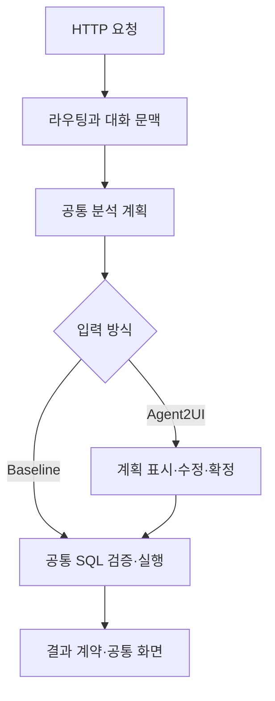

# 폴더와 모드별 코드 배치

> **한눈에 보기** · 질문을 받아 분석 계획을 만들고, SQL을 검사한 뒤 결과를 화면에 보여주는 서버입니다.

**기본 흐름:** 질문 접수 → 계획 생성 → SQL 검사·실행 → 결과 전달

[전체 시스템 구조도](../README.md#시스템-구조)

## 앱 진입점

[server.py](server.py)가 FastAPI 앱을 만들고 정적 파일·API 라우터·오류 처리를 등록합니다. 서버 시작 시 모델 설정과 로컬 자원을 점검합니다. 각 기능의 세부 책임은 아래 폴더 안내에서 확인할 수 있습니다.

## 분리 원칙

각 기능 폴더에는 Baseline과 A2UI가 함께 사용하는 코드를 두고, A2UI 모드 전용 코드는 해당 폴더의 `a2ui/` 하위에 둔다. Baseline 전용 실행 응답은 `execution/baseline/`에 둔다. execution의 공통 구현은 agent/, tools/, sql/, semantics/, results/로 역할별로 나눈다. API의 A2UI 모드 값은 `agent2ui`이다.

파일 이름보다 실제 호출 경로를 기준으로 분류한다. Baseline도 같은 분석 계획 생성기와 SQL 실행기를 사용하며, 조회 결과는 두 모드 모두 A2UI 화면 형식으로 전달한다. 따라서 UI나 confirmed라는 이름이 있다는 이유만으로 A2UI 전용 코드로 분류하지 않는다.

## 폴더별 책임

| 폴더 | 공통 코드 | 모드 전용 코드 |
|---|---|---|
| `routes/` | 채팅 접수·취소, 실험 관리, 오류 처리, 기본 화면 | `a2ui/review.py`: 계획 수정·확정 API, `a2ui/schemas.py`: 전용 요청·응답 모델 |
| `chat/` | 질문 유형 판단, 모드 분기, 결과 설명·요약, 이전 결과 문맥 | `a2ui/review.py`: 계획 검토 응답과 참조 불명확 시 확인 질문 |
| `planning/` | 분석 계획·UI 모델, LLM 계획 생성, 스키마·선택지 구성, 필수값 계산 | `a2ui/review.py`: 검토 응답 조립, `refinement.py`: 추가 조건 수정, `models.py`: 수정 패치, `validator.py`: 확정·편집 검증 |
| `execution/` | SQL 실행기·도구·안전성·시간 범위·계약 검사, 실패 결과 형식 | `baseline/service.py`: 즉시 실행 응답, `a2ui/service.py`: 확정 계획 실행 응답 |
| `runtime/` | 취소 가능한 워커, DB 연결·스키마 생성, 대화 결과·문맥·SQL 예시, 채팅 로그 | `a2ui/surfaces.py`: 검토 화면 저장·조회, `a2ui/worker.py`: 확정 요청 검증·실행 연결 |
| `experiment/` | 실험 세션·과제·단계, 채팅 상호작용·CSV 기록 | `a2ui/interactions.py`: 계획 확정 실행의 편집 시간·변경 내역 기록 |
| `a2ui/` | `adapter.py`: 두 모드의 결과 화면 변환, `models.py`·`catalog.py`: 화면 전송 규격 | `review.py`: A2UI 모드 전용 검토 화면 생성 |
| `core/` | LLM 접속 설정과 시작 점검 | 전용 코드 없음 |
| `data/` | DB 경로와 연결 | 전용 코드 없음 |

공통 기능만 있는 폴더에는 빈 `a2ui/` 폴더를 만들지 않는다. 기존 `app/a2ui/`는 화면 전송 형식 계층이므로 `app/a2ui/a2ui/`처럼 중첩하지 않고 `review.py`로 전용 화면 생성을 구분한다.

## 하위 폴더 안내

| 폴더 | 역할 |
|---|---|
| [a2ui/](a2ui/README.md) | 서버의 화면 전송 모델 |
| [chat/](chat/README.md) | 대화 요청 분류와 문맥 |
| [core/](core/README.md) | 모델 연결 설정과 시작 점검 |
| [data/](data/README.md) | 조회 데이터베이스 경로 |
| [execution/](execution/README.md) | SQL 생성·검증·실행 |
| [experiment/](experiment/README.md) | 사용자 실험 진행과 상호작용 기록 |
| [planning/](planning/README.md) | 분석 계획과 편집 UI 정의 |
| [routes/](routes/README.md) | HTTP 요청과 응답 |
| [runtime/](runtime/README.md) | 대화 상태와 취소 가능한 실행 |
| [static/](static/README.md) | 프론트엔드 정적 리소스 |
| [templates/](templates/README.md) | 웹 앱 HTML 셸 |

## 핵심 개념과 동작

서버는 FastAPI의 라우터를 서비스 계층에 연결하고, Pydantic 모델로 요청·분석 계획·화면 전송 값을 구분합니다. 분석 계획은 SQL 생성 이전의 공통 계약이며 Baseline은 즉시 실행, Agent2UI는 사용자의 수정·확정 후 실행합니다. 기능 폴더별 자세한 알고리즘은 하위 README에서 설명합니다.

### 주요 함수·클래스

| 함수·클래스 | 구체적인 역할 | 관련 기술 |
|---|---|---|
| `lifespan` | 요청 수락 전에 시작 점검 수행 | FastAPI lifespan |
| `http_error_handler` | HTTP 예외를 공통 오류 본문으로 변환 | 오류 경계 |
| `main` | 설정된 주소에서 서버 실행 | Uvicorn |

### 핵심 코드: validation_error_handler

자료형 검증 오류를 클라이언트가 처리할 수 있는 응답으로 바꿉니다.

**동작:** Pydantic 오류의 위치를 점 경로로 만들고 공통 오류 payload에 넣어 422를 반환합니다.

**설계:** FastAPI 예외 핸들러를 사용합니다. 입력 오류와 처리되지 않은 500 오류의 응답 계약을 분리합니다.

**예:** 필수 question이 없는 요청은 필드 경로와 메시지가 있는 422 응답이 됩니다.

<details>
<summary>실제 코드와 원본 위치 보기</summary>

원본: [app/server.py](server.py#L74). 아래는 실제 코드의 74~78행 발췌이며 앞뒤는 생략했습니다.

```python
async def validation_error_handler(_request: Request, exc: RequestValidationError) -> JSONResponse:
    """요청 본문/쿼리 검증 실패를 필드별 메시지가 담긴 422로 돌려준다."""

    field_errors = [{"field": ".".join(map(str, error.get("loc", []))), "message": error.get("msg", "")} for error in exc.errors()]
    return JSONResponse(status_code=422, content=api_error_payload(PLAN_VALIDATION_ERROR, "요청 형식을 확인해 주세요.", field_errors=field_errors))
```

</details>

### 다른 기능과 연결되는 순서

실제 진입은 `server.py → routes → chat/dispatch`입니다. 새 분석은 `planning → execution`, 기존 결과 재표시는 저장 결과로 분기합니다. Agent2UI 계획 화면은 `a2ui/review → runtime/a2ui/surfaces`에 저장한 뒤 확정 API로 실행합니다.



다이어그램은 계층의 개념 흐름입니다. 구체적인 API와 분기는 [routes](routes/README.md), [chat](chat/README.md), [실행 계층](execution/README.md)을 참고하세요.

### 확인한 범위와 한계

시작 점검은 실제 LLM 호출의 성공을 증명하지 않습니다. 자동 테스트는 대체 모델과 임시 DB 중심이며 실모델 해석 품질·전체 브라우저 조작·운영 인증까지 검증한 것은 아닙니다.

관련 검증: [test_turn_router.py](../tests/test_turn_router.py), [test_sql_tools.py](../tests/execution/test_sql_tools.py).

## 함께 읽기

- [프로젝트 소개](../README.md)
