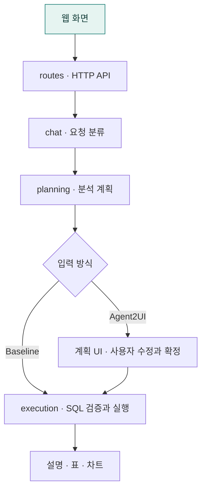

# 폴더와 모드별 코드 배치

## 한눈에 보는 흐름




자연어 입력에서 두 모드의 처리, SQL 검증·실행과 결과까지의 전체 구성입니다. 그림의 Baseline 직접 생성은 사용자 검토 단계 생략을 요약한 것으로, 현재 코드에서는 내부 계획을 공유합니다.

## 앱 진입점

[server.py](server.py)가 FastAPI 앱을 만들고 정적 파일·API 라우터·오류 처리를 등록합니다. 서버 시작 시 모델 설정과 로컬 자원을 점검합니다. 각 기능의 세부 책임은 아래 폴더 안내에서 확인할 수 있습니다.

## 분리 원칙

각 기능 폴더 바로 아래에는 Baseline과 A2UI가 함께 사용하는 코드를 두고, A2UI 모드 전용 코드는 해당 폴더의 `a2ui/` 하위에 둔다. Baseline 전용 실행 응답은 `execution/baseline/`에 둔다. API의 A2UI 모드 값은 `agent2ui`이다.

파일 이름보다 실제 호출 경로를 기준으로 분류한다. Baseline도 같은 분석 계획 생성기와 SQL 실행기를 사용하며, 조회 결과는 두 모드 모두 A2UI 화면 형식으로 전달한다. 따라서 UI나 confirmed라는 이름이 있다는 이유만으로 A2UI 전용 코드로 분류하지 않는다.

## 폴더별 책임

| 폴더 | 공통 코드 | 모드 전용 코드 |
|---|---|---|
| `routes/` | 채팅 접수·취소, 실험 관리, 오류 처리, 기본 화면 | `a2ui/review.py`: 계획 수정·확정 API, `a2ui/schemas.py`: 전용 요청·응답 모델 |
| `chat/` | 질문 유형 판단, 모드 분기, 결과 설명·요약, 이전 결과 문맥 | `a2ui/review.py`: 계획 검토 응답과 참조 불명확 시 확인 질문 |
| `planning/` | 분석 계획·UI 모델, LLM 계획 생성, 스키마·선택지 구성, 필수값 계산 | `a2ui/review.py`: 검토 응답 조립, `refinement.py`: 추가 조건 수정, `models.py`: 수정 패치, `validator.py`: 확정·편집 검증 |
| `execution/` | SQL 실행기·도구·안전성·시간 범위·계약 검사, 실패 결과 형식 | `baseline/service.py`: 즉시 실행 응답, `a2ui/service.py`: 확정 계획 실행 응답 |
| `runtime/` | 취소 가능한 워커, DB 연결·스키마 생성, 대화 결과·문맥·SQL 예시, 채팅 로그 | `a2ui/surfaces.py`: 검토 화면 저장·조회, `a2ui/worker.py`: 확정 요청 검증·실행 연결 |
| `experiment/` | 실험 세션·과제·단계, 채팅 상호작용·CSV·분석 | `a2ui/interactions.py`: 계획 확정 실행의 편집 시간·변경 내역 기록 |
| `a2ui/` | `adapter.py`: 두 모드의 결과 화면 변환, `models.py`·`catalog.py`: 화면 전송 규격 | `review.py`: A2UI 모드 전용 검토 화면 생성 |
| `core/` | LLM 접속 설정과 시작 점검 | 전용 코드 없음 |
| `data/` | DB 경로와 연결 | 전용 코드 없음 |
| `eval/` | 정확도·안정성 평가 | 전용 코드 없음 |

공통 기능만 있는 폴더에는 빈 `a2ui/` 폴더를 만들지 않는다. 기존 `app/a2ui/`는 화면 전송 형식 계층이므로 `app/a2ui/a2ui/`처럼 중첩하지 않고 `review.py`로 전용 화면 생성을 구분한다.

## 주요 구조

```text
app/
  routes/
    api.py, chat.py, experiment.py, schemas.py, errors.py, web_ui.py
    a2ui/
      review.py, schemas.py
  chat/
    service.py, dispatch.py, turn_router.py, thread_context.py, summary.py
    a2ui/
      review.py
  planning/
    service.py, analysis_models.py, ui_models.py
    schema_context.py, option_catalog.py, validator.py
    planner/
      __init__.py, dynamic_planner.py, models.py, prompt.py
      response.py, controls.py, context.py, semantics.py
    a2ui/
      review.py, refinement.py, models.py, validator.py
  execution/
    confirmed_execution.py, confirmed_context.py, result_payload.py
    fast_sql_agent.py, sql_tools.py, sql_safety.py, ...
    baseline/
      service.py
    a2ui/
      service.py
  runtime/
    run_manager.py, state_store.py, chat_log.py
    a2ui/
      surfaces.py, worker.py
  experiment/
    context.py, interactions.py, store.py, log.py, tasks.py, analysis.py
    a2ui/
      interactions.py
  a2ui/
    adapter.py, models.py, catalog.py
    review.py
```

## 요청 처리 흐름

### 공통 채팅

`routes/chat.py` → `chat/service.py` → `chat/dispatch.py`

`chat/turn_router.py`가 질문 유형과 참조할 결과를 결정한다. 일반 대화, 저장된 결과의 요약·설명·표시 변경은 공통 경로에서 처리한다. 분석 요청이면 모드에 따라 아래 경로로 나뉜다.

### Baseline 분석

`execution/baseline/service.py` → 공통 `planning/service.py` → 공통 `execution/confirmed_execution.py`

계획을 생성한 뒤 사용자 검토 단계를 거치지 않고 실행한다. 불명확한 조건이나 참조는 확인 질문으로 반환할 수 있다. 결과는 공통 `a2ui/adapter.py`에서 화면 형식으로 변환한다.

### A2UI 계획 검토와 실행

1. `chat/a2ui/review.py`가 공통 계획 생성기를 호출한다.
2. `planning/a2ui/review.py`와 `a2ui/review.py`가 검토 응답·화면을 만들고, `runtime/a2ui/surfaces.py`에 저장한다.
3. 자연어 조건 추가 요청은 `routes/a2ui/review.py` → `planning/a2ui/review.py` → `planning/a2ui/refinement.py`에서 처리한다. SQL은 실행하지 않고 화면 버전을 올린다.
4. 확정 요청에서는 최신 화면 버전과 허용된 편집 범위를 검사한다. `execution/a2ui/service.py`가 계획을 검증하고 공통 SQL 실행기를 호출한다.
5. 결과는 공통 화면 형식으로 변환하고, 활성 실험이면 `experiment/a2ui/interactions.py`에서 확정 실행 기록을 생성한다.

## 공통 위치에 남은 파일의 이유

- `planning/ui_models.py`: Baseline 계획 생성도 `UiPlan`과 `DynamicPlannerOutput`을 사용한다. 자연어 추가 조건 전용 `RefinementPatch`만 `planning/a2ui/models.py`로 분리한다.
- `planning/planner/`: 두 모드가 공유하는 LLM 계획 생성기다. 외부 서비스는 패키지에서 `plan_dynamic_analysis`와 맥락 모델을 가져온다. `dynamic_planner.py`는 호출·후처리 순서·재시도·대체 계획을 담당하고, 세부 로직은 `models.py`(응답·맥락 모델), `prompt.py`(프롬프트), `response.py`(응답 복구), `controls.py`(UI 구성), `context.py`(후속 조건 상속), `semantics.py`(분석 의미 보정·검증)에 둔다. 검토 중 조건 수정은 별도 `a2ui/refinement.py`에 둔다.
- `execution/confirmed_context.py`, `confirmed_execution.py`: Baseline도 내부 계획을 실행 문맥으로 만들어 같은 실행기를 호출한다. confirmed는 사용자 확인 화면의 유무를 뜻하지 않는다.
- `execution/sql_tools.py`: 추가 LLM 호출 없이 SQL을 검사한다. 검사 도구와 실행 도구는 `_validate_execution_sql`의 공통 검증 순서를 공유하며, 실행 직전에도 재검증한다. 날짜 상한이 교정된 SQL은 원래 SQL과의 매핑을 보존해 실행한다. 생성 SQL은 도구 인자로 받으므로 텍스트 응답에서 SQL을 추출하는 별도 모듈은 사용하지 않는다.
- `runtime/state_store.py`: 두 모드가 공유하는 DB 연결과 테이블 생성을 유지한다. 검토 화면 전용 저장·조회 함수만 하위 폴더로 분리한다.
- `runtime/run_manager.py`: 채팅과 A2UI 확정 실행을 같은 워커 방식으로 관리한다. 확정 요청의 모델 검증과 서비스 연결은 `runtime/a2ui/worker.py`에 위임한다. 현재 활성 실험 채팅과 계획 수정은 이 워커를 사용하지 않는다.
- `routes/schemas.py`: 공통 채팅·실험 모델과 `ClientMetrics`를 제공한다. 계획 확정·수정 모델은 `routes/a2ui/schemas.py`에 둔다.

## 파일을 추가하거나 수정할 때

1. 두 모드가 같은 기능을 호출하면 해당 기능 폴더의 공통 위치에 둔다.
2. A2UI 사용자 검토·수정·확정 흐름에만 필요한 기능이면 해당 폴더의 `a2ui/`에 둔다.
3. 공통 진입점의 모드 분기는 유지하되, 전용 처리 본문은 전용 모듈로 위임한다.
4. 기존 모듈에서 다시 가져오게 하는 호환용 재노출 대신 실제 사용 지점의 import를 새 경로로 수정한다.
5. HTTP 주소·요청 필드와 저장 DB 구조는 파일 경로와 별개로 유지한다.

라우터별 API와 검증 단계는 [routes 설명](routes/README.md)을 참고한다. 프론트엔드도 같은 원칙을 적용한다. 기본 HTML은 `templates/`에 두고, 전용 컨트롤러·편집 상태·API·계획 UI는 `static/js/a2ui/`, 입력 위젯은 `static/js/components/a2ui/`, 후속 버튼은 `static/js/results/a2ui/`, 전용 스타일은 `static/a2ui/`에 둔다. 자세한 배치는 [프론트엔드 설명](static/README.md)을 참고한다.

## 검증

`uv run pytest tests/execution -q`로 격리된 DB 기반 SQL 실행·검증 테스트를 실행합니다. 실제 LLM 품질 평가는 `eval/`의 별도 평가 범위이며, 평가 원자료는 공개 소스에 포함하지 않습니다.

## 프론트엔드와 테스트의 전용 폴더

- `static/js/app.js`는 공통 화면·채팅·결과 표시를 담당하고 계획 검토는 전용 컨트롤러로 전달한다.
- `static/js/a2ui/review-controller.js`는 계획 표시·추가 조건 수정·확정 실행 흐름을 담당한다.
- `static/js/a2ui/api.js`, `state.js`, `surfaces.js`, `plan/`는 각각 전용 API·편집 상태·계획 화면 연결·편집 UI를 담당한다.
- `static/js/surfaces/`는 두 모드가 공유하는 화면 검증·결과 표시 진입점이다.
- 파일 이동 시 `pyproject.toml`의 정적 파일 포함 경로와 HTML·JavaScript import를 함께 갱신한다.

현재 공개 테스트는 `tests/execution/`에 있다. 프론트엔드 자동 테스트는 포함되어 있지 않다.

## 하위 폴더 안내

| 폴더 | 역할 |
|---|---|
| [a2ui/](a2ui/README.md) | 서버의 화면 전송 모델 |
| [chat/](chat/README.md) | 대화 요청 분류와 문맥 |
| [core/](core/README.md) | 모델 연결 설정과 시작 점검 |
| [data/](data/README.md) | 조회 데이터베이스 경로 |
| [eval/](eval/README.md) | Text-to-SQL 정확도·안정성 평가 |
| [execution/](execution/README.md) | SQL 생성·검증·실행 |
| [experiment/](experiment/README.md) | 사용자 실험 진행과 상호작용 기록 |
| [planning/](planning/README.md) | 분석 계획과 편집 UI 정의 |
| [routes/](routes/README.md) | HTTP 요청과 응답 |
| [runtime/](runtime/README.md) | 대화 상태와 취소 가능한 실행 |
| [static/](static/README.md) | 프론트엔드 정적 리소스 |
| [templates/](templates/README.md) | 웹 앱 HTML 셸 |

## 함께 읽기

- [프로젝트 소개](../README.md)
