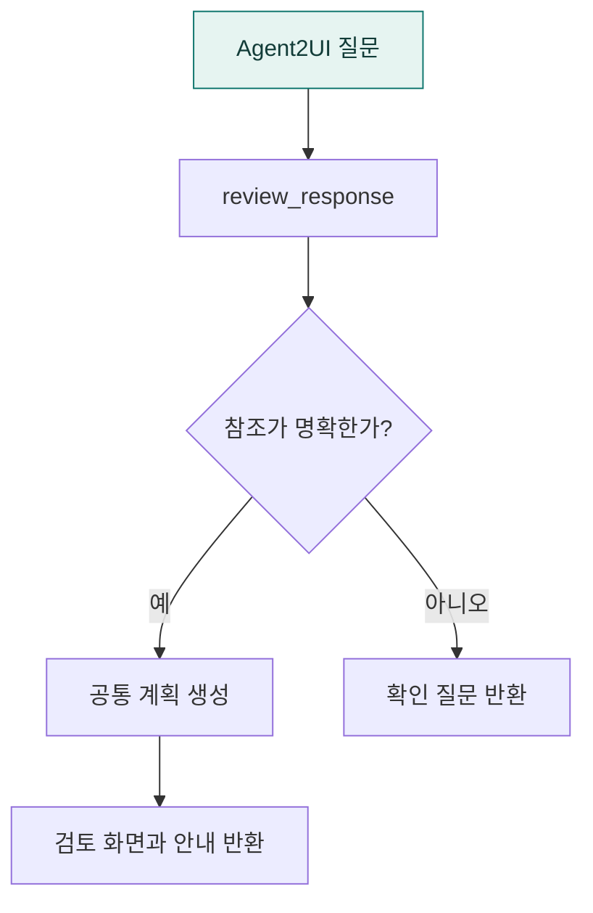

# `app/chat/a2ui` · Agent2UI 계획 검토 응답

Agent2UI 질문에 대한 검토 계획과 안내 응답을 구성합니다. 이전 결과 참조가 불명확하면 확인 질문을 반환합니다.

## 한눈에 보는 흐름

## 주요 파일

| 파일 | 역할 |
|---|---|
| [review.py](review.py) | A2UI 전용 계획 검토 응답과 참조 불명확 시 확인 질문을 만든다. |

## 연결 흐름

공통 chat/dispatch.py가 review_response를 호출합니다. 공통 planning 서비스에서 계획을 만든 뒤 계획 검토 응답을 반환합니다.

## 함께 읽기

- [상위 폴더 안내](../README.md)
- [앱 전체 구조](../../README.md)
- [프로젝트 소개](../../../README.md)
