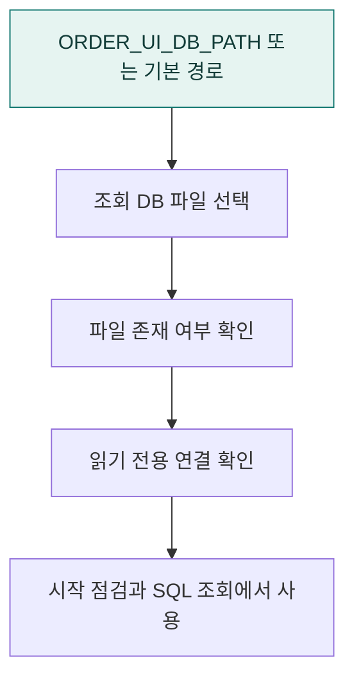

# `app/data` · 조회 데이터베이스 경로

분석 대상 SQLite의 경로를 결정하고 파일이 읽을 수 있는 DB인지 확인합니다.

## 한눈에 보는 흐름

## 주요 파일

| 파일 | 역할 |
|---|---|
| [database.py](database.py) | 조회 DB 경로 선택과 SQLite 파일 준비 상태 확인. |

## 연결 흐름

database.py가 ORDER_UI_DB_PATH와 기본 경로 규칙으로 조회 파일을 고릅니다. 실제 SQL 안전성 검증과 읽기 전용 실행은 execution 계층이 담당합니다. 원본 데이터 출처는 프로젝트 루트의 Data/README.md에 있습니다.

## 함께 읽기

- [앱 전체 구조](../README.md)
- [프로젝트 소개](../../README.md)
