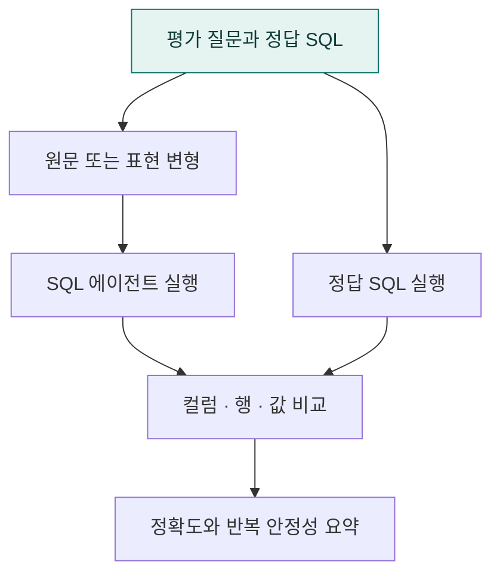

# `app/eval` · Text-to-SQL 정확도·안정성 평가

정답 SQL과 에이전트의 조회 결과를 비교하고, 질문 표현 변형·반복 실행에 따른 결과 안정성을 평가합니다.

## 한눈에 보는 흐름

## 주요 파일

| 파일 | 역할 |
|---|---|
| [accuracy_eval.py](accuracy_eval.py) | 정답 SQL 대비 결과 컬럼·값·행·순서와 반복 실행 안정성 평가 CLI. |
| [perturbations.py](perturbations.py) | 질문의 띄어쓰기·표현·오타 변형을 만들어 평가 사례 확장. |

## 연결 흐름

accuracy_eval.py가 평가 질문을 공통 실행기로 전달하고 정답 결과와 비교합니다. perturbations.py는 표현 변형을 만듭니다. 실행에는 별도의 정답셋·조회 DB·모델 설정이 필요하며 평가 원자료는 공개본에 포함되지 않습니다.

## 함께 읽기

- [앱 전체 구조](../README.md)
- [프로젝트 소개](../../README.md)
