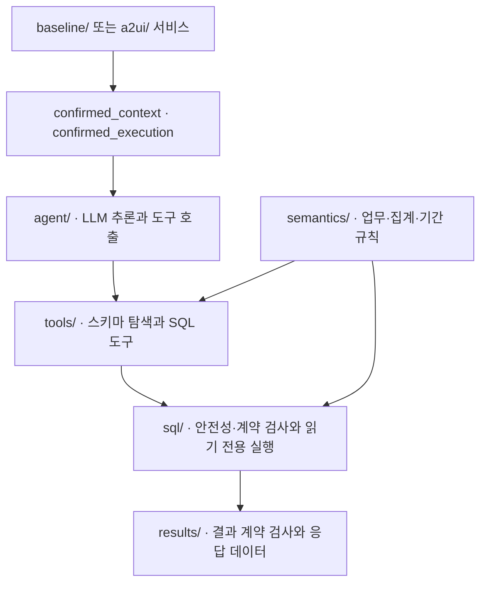

# `app/execution` · SQL 생성·검증·실행

분석 계획을 실행 문맥으로 바꾸고 스키마 탐색, SQL 생성, 계약 검증, 읽기 전용 실행과 결과 검사를 수행합니다.

## 역할별 구성

| 폴더 | 역할 |
|---|---|
| [agent/](agent/README.md) | LLM 추론과 Tool 호출 제어 |
| [tools/](tools/README.md) | DB 스키마 탐색과 SQL 도구 |
| [sql/](sql/README.md) | SQL 구문 분석·생성·검증 |
| [semantics/](semantics/README.md) | 업무 의미와 집계 규칙 |
| [results/](results/README.md) | 실행 결과의 검증과 응답 구성 |
| [baseline/](baseline/README.md) | 프롬프트 모드의 계획 생성·즉시 실행 응답 |
| [a2ui/](a2ui/README.md) | 사용자가 확정한 계획의 실행 응답 |

## 공통 실행 진입점

| 파일 | 역할 |
|---|---|
| [confirmed_context.py](confirmed_context.py) | 분석 계획을 SQL 생성기와 검증기가 공유하는 실행 기준으로 정리한다. |
| [confirmed_execution.py](confirmed_execution.py) | 공통 실행을 시작하고 성공·실패 결과를 표준화한다. |

두 파일은 Baseline과 Agent2UI가 공유하므로 execution/ 바로 아래에 둡니다. confirmed는 사용자 확인 화면의 유무를 뜻하지 않습니다.

## 실행과 검증 흐름

검사 도구와 실행 도구는 공통 검증 순서를 사용하며, 실행 직전에도 현재 계획과 스키마를 다시 검사합니다. 날짜 수정자나 필터 값 추출은 보조 정보이며 업무 조건의 타당성은 SQL 계약 검증으로 확인합니다.

등록 모집단 지표는 confirmed_execution.py에서 semantics/registered_metrics.py를 통해 컴파일한 뒤 같은 검사·실행 도구를 통과합니다. 실행 기록에는 registered_metric으로 구분하며 두 모드에 동일하게 적용합니다.

## 함께 읽기

- [앱 전체 구조](../README.md)
- [프로젝트 소개](../../README.md)
