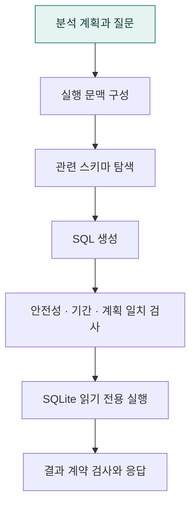

# `app/execution` · SQL 생성·검증·실행

분석 계획을 실행 문맥으로 바꾸고 스키마 탐색, SQL 생성, 계획 일치 검사, 읽기 전용 실행과 결과 검사를 수행합니다.

## SQL 실행과 검증 순서

## 주요 파일

| 파일 | 역할 |
|---|---|
| [analysis_semantics.py](analysis_semantics.py) | 스키마만으로 알기 어려운 업무 의미 설정을 읽고 SQL에 적용한다. |
| [confirmed_context.py](confirmed_context.py) | 분석 계획을 SQL 생성기와 검증기가 공유하는 실행 기준으로 정리한다. |
| [confirmed_execution.py](confirmed_execution.py) | 공통 SQL 에이전트의 실행을 시작하고 성공·실패 결과를 표준화한다. |
| [fast_sql_agent.py](fast_sql_agent.py) | LLM의 스키마 탐색·SQL 검사·실행 도구 호출을 조정하는 핵심 에이전트. |
| [result_contract.py](result_contract.py) | 실행 결과의 컬럼과 행이 계획의 요청 속성·결과 단위에 맞는지 검사한다. |
| [join_contract.py](join_contract.py) | 설정에 확인된 식별자 역할로 CTE를 거친 잘못된 연결을 차단한다. |
| [registered_metrics.py](registered_metrics.py) | 설정에 등록한 모집단·부분집합 지표를 공통 SQL로 컴파일한다. |
| [result_payload.py](result_payload.py) | 두 모드가 공유하는 SQL 실행 실패 응답 데이터를 만든다. |
| [schema_tools.py](schema_tools.py) | 실제 SQLite 스키마와 데이터 특성을 읽기 전용으로 탐색한다. |
| [semantic_aliases.py](semantic_aliases.py) | 사용자 표현과 DB에 저장된 표준 값 사이의 별칭 매핑을 제공한다. |
| [sql_builder.py](sql_builder.py) | 검증된 SQL을 실제 DB에서 실행하고 결과를 기본 표 형식으로 표시한다. |
| [sql_ast.py](sql_ast.py) | 공통 계약 예외, SQLite SQL 파싱과 AST 정보 추출을 제공한다. |
| [sql_contract.py](sql_contract.py) | 계약 검사를 조율하고 계획의 그룹·정렬·필터·업무 조건을 검사한다. |
| [sql_schema_contract.py](sql_schema_contract.py) | SQL의 물리 테이블·컬럼을 확인된 라이브 스키마와 대조한다. |
| [sql_metric_contract.py](sql_metric_contract.py) | 집계 종류·건수 단위와 등록된 비율 지표를 검사한다. |
| [sql_safety.py](sql_safety.py) | 생성 SQL이 DB를 변경하지 못하도록 읽기 전용 경계를 적용한다. |
| [sql_tools.py](sql_tools.py) | LLM이 호출할 SQL 검사·실행 도구와 두 도구가 공유할 상태를 만든다. |
| [temporal_policy.py](temporal_policy.py) | 상대 기간의 기준 시점과 SQL 날짜 조건을 일관되게 검사한다. |

## 연결 흐름

baseline/ 또는 a2ui/ 서비스 → confirmed_execution.py → fast_sql_agent.py → SQL 검사·실행 도구로 연결됩니다. sql_safety는 데이터 변경 차단, sql_contract는 계획 의미, result_contract는 결과 형태를 검사합니다.

등록 모집단 지표는 `confirmed_execution.py`에서 `registered_metrics.py`를 통해 컴파일한 뒤 같은 SQL 검사·실행 도구를 통과합니다. SQL의 분모·관계·조건을 모델이 임의로 바꿀 수 없으며, 실행 기록에는 `registered_metric`으로 구분합니다. 두 모드에 동일하게 적용합니다.

## 하위 폴더 안내

| 폴더 | 역할 |
|---|---|
| [a2ui/](a2ui/README.md) | 확정된 Agent2UI 계획 실행 |
| [baseline/](baseline/README.md) | 프롬프트 모드 즉시 실행 |

## 함께 읽기

- [앱 전체 구조](../README.md)
- [프로젝트 소개](../../README.md)
