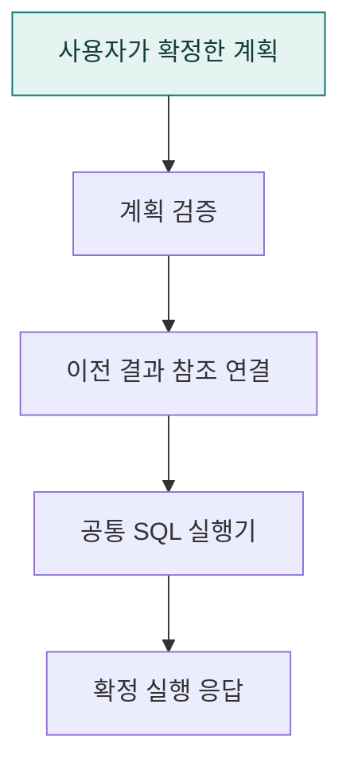

# `app/execution/a2ui` · 확정된 Agent2UI 계획 실행

사용자가 확정한 계획을 검증하고 이전 분석 참조를 실행 문맥에 연결한 뒤 결과 응답을 구성합니다.

## 한눈에 보는 흐름

## 주요 파일

| 파일 | 역할 |
|---|---|
| [service.py](service.py) | 사용자가 확인한 A2UI 계획을 검증·실행하고 응답을 조립한다. |

## 연결 흐름

계획 확정 라우트 또는 runtime/a2ui/worker.py에서 confirm_response_payload를 호출합니다. 검증된 계획은 공통 confirmed_execution.py로 전달합니다.

## 함께 읽기

- [상위 폴더 안내](../README.md)
- [앱 전체 구조](../../README.md)
- [프로젝트 소개](../../../README.md)
