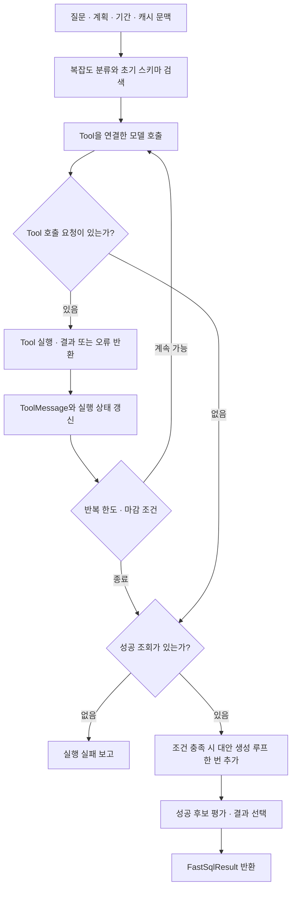

# `app/execution/agent` · SQL Agent 및 Tool Calling

SQL Agent는 질문과 분석 계획을 받아 필요한 스키마를 확인하고, SQL을 검사·실행하는 Tool을 호출한 뒤 결과를 선택합니다. [fast_sql_agent.py](fast_sql_agent.py)는 LLM 호출과 반복 흐름을 담당하며, 실제 SQL 검증과 DB 조회는 [tools/](../tools/README.md)에 위임합니다.

## 주요 함수·클래스

| 함수·클래스 | 실제 역할 |
|---|---|
| `try_fast_sql_answer()` | 실행 진입점. 질문·계획·기간·캐시 문맥을 준비하고 Tool 루프와 후보 선택을 거쳐 `FastSqlResult`를 반환한다. 성공 조회가 없으면 오류를 발생시킨다. |
| `_run_react_tool_loop()` | 모델 응답 → Tool 실행 → 결과 메시지 추가 → 다음 모델 호출을 반복한다. |
| `_invoke_model_with_retry()` | 일시적인 모델 호출 오류에 한해 지수 백오프와 임의 지연을 적용해 재시도한다. |
| `classify_query_complexity()` | 질문 표현과 계획 구조로 `simple` 또는 `complex`를 결정한다. 추론 옵션과 대안 후보 생성 조건에 사용한다. |
| `_select_best_success()` | 성공 조회를 SQL 계약·결과 형태·실행 계획으로 평가하고 선택 인덱스와 점수 목록을 반환한다. |
| `FastSqlResult` | 선택한 SQL·컬럼·행·답변, 경과 시간, 스키마 정보, 도구 로그와 후보 선택 통계를 담는다. |
| `classify_failure_message()` | 실패 문자열을 모델 호출·스키마·SQL 계약·실행 등으로 분류해 상위 응답 구성에 사용한다. |

`make_query_checker_tool()`, `make_execute_query_tool()`, `SqlToolState`는 [SQL Tool 안내](../tools/README.md#sql-tool과-공유-상태)에서 설명합니다.

## ReAct와 Tool Calling

**ReAct(Reasoning and Acting)**는 모델이 현재 문맥으로 다음 행동을 결정하고, Tool의 반환 결과를 관찰한 뒤 다음 행동을 결정하는 반복 방식입니다. 이 구현에서는 `_run_react_tool_loop()`가 대화 이력에 모델 응답과 `ToolMessage`를 쌓으며 반복을 제어합니다. 내부 추론 과정을 별도 텍스트로 추출하거나 저장하는 구조는 아닙니다.

**Tool Calling**은 모델이 등록된 함수 이름과 인자를 구조화된 요청으로 반환하고, 애플리케이션이 해당 함수를 실행하는 방식입니다. `bind_tools()`로 Tool을 연결하고 응답의 `tool_calls`를 읽어 실행합니다. 모델은 다음 Tool을 선택하지만, 검사 이력과 읽기 전용 제한은 애플리케이션 코드가 강제합니다.

| 모델에 연결하는 Tool | 용도 |
|---|---|
| `get_table_schema` | 테이블·컬럼·샘플 값을 확인한다. |
| `get_semantic_context` | 관련 업무 의미 문서를 확인한다. |
| `discover_relationships` | 테이블 연결 후보를 탐색한다. 후보는 실제 스키마와 값으로 확인해야 한다. |
| `query_checker` | SQL의 안전성·계획·기간·업무 조건을 검사한다. |
| `execute_query` | 검사한 SQL을 재검증하고 읽기 전용으로 조회한다. |

`list_tables()`와 관련 스키마 검색은 첫 모델 호출 전에 코드에서 수행합니다. 관련 테이블이 여러 개면 관계 후보도 미리 조회합니다. 이렇게 얻은 문맥을 모델에 제공하며, 루프 안에서 추가 스키마 탐색을 할 수 있습니다.

## 실행 흐름

[confirmed_execution.py](../confirmed_execution.py)가 공통 실행을 시작합니다. 등록된 모집단 지표로 처리할 수 있으면 [registered_metrics.py](../semantics/registered_metrics.py)가 공통 Tool로 실행하고, 그 외 요청이 이 SQL Agent 경로로 들어옵니다. Baseline과 Agent2UI는 같은 실행 계층을 공유합니다.

## 복잡도 분류와 SQL 후보 선택

다중 지표, 비율 지표, 비교, 여러 그룹 기준, 이전 결과 참조, 필터 3개 이상 중 하나가 있거나 질문에 비율·비교·순위·연결 등의 표현이 있으면 `complex`로 분류합니다. 이는 규칙 기반 분류이며 질문 난이도의 정확한 측정값은 아닙니다. `gpt-5`로 시작하는 모델에서는 복잡도에 따라 추론 강도 옵션도 선택합니다.

첫 루프 종료 후 다음 조건을 **모두** 만족하면 독립적인 대안 SQL 하나를 요청하는 루프를 추가합니다.

- 복잡도가 `complex`이고 `FAST_SQL_COMPLEX_CANDIDATES > 1`이다.
- 성공 조회가 정확히 하나이며, 마지막 모델 응답에 Tool 호출 요청이 없다.
- 전체 마감까지 남은 시간이 `FAST_SQL_MIN_ALTERNATIVE_SECONDS`보다 길다.

현재 `FAST_SQL_COMPLEX_CANDIDATES`는 추가 루프를 켜는 조건입니다. 값을 3으로 올려도 후보 3개를 자동 생성하는 반복문은 없으며, 추가 루프가 성공 후보를 반드시 만드는 것도 아닙니다. 한 루프 안에서도 조회에 여러 번 성공할 수 있습니다.

`_select_best_success()`는 검사와 실행·결과 계약을 통과해 성공 목록에 기록된 조회를 다음 기준으로 평가합니다.

| 평가 항목 | 점수 |
|---|---:|
| 현재 계획·스키마로 SQL 계약 재검증 통과 | +100 |
| 결과 컬럼 수 | 컬럼당 +2, 최대 12개 반영 |
| 결과 행이 하나 이상 있음 | +3 |
| 인덱스를 사용하지 않는 `SCAN` | 건당 −0.5 |
| `USE TEMP B-TREE` | 건당 −1 |

실행 계획은 SQLite `EXPLAIN QUERY PLAN`으로 확인합니다. 실행 계획 확인에 실패해도 성공 조회를 버리지는 않습니다. 이 점수는 계약과 결과 형태, 실행 계획에 대한 휴리스틱이며 SQL의 업무적 정답이나 실제 실행 시간을 보장하지 않습니다. 컬럼 수와 비어 있지 않은 결과가 점수를 높인다는 한계도 있습니다.

계획이 전달된 경우 최고 점수 후보를 고르고, 동점이면 나중 후보를 선택합니다. `confirmed_plan is None`이면 여러 조회가 서로 보완하는 답일 수 있어 **마지막 성공 조회**를 선택합니다. 따라서 단순히 첫 SQL을 채택하는 방식과 다르며, 모든 요청에서 점수로 최종 후보를 고르는 것도 아닙니다.

선택 결과가 마지막 성공 조회라면 마지막 모델 응답의 텍스트를 답변으로 사용할 수 있습니다. 앞선 후보가 선택되거나 응답 텍스트가 없으면 선택한 컬럼·행으로 기본 표 답변을 만듭니다.

## 실행 제한과 오류 복구

아래는 환경 변수가 없을 때의 **코드 기본값**입니다. 실제 실행 환경에서 덮어쓸 수 있으며, `.env.example`의 `FAST_SQL_TIMEOUT_SECONDS` 예시는 30초입니다.

| 설정 | 기본값 | 적용 범위 |
|---|---:|---|
| `FAST_SQL_TIMEOUT_SECONDS` | 20초 | 모델 요청의 읽기 타임아웃. 연결 타임아웃은 5초로 전달한다. |
| `FAST_SQL_TOTAL_TIMEOUT_SECONDS` | 45초 | 초기 스키마 준비부터 계산하는 전체 마감 기준. 루프와 재시도·대안 생성 여부를 판단한다. |
| `FAST_SQL_REACT_MAX_TURNS` | 10 | 첫 루프의 Tool 호출 묶음 처리 반복 상한. 한 응답에는 여러 Tool 호출이 포함될 수 있다. |
| `FAST_SQL_MAX_TOKENS` | 1600 | SQL Agent 모델 호출의 출력 토큰 상한으로 전달한다. |
| `FAST_SQL_RATE_LIMIT_RETRIES` | 3 | 한 모델 호출에서 허용하는 추가 재시도 횟수. 최초 시도까지 합치면 최대 4회다. |
| `FAST_SQL_RATE_LIMIT_BACKOFF_SECONDS` | 1.5초 | 재시도 지연의 기준값. 지수 백오프에 임의 지연을 더한다. |
| `FAST_SQL_COMPLEX_CANDIDATES` | 2 | 1보다 크면 조건 충족 시 대안 생성 루프를 한 번 추가한다. |
| `FAST_SQL_MIN_ALTERNATIVE_SECONDS` | 8초 | 대안 생성 시작에 필요한 잔여 시간 기준. |

각 루프는 최초 모델 호출 뒤 Tool 결과를 처리하며 모델을 다시 호출합니다. 따라서 반복 상한 10은 모델 호출 총 10회라는 뜻이 아닙니다. 추가 루프의 반복 상한은 `max(3, FAST_SQL_REACT_MAX_TURNS // 2)`이며 기본값에서는 5입니다.

전체 시간은 반복 사이와 재시도 대기 전에 확인하는 마감 기준입니다. 이미 실행 중인 모델 호출이나 Tool을 강제 취소하는 제한은 아니므로 실제 경과 시간이 설정값을 넘을 수 있습니다.

SDK의 자동 재시도는 `max_retries=0`으로 두고 `_invoke_model_with_retry()`가 [공통 오류 분류](../../core/model_errors.py)에 따라 재시도합니다. 요청 한도 초과, 일부 일시적 HTTP 오류(408·425·500·502·503·504), 시간 초과·연결 오류는 재시도 대상입니다. 인증·권한 오류, API 크레딧 소진, 애플리케이션 호출 한도 초과는 재시도하지 않습니다. 재시도 대기가 전체 마감에 도달할 경우에도 예외를 다시 전달합니다.

SQL 검사 실패와 Tool 예외는 오류 메시지로 모델에 반환해 남은 반복 범위에서 수정할 수 있게 합니다. 이는 동일한 모델 호출을 네트워크 오류로 재시도하는 것과 별개입니다. 최종적으로 성공 조회가 없으면 최근 Tool 오류를 포함한 실행 실패를 보고합니다.

요청 추적이 적용된 서비스 경로에서는 [llm_usage.py](../../core/llm_usage.py)가 요청 전체의 모델 호출 수와 입력 크기도 제한합니다. 기본값은 `LLM_MAX_CALLS_PER_REQUEST=12`, `LLM_MAX_PROMPT_BYTES=120000`이며, 계획 생성 등 같은 요청의 다른 모델 호출과 한도를 공유할 수 있습니다. 이는 비용 금액 자체를 보장하는 예산은 아닙니다.

## 결과와 관찰 정보

| `FastSqlResult` 필드 | 의미 |
|---|---|
| `answer`, `sql`, `columns`, `rows` | 선택한 답변·SQL·컬럼·결과 행. 행은 실행 도구의 반환 상한을 적용한 데이터다. |
| `elapsed_ms`, `model_calls`, `model_retries` | 경과 시간, 루프에서 요청한 논리적 모델 호출 수, 추가 재시도 횟수. `model_calls`에는 재시도 횟수를 별도로 합산하지 않는다. |
| `tables`, `cached_tables`, `retrieved_tables`, `schema_fingerprint` | 확인한 테이블, 캐시·검색 후보와 스키마 식별 정보. |
| `tool_calls`, `executed_queries` | Tool 호출 로그와 검사·실행·결과 계약을 통과한 조회 목록. `executed_queries`는 실패 시도 전체를 담는 목록은 아니다. |
| `complexity`, `selected_candidate_index`, `candidate_scores` | 복잡도, 성공 조회 목록 기준 선택 인덱스와 후보 점수·사유. |
| `result_truncated`, `returned_row_count` | 공유 상태에 기록된 마지막 DB 실행 결과의 제한 여부와 반환 행 수. 앞선 후보가 선택되면 선택 후보의 메타데이터와 다를 수 있다. |
| `memory_eligible`, `execution_route` | 사례 재사용 가능 여부와 실행 경로 식별값. |

## 함께 읽기

- [SQL Tool과 공유 상태](../tools/README.md)
- [SQL 파싱·검증·실행](../sql/README.md)
- [업무·기간·집계 규칙](../semantics/README.md)
- [실행 계층 안내](../README.md)
- [GPT 운영 안내](../../../docs/gpt-operation.md)
