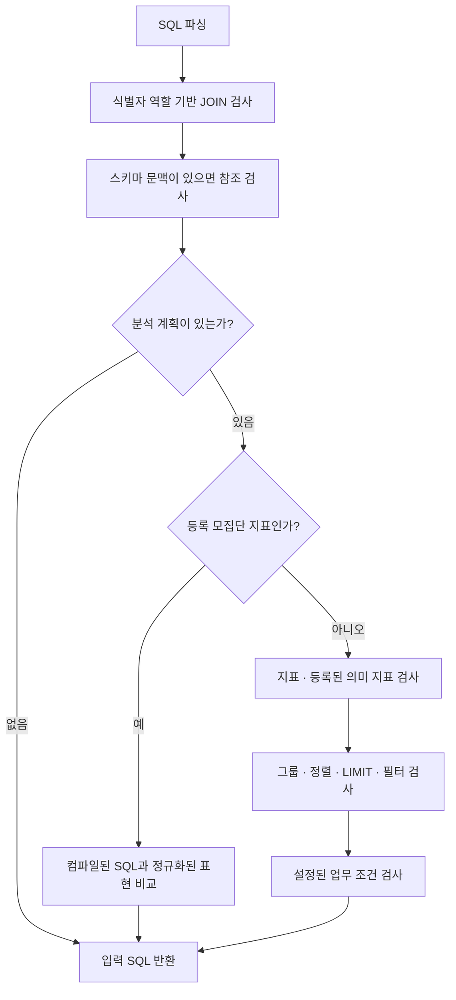

# `app/execution/sql` · SQL AST 및 계약 검증

## 1. 이 폴더의 역할

> **한눈에 보기** · SQL을 구조적으로 읽고 분석 계획과 비교합니다. 문법이 맞는지뿐 아니라, 요청한 조건과 집계가 들어갔는지 검사합니다.

**기본 흐름:** SQL 해석 → 테이블·조건·지표 확인 → 계획과 비교

## 2. 해결하려는 문제

문법이 맞는 SQL도 사용자가 정한 기간·필터·집계 단위를 잘못 반영할 수 있습니다. SQL을 구조로 읽고 계획과 비교하며 데이터 변경도 차단합니다.

## 3. 핵심 기술

### 핵심 개념과 관련 함수

| 핵심 기술 | 관련 함수 | 문서에서 확인할 내용 |
|---|---|---|
| AST | `parse_sql_ast()` | SQL을 문자열이 아닌 문법 구조로 분석하는 이유. |
| CTE와 스코프 | `extract_physical_tables()`, `physical_tables_from_tree()` | 실제 테이블과 이름이 붙은 임시 조회 참조의 구분. |
| Predicate | `extract_filter_literals()` | 조건식 안의 문자열 상수 추출과 근거 검사 연결. |
| SQL Contract | `validate_sql_contract()` | 분석 계획과 SQL의 일치 여부를 검사하는 전체 흐름. |
| Grouping | `_validate_grouping()` | 그룹 기준과 날짜 버킷 검사. |
| Sort & Limit | `_validate_sort_and_limit()` | 최종 정렬 방향·필드와 결과 개수 검사. |
| Filter Validation | `_validate_explicit_filters()` | 지원하는 명시적 필터의 필드·연산자·값 검사. |
| Metric Validation | `validate_metrics()` | 출력 집계 함수·개수·필드·DISTINCT와 건수 단위 검사. |
| Semantic Metrics | `validate_semantic_metrics()` | 등록된 업무 지표의 분자·분모와 모집단 의미 검사. |
| Schema Validation | `validate_schema_references()` | 실제 스키마 설명에 근거한 테이블·컬럼 참조 검사. |

### AST: SQL을 구조로 분석하는 이유

AST(Abstract Syntax Tree, 추상 구문 트리)는 SQL의 조회·집계·조건·테이블 참조를 노드로 표현합니다. 문자열에서 `COUNT`나 테이블 이름이 보이는지만 검사하면 주석, 출력용 상수, CTE, 다른 하위 질의에 있는 표현을 실제 분석 조건으로 오해할 수 있습니다.

`parse_sql_ast()`는 SQLGlot의 SQLite 방언으로 파싱하고, 비어 있지 않은 문장이 정확히 하나이며 조회형 `exp.Query`인지 확인합니다. 문법 오류, 여러 문장, 조회형이 아닌 입력은 `SqlContractViolation`으로 보고합니다. AST 파싱만으로 읽기 전용 실행이 완성되는 것은 아니며, 실제 실행에는 별도의 SQL 안전성 검사와 읽기 전용 연결을 사용합니다.

예를 들어 `SELECT 'paid' AS label FROM orders`의 `'paid'`는 표시용 상수이고, `WHERE status = 'paid'`의 `'paid'`는 조건식에 참여하는 값입니다. AST는 이 위치 차이를 구분할 근거를 제공합니다.

### CTE: 실제 테이블과 임시 참조

CTE(Common Table Expression)는 `WITH` 절로 이름을 붙여 같은 SQL 안에서 참조하는 조회입니다. 별도의 영구 테이블이 아니며, CTE 이름이 물리 테이블 이름과 같을 수도 있습니다.

```sql
WITH failed_orders AS (
    SELECT DISTINCT order_id
    FROM order_events
    WHERE event_type = 'failed_delivery'
)
SELECT COUNT(DISTINCT order_id)
FROM failed_orders;
```

이 예시의 실제 테이블은 `order_events`이고 `failed_orders`는 CTE 참조입니다. 스키마 확인 대상과 업무 관계에 필요한 테이블을 판별할 때 둘을 구분해야 합니다.

`extract_physical_tables(sql)`은 파싱한 뒤 `physical_tables_from_tree(tree)`를 호출합니다. 후자는 SQLGlot의 `traverse_scope()`로 각 조회 범위에서 실제 `exp.Table`과 CTE·하위 질의 참조를 구분합니다. SQL 전체에서 CTE 이름을 한꺼번에 빼면 다른 범위의 같은 이름을 가진 실제 테이블까지 누락할 수 있으므로 스코프별로 분석합니다.

SQLite 식별자의 대소문자 비교를 위해 트리 복사본을 정규화합니다. 원본 AST와 반환하는 원래 테이블 이름은 보존합니다. 중첩·재귀 CTE, 스키마 접두사가 있는 테이블, UNION의 별도 조회 범위는 [AST 테스트](../../../tests/execution/test_sql_ast.py)에서 확인합니다.

### Predicate: 조건식에서 필터 값 추출

Predicate는 `=`, `<>`, `IN`, `BETWEEN`, `LIKE` 등 조건 판단에 사용되는 표현입니다. `extract_filter_literals()`는 AST의 `exp.Predicate` 아래에 있는 문자열 리터럴을 모읍니다.

- 문자열 리터럴만 추출하고, 빈 값과 중복을 제거합니다.
- `LIKE`·`ILIKE` 조건에서는 값 양끝의 `%`, `_`를 정리합니다.
- 정규식에 맞는 일·주·월·년 단위 날짜 이동 문자열(예: `'-1 days'`)은 제외합니다.
- 주석이나 단순 출력 상수는 필터 근거로 취급하지 않습니다.

이 결과는 필드·연산자·값을 연결한 완전한 필터 모델이 아니라 **문자열 값 목록**입니다. 함수 인자에 있는 날짜 문자열 등이 포함될 수도 있고, 숫자 조건이나 모든 날짜 수정자를 다루는 것도 아닙니다. [SQL Tool](../tools/README.md)은 추출한 값을 질문·확인한 스키마·별칭과 대조해 근거 없는 조건을 탐지합니다. 날짜 수정자를 제외했다는 사실만으로 업무적 타당성이 보장되지는 않습니다.

### SQL Contract: 분석 계획과 SQL의 실행 계약

SQL Contract는 분석 계획의 지표·집계 기준·필터·정렬·개수 제한·업무 조건이 생성 SQL에 반영되어야 한다는 규칙입니다. Agent2UI에서 사용자가 검토·수정한 계획을 실제 실행과 연결하는 핵심 경계입니다.

`validate_sql_contract()`는 통과하면 입력 SQL을 그대로 반환하고 위반하면 코드와 상세 사유를 담은 `SqlContractViolation`을 발생시킵니다. 날짜 조건 교정은 이 함수가 아니라 별도의 기간 정책에서 수행합니다.



등록 모집단 지표는 [registered_metrics.py](../semantics/registered_metrics.py)가 만든 SQL과 SQLite 방언으로 정규화한 AST 출력이 같아야 합니다. 분모·관계·필터를 임의로 바꾸는 것을 막는 경로이며, 의미적으로 동등한 모든 SQL을 인정하는 비교는 아닙니다.

[SQL Tool](../tools/README.md#검사에서-실행까지)은 계약 검증을 읽기 전용·기간·업무 의미 검사와 연결하며, 실행 직전에도 재검증합니다. 조회 후의 결과 컬럼·단위 검사는 [결과 계약](../results/README.md)이 담당합니다.

### 그룹·정렬·개수 제한·필터

| 검사 | 현재 구현 |
|---|---|
| `_validate_grouping()` | 계획에 그룹 기준이 있으면 SQL의 `GROUP BY`를 요구한다. `day`, `month`, `year`는 실제 컬럼을 참조하는 날짜 버킷 표현을 확인하며, 물리 필드로 판단한 이름은 그룹 표현에 포함되는지 확인한다. |
| `_validate_sort_and_limit()` | 최종 조회의 `ORDER BY` 항목 수와 계획 순서에 따른 방향·지원하는 물리 필드를 확인한다. 계획에 정수 `limit`이 있으면 SQL의 정수 `LIMIT`가 정확히 같아야 한다. |
| `_validate_explicit_filters()` | 단순 식별자 형식의 필터 필드가 조건식에 등장하는지 찾고, 지원하는 연산자·리터럴 값과 일치하는 조건이 있는지 확인한다. |

명시적 필터의 지원 연산자는 `eq`, `neq`, `gt`, `gte`, `lt`, `lte`, `in`, `not_in`, `between`, `contains`입니다. 예를 들어 계획이 `status eq paid`인데 SQL이 `status = 'pending'` 또는 `status <> 'paid'`이면 `filter_value_mismatch`가 발생합니다. 단순 식별자 필드에 대해 지원하지 않는 표현은 일치로 인정하지 않습니다.

그룹·정렬에서 물리 필드처럼 판단하는 기준은 단순 식별자이면서 언더스코어가 있거나 이름이 `id`인 경우입니다. 그룹 검사는 트리 안의 여러 SELECT에서 그룹 표현을 모으며 일부 비교는 문자열 포함 여부를 사용합니다. 필터 검사는 복잡한 AND·OR·NOT 조합이나 하위 질의 전체의 논리적 동등성을 증명하지 않습니다. 따라서 검사 통과를 모든 SQL 의미의 완전한 일치로 해석하면 안 됩니다.

### COUNT(*)와 COUNT(DISTINCT): 무엇을 세는가

배송 실패 기록이 10행이라고 해서 실패한 주문이 반드시 10개인 것은 아닙니다. 같은 주문에 실패 이벤트가 여러 번 발생하거나 JOIN으로 행이 늘어날 수 있습니다.

| 표현 | 집계 의미 |
|---|---|
| `COUNT(*)` | 조회 조건과 JOIN을 적용한 결과 행 수. |
| `COUNT(order_id)` | `order_id`가 NULL이 아닌 행 수. 같은 주문도 반복해 센다. |
| `COUNT(DISTINCT order_id)` | NULL을 제외하고 중복을 제거한 주문 식별자 수. |
| `COUNT(DISTINCT event_id)` | 중복을 제거한 이벤트 식별자 수. 고유 주문 수와는 다른 단위다. |

실패 기록 10행이 서로 다른 주문 4개의 반복 이력이고 주문 식별자가 모두 있다면, 앞의 두 표현은 10이고 고유 주문 수는 4입니다. DISTINCT를 붙여도 잘못된 식별자를 고르면 집계 단위가 달라집니다.

[MetricSpec](../../planning/analysis_models.py)은 `kind='count'`를 대상 건수로 취급해 `distinct=True`로 정규화합니다. `validate_metrics()`는 계획이 DISTINCT를 요구하면 실제 `COUNT`의 DISTINCT 여부를 확인하고, 기대 필드가 있으면 해당 필드 참조도 확인합니다. 기대 필드가 없는 DISTINCT 건수는 `id`, `*_id` 또는 프로필에 선언한 식별자 컬럼을 요구합니다.

일반 딕셔너리를 직접 전달하는 경우 `MetricSpec`의 정규화가 자동 적용되는 것은 아닙니다. 검증기는 전달된 지표의 `distinct`·`field`·`unit`과 업무 설정을 사용합니다.

### 지표 검증과 업무상 집계 단위

`validate_metrics()`는 최종 출력 표현식에서 `COUNT`, `SUM`, `AVG`, `MIN`, `MAX`의 종류·필요 개수·필드 참조를 확인합니다. 서로 다른 계획 지표를 같은 집계 노드 하나로 중복 충족시키지 않도록 사용한 노드를 구분합니다. 비율 지표는 최종 출력에 명시적인 나눗셈 표현식을 요구합니다.

단순히 트리 어디에나 집계가 있으면 통과시키지는 않습니다. 예를 들어 날짜 기준일을 구하는 유틸리티 CTE의 `MAX(created_at)`은 주문 수 출력 지표가 아닙니다. 현재 검증은 최종 출력 표현식 안의 집계 노드를 확인하며, CTE 출력 별칭을 거슬러 올라가는 일반적인 계보 분석까지 수행하지는 않습니다.

`validate_semantic_metrics()`는 `semantic_id`가 지정된 경우 업무 설정의 등록 정의를 조회합니다. 등록되지 않은 이름, 다른 대상 필드·분자·분모 이름은 거절합니다. 조건부 DISTINCT 비율 경로에서는 아래와 같은 구조를 요구합니다.

```sql
SELECT
    1.0 * COUNT(DISTINCT CASE
        WHEN event_type = 'failed_delivery' THEN order_id
    END) / NULLIF(COUNT(DISTINCT order_id), 0) AS failure_rate
FROM order_events;
```

위 SQL은 구조 설명용 예시입니다. 실제 테이블·필드·실패 이벤트·모집단은 설정과 맞아야 합니다. `1.0` 곱셈 또는 지원하는 실수형 CAST로 정수 나눗셈을 피하고, `NULLIF(..., 0)`으로 분모가 0일 때를 처리하며, 같은 단위의 고유 식별자로 분자와 분모를 셉니다.

실패율을 구하면서 `WHERE event_type = 'failed_delivery'`로 분모까지 실패 대상만 남기면 원래 모집단을 잃습니다. 검증기는 이벤트 조건으로 분모를 좁히는 형태를 확인합니다. 다만 지원하는 조건부 DISTINCT 집계 형태를 대상으로 하며, 동등한 모든 대수 변환이나 CTE 기반 비율식을 허용하지는 않습니다. `population` 정의가 있는 지표는 이 경로 대신 등록 지표 컴파일 경로를 사용해야 합니다.

### 라이브 스키마 참조 검증

`validate_schema_references()`는 `schema_context`에서 `orders(order_id TEXT, status TEXT)`처럼 한 줄에 기술된 스키마를 읽습니다. 각 SQL 스코프에서 실제 테이블·컬럼과 CTE·하위 질의·출력 별칭을 구분하고, 확인된 스키마에 없는 참조는 `unknown_table`, `unknown_column`으로 보고합니다.

이 함수 자체가 DB를 조회하지는 않습니다. 실제 DB에서 수집한 설명을 [schema_tools.py](../tools/schema_tools.py)가 제공하고, 계약 검증기가 그 설명과 대조합니다. 스키마 문맥이 비어 있거나 지원하는 형식으로 읽을 수 없으면 이 검사 단계는 건너뜁니다.

CTE·하위 질의의 출력 참조는 해당 범위의 검사를 활용하며, 모든 출력 계보·모호한 컬럼·알 수 없는 한정자·중첩 비한정 컬럼을 완전히 해석하는 검증기는 아닙니다. 실제 SQL 실행과 결과 계약 검사를 함께 사용해야 합니다.

AST는 **SQL을 테이블·조건·집계 같은 구성 요소로 나눈 구조**입니다. SQLGlot 라이브러리로 이 구조를 읽고 계획과 비교합니다.

SQL 계약은 “계획한 조건이 SQL에도 들어 있어야 한다”는 규칙입니다. 데이터 변경 차단은 별도로 읽기 전용 연결과 authorizer를 사용합니다. authorizer는 DB가 요청받은 작업을 허용할지 결정하는 함수입니다.

## 4. 핵심 함수와 실제 코드

### 주요 함수·클래스

| 함수·클래스 | 구체적인 역할 | 관련 기술 |
|---|---|---|
| `physical_tables_from_tree` | 스코프별 실제 테이블 추출 | SQLGlot Scope |
| `validate_sql_contract` | 계획·지표·스키마 검증 조율 | 실행 계약 |
| `create_read_only_connection` | 읽기 전용 연결과 authorizer 설치 | DB 권한 경계 |

### 핵심 코드: physical_tables_from_tree

다른 스코프의 CTE 이름 때문에 실제 테이블이 누락되지 않도록 합니다.

**동작:** 트리를 복사해 식별자만 정규화하고 각 scope의 실제 Table 소스에서 원래 이름을 모읍니다.

**설계:** AST 복사와 SQLGlot 스코프 탐색입니다. 원본 트리와 표시 이름을 보존하면서 SQLite의 이름 비교를 반영합니다.

**예:** WITH recent AS (SELECT * FROM Orders) SELECT * FROM recent의 실제 테이블 집합은 {Orders}입니다.

<details>
<summary>실제 코드와 원본 위치 보기</summary>

원본: [app/execution/sql/sql_ast.py](sql_ast.py#L88). 아래는 실제 코드의 88~102행 발췌이며 앞뒤는 생략했습니다.

```python
def physical_tables_from_tree(tree: exp.Query) -> set[str]:
    """각 조회 범위에서 CTE와 물리 테이블 참조를 구분해 실제 테이블 이름을 반환한다.

    SQLite 이름 비교를 위해 복사본만 정규화하며 반환 이름과 원본 AST는 보존한다.
    """

    scoped_tree = tree.copy()
    original_names = {id(table): table.name for table in scoped_tree.find_all(exp.Table)}
    normalize_identifiers(scoped_tree, dialect="sqlite")
    return {
        original_names[id(source)]
        for scope in traverse_scope(scoped_tree)
        for source in scope.sources.values()
        if isinstance(source, exp.Table) and original_names.get(id(source))
    }
```

</details>

### 핵심 코드: create_read_only_connection

쿼리 텍스트 검사 이후에도 DB 변경 권한을 제한합니다.

**동작:** mode=ro URI로 연결하고 busy timeout과 작업별 authorizer를 설치합니다.

**설계:** SQLite URI 권한과 authorizer의 다층 방어입니다. 문법 검사만으로 모든 DB 동작의 안전성을 보장하지 않기 때문입니다.

**예:** 읽기 작업은 허용 목록으로 판단하며 쓰기·기타 작업 코드는 SQLITE_DENY입니다.

<details>
<summary>실제 코드와 원본 위치 보기</summary>

원본: [app/execution/sql/sql_safety.py](sql_safety.py#L147). 아래는 실제 코드의 147~158행 발췌이며 앞뒤는 생략했습니다.

```python
def create_read_only_connection(path: Path) -> sqlite3.Connection:
    """주어진 DB 경로를 절대 경로로 바꾸고 SQLite mode=ro 연결을 연다.

    잠금 대기 시간과 authorizer를 설정해 반환하며 연결을 닫는 책임은 호출자에게 있다.
    """

    absolute = Path(path).expanduser().resolve()
    uri = f"file:{absolute.as_posix()}?mode=ro"
    conn = sqlite3.connect(uri, uri=True, check_same_thread=False)
    conn.execute("PRAGMA busy_timeout=5000")
    conn.set_authorizer(_readonly_authorizer)
    return conn
```

</details>

### 다른 기능과 연결되는 순서

query_checker와 execute_query가 읽기 전용 → SQL 계약 → 기간 → 설정 의미를 공통으로 적용합니다. DB 조회 후 결과 계약은 results에서 검사합니다. CTE 구조와 조건식은 앞 절의 개념 설명을 참고하세요.

## 5. 구현 결과와 한계

**현재 구현:** CTE와 물리 테이블을 스코프별로 구분하고 지원하는 집계·필터·스키마 계약을 검사합니다.

### 오류 코드와 확인 방법

| 대표 코드 | 의미 |
|---|---|
| `sql_parse_error`, `statement_count`, `not_a_query` | 파싱 실패, 문장 수 위반, 조회형이 아닌 입력. |
| `unknown_table`, `unknown_column` | 확인된 스키마와 참조 불일치. |
| `missing_metric`, `metric_projection_mismatch`, `count_unit_mismatch` | 출력 집계 종류·개수·집계 단위 불일치. |
| `missing_group_by`, `temporal_group_mismatch` | 그룹 누락 또는 날짜 버킷 불일치. |
| `sort_direction_mismatch`, `limit_mismatch` | 정렬 방향 또는 개수 제한 불일치. |
| `missing_filter`, `filter_value_mismatch` | 필터 누락 또는 지원하는 조건의 연산자·값 불일치. |
| `semantic_ratio_population`, `registered_metric_query` | 등록된 비율 모집단 또는 컴파일된 지표 SQL 계약 위반. |

스키마 관련 후보를 고르는 단계는 [Schema Retrieval](../tools/README.md#schema-retrieval-질문과-관련된-스키마-우선-검색), 식별자 역할 충돌 검사는 [JOIN의 의미적 유효성](../semantics/README.md#join의-의미적-유효성)에서 자세히 설명합니다.

AST와 계약 검증은 지원하는 표현 범위에 한정됩니다. authorizer는 읽기 작업을 제한하지만 큰 SELECT의 비용·민감 데이터 접근 정책·운영 사용자 권한까지 자동으로 해결하지 않습니다.

관련 검증: [test_sql_ast.py](../../../tests/execution/test_sql_ast.py), [test_sql_tools.py](../../../tests/execution/test_sql_tools.py), [test_join_contract.py](../../../tests/execution/test_join_contract.py).

<details>
<summary>파일 목록과 관련 문서 보기</summary>

### 보충 안내

사용자가 확정한 분석 조건과 LLM이 만든 SQL이 일치하는지 구조적으로 검사하는 계층입니다. SQL이 실행된다는 사실만으로 요청한 집계 단위·필터·기간이 맞다고 볼 수 없으므로, 구문 분석과 계획 계약·스키마·지표 검증을 분리합니다. Baseline도 내부 분석 계획을 만들어 같은 검증 경로를 사용합니다.

### 주요 파일

| 파일 | 역할 |
|---|---|
| [sql_ast.py](sql_ast.py) | SQLite SQL 파싱, 공통 계약 예외, 스코프 기반 물리 테이블·조건 값 추출. |
| [sql_contract.py](sql_contract.py) | 계약 검사 조율과 그룹·정렬·개수 제한·명시적 필터·업무 조건 검사. |
| [sql_metric_contract.py](sql_metric_contract.py) | 집계 함수·필드·중복 제거·집계 단위와 등록된 의미 지표 검사. |
| [sql_schema_contract.py](sql_schema_contract.py) | 확인된 라이브 스키마 설명과 SQL의 테이블·컬럼 참조 대조. |
| [sql_safety.py](sql_safety.py) | 읽기 전용 SQL 경계와 DB 연결에서 데이터 변경 차단. |
| [sql_builder.py](sql_builder.py) | 검증된 SQL의 DB 실행, 실행 계획 확인과 기본 표 형식 제공. |

### 함께 읽기

- [SQL Agent 및 Tool Calling](../agent/README.md)
- [SQL Tool과 공유 상태](../tools/README.md)
- [업무·기간·집계 규칙](../semantics/README.md)
- [실행 결과 계약](../results/README.md)
- [실행 계층 안내](../README.md)

</details>
