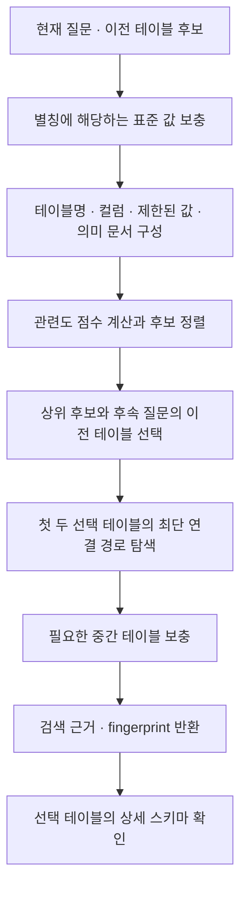

# `app/execution/tools` · DB 스키마 탐색과 SQL 도구

> **한눈에 보기** · 모델이 사용할 스키마 확인·SQL 검사·조회 도구를 제공합니다. 조회 직전에도 SQL을 다시 검사합니다.

**기본 흐름:** 관련 테이블 찾기 → SQL 검사 → 재검사 후 조회

모델이 선택한 작업을 실제 코드로 수행하는 Tool 계층입니다. Agent는 다음 행동을 결정하고, Tool은 스키마 탐색·SQL 검사·읽기 전용 조회와 실행 상태 관리를 담당합니다. [Agent의 ReAct·Tool Calling 흐름](../agent/README.md#react와-tool-calling)과 함께 읽을 수 있습니다.

## 주요 파일

| 파일 | 역할 |
|---|---|
| [schema_tools.py](schema_tools.py) | 실제 SQLite 테이블·컬럼·관계와 샘플 값을 탐색하고 질문에 관련된 스키마를 제공한다. |
| [sql_tools.py](sql_tools.py) | SQL 검사·실행 Tool을 생성하고 검사 이력과 원시 조회 결과를 관리한다. |

## SQL Tool과 공유 상태

| 함수·클래스 | 실제 역할 |
|---|---|
| `make_query_checker_tool()` | 질문·계획·기간 문맥과 상태를 캡처한 `query_checker` Tool을 만든다. 추가 LLM 호출 없이 코드로 검사하며, 통과한 SQL 또는 날짜 상한을 교정한 SQL을 반환한다. |
| `make_execute_query_tool()` | `execute_query` Tool과 성공 조회 목록을 함께 반환한다. Tool은 모델에 결과 문자열을 반환하고, 호출자는 성공 목록에서 SQL·컬럼·행을 얻는다. |
| `SqlToolState` | 두 Tool이 같은 실행 문맥에서 검사 이력·교정 SQL·확인한 스키마·결과 제한 정보를 공유한다. |
| `normalize_sql()` | 인용된 값을 보존하면서 공백과 끝 세미콜론을 정리해 검사·실행 SQL을 비교할 키를 만든다. SQL의 의미적 동등성을 판정하는 함수는 아니다. |
| `_validate_execution_sql()` | 두 Tool이 공유하는 읽기 전용·계획·스키마·기간·업무 조건 검증 순서를 제공한다. |
| `extract_referenced_tables()` | 실행 SQL의 물리 테이블을 AST의 스코프로 구분해 추출한다. 파싱 실패 시 진단용 문자열 추출을 보조적으로 사용한다. |

Agent는 하나의 `SqlToolState(require_schema_inspection=True)`를 만들어 두 생성 함수에 동일하게 전달합니다. 별도로 Tool을 구성할 때도 같은 상태를 전달해야 검사 성공 이력과 실행 허용 판단이 연결됩니다. 상태를 생략하면 각 생성 함수가 자신만의 상태를 만듭니다.

| `SqlToolState` 필드 | 용도 |
|---|---|
| `checked_queries` | 검사에 통과한 최종 SQL의 정규화 키 집합. |
| `checked_rewrites` | 최초 요청 SQL의 키에서 교정된 SQL로 연결하는 매핑. |
| `inspected_tables` | 스키마 확인 이력이 있는 테이블 이름 집합. |
| `schema_context` | 초기 검색과 `get_table_schema` 호출로 모은 스키마 설명. |
| `require_schema_inspection` | 실행 전 모든 참조 테이블의 스키마 확인을 요구할지 결정한다. 클래스 기본값은 `False`이고 Agent는 `True`로 설정한다. |
| `last_result_truncated`, `last_returned_row_count` | 마지막 DB 실행의 결과 제한 여부와 반환 행 수. 후보별 메타데이터 저장소는 아니다. |

## 검사에서 실행까지

1. **필터 근거 검사:** `query_checker`가 후속 질문에 임의로 추가된 범주 조건과 질문·스키마·별칭에 근거가 없는 문자열 조건을 확인합니다.
2. **공통 SQL 검증:** 읽기 전용 SQL → 계획·라이브 스키마 계약 → 상대 기간 → 설정된 업무 의미 순서로 검사합니다. 날짜 상한이 교정될 수 있습니다.
3. **검사 이력 등록:** 최종 SQL의 키와 원래 SQL → 교정 SQL 매핑을 상태에 기록합니다. 실패한 SQL은 등록하지 않습니다.
4. **실행 허용 확인:** `execute_query`는 검사 성공 키 또는 교정 매핑에 있는 SQL만 받습니다. Agent 경로에서는 모든 참조 테이블의 스키마 확인 이력도 요구합니다.
5. **실행 직전 재검증:** 현재 계획·스키마·기간·업무 조건으로 공통 검증을 다시 수행한 뒤 읽기 전용 DB 연결로 실행합니다.
6. **결과 계약 검사:** 컬럼·요청 속성·결과 단위를 검사하고, 통과한 `(SQL, 컬럼, 행)`을 성공 목록에 추가합니다. 이 목록을 Agent의 후보 선택에 전달합니다.

예를 들어 `query_checker`가 `status = 'paid'`인 SQL을 검사한 후 모델이 `status = 'pending'`으로 바꾸면, 바뀐 SQL을 다시 검사해야 합니다. 날짜 조건이 검사 과정에서 교정된 경우에는 등록된 매핑을 통해 원래 SQL을 제출해도 교정된 SQL을 실행할 수 있습니다.

날짜 수정자(`'-1 days'` 등)를 필터 값 추출에서 제외하는 것은 보조 처리입니다. 그것만으로 필터의 업무적 타당성이 보장되지는 않으며 [SQL 계약](../sql/sql_contract.py)과 [업무·기간 규칙](../semantics/README.md)을 함께 적용합니다. 계약 검사도 지원하는 조건 범위 안에서 동작하므로 모든 SQL의 의미적 정확성을 보장하지 않습니다.

## Schema Retrieval: 질문과 관련된 스키마 우선 검색

Schema Retrieval은 전체 테이블의 상세 스키마를 매번 LLM에 전달하는 대신, 질문과 관련된 초기 테이블 후보를 고르고 필요할 때 확장하는 방식입니다. `retrieve_relevant_schema()`는 LLM 호출 없이 실제 SQLite 메타데이터·제한된 고유값·의미 문서를 읽어 후보를 평가합니다. 전체 테이블 목록은 Agent의 초기 문맥에 제공될 수 있으며, 상세 스키마를 줄이는 것과 전체 DB를 전혀 탐색하지 않는 것은 다릅니다.

### 주요 함수와 결과 객체

| 함수·클래스 | 실제 역할 |
|---|---|
| `retrieve_relevant_schema()` | 질문·별칭·컬럼·값·의미 문서로 테이블 후보를 검색하고 이전 결과 테이블과 필요한 연결 테이블을 보충한다. |
| `_schema_match_score()` | 테이블명과 검색 문서에 대한 정확·부분 일치, 문자열 유사도 점수를 계산한다. |
| `_token_similarity()` | 두 토큰의 `SequenceMatcher` 비율과 문자 n-gram Jaccard 점수 중 큰 값을 사용한다. |
| `_character_ngrams()` | 공백을 제거한 문자열을 기본 길이 3의 겹치는 문자 조각 집합으로 분해한다. |
| `_schema_join_graph()` | 테이블·뷰를 정점으로 외래 키·공통 정규화 식별자·설정된 관계를 연결한 무방향 후보 그래프를 만든다. |
| `_shortest_path()` | 너비 우선 탐색(BFS)으로 두 테이블 사이의 간선 수가 가장 적은 경로를 찾는다. |
| `discover_relationships()` | 선언된 외래 키와 식별자 이름·실제 값 중첩을 근거로 JOIN 후보를 설명한다. |
| `get_table_schema()` | 실제 컬럼·키·인덱스·DDL·표본과 데이터 프로필을 조회한다. `compact` 옵션에 따라 설명량을 줄인다. |
| `schema_fingerprint()` | 스키마와 DB 파일·업무 설정 정보를 함께 해시한 16자리 식별값을 만든다. |
| `SchemaCandidate` | 테이블 이름·총점·어휘/유사도/값 점수와 일치 단어·컬럼·값을 담는다. |
| `SchemaRetrievalResult` | 선택 테이블, 정렬된 전체 후보, 검색 근거 문자열과 fingerprint를 반환한다. |

JOIN 후보가 실제로 같은 업무 대상을 연결하는지 검사하는 `validate_join_roles()`는 [JOIN의 의미적 유효성](../semantics/README.md#join의-의미적-유효성)에서 설명합니다.

### 검색과 확장 순서



`top_k` 또는 `SCHEMA_RETRIEVAL_TOP_K`의 코드 기본값은 3이며 검색 기준값을 1~8로 제한합니다. 후속 질문에서는 기존 테이블 중 실제 존재하는 앞의 최대 두 개를 먼저 선택하고, 초기 목표 크기를 기준값보다 하나 늘릴 수 있습니다. 연결 테이블을 추가할 때는 전체 선택 수가 기준값 + 2를 넘지 않도록 합니다. 따라서 최종 반환 테이블 수가 항상 `top_k`와 같지는 않습니다.

검색 문서는 테이블명과 컬럼명, 관련 `schema_summary.md` 구역 및 제한된 고유값으로 구성합니다. 시간형 컬럼은 값 검색에서 제외하고, 이름상 식별자 컬럼은 고유값 50개 이하, 그 밖의 컬럼은 12개 이하일 때만 값을 문서에 넣습니다. 이는 전체 행을 모델에 보내는 방식이 아니지만 실제 DB 조회 비용은 발생합니다.

### N-gram과 문자열 유사도

`_tokens()`는 언더스코어를 공백처럼 처리하고 영문·숫자·한국어 토큰을 소문자 집합으로 만듭니다. 길이 1인 토큰은 제외합니다. `_character_ngrams('orders')`의 기본 결과는 `ord`, `rde`, `der`, `ers`이며, 길이가 3 이하이면 문자열 전체를 한 조각으로 취급합니다.

`_token_similarity()`는 대소문자를 정리한 두 토큰의 다음 점수 중 큰 값을 반환합니다.

- `SequenceMatcher` 비율: 문자열 순서와 일치 구간에 기반한 유사도.
- Jaccard 유사도: n-gram 집합의 교집합 크기 / 합집합 크기.

이는 문자열 관련도이며 의미 임베딩이나 LLM 기반 검색은 아닙니다. 한국어 표현과 영문 DB 값의 차이는 [별칭 설정](../semantics/semantic_aliases.py)과 의미 문서로 보완합니다. 이름이 비슷하다는 이유만으로 같은 엔터티나 올바른 JOIN 관계로 확정하지 않습니다.

### 관련도 점수의 구성

| 근거 | 현재 점수 규칙 |
|---|---|
| 질문에 테이블명 포함 | 어휘 점수 +12 |
| 질문 토큰과 검색 문서 토큰 정확 일치 | 토큰당 +4. 아래 부분·유사 일치 계산은 해당 토큰에서 건너뛴다. |
| 토큰 간 부분 포함 | +1.25 |
| 길이 3 이상인 질문 토큰이 문서 문자열에 포함 | +0.75. 부분 포함 점수와 함께 적용될 수 있다. |
| 최상위 토큰 유사도 0.72 이상 | 유사도 × 1.5 |
| 일치한 컬럼 | 컬럼당 +2.5, 최대 8개 |
| 일치한 값 | 값당 +5, 최대 4개 |
| 양수 점수의 `analysis_` 이름 | +0.35 |
| 양수 점수의 뷰 | +10 |
| 후속 질문의 이전 테이블 | +6 |

컬럼 일치는 정확 일치 또는 유사도 0.74 이상, 값 일치는 정확 일치 또는 더 엄격한 유사도 0.86 이상을 사용합니다. 후보는 총점 내림차순·테이블명 순으로 정렬합니다. 모든 점수가 0 이하이면 `analysis_` 이름을 우선하는 대체 순서를 사용합니다. 이 점수는 테이블 선택 근거이며, 확률·정답률이나 SQL 후보 평가 점수와는 다릅니다.

## 그래프 기반 관계 탐색

`_schema_join_graph()`는 다음 근거로 테이블 사이에 양방향 간선을 만듭니다.

- SQLite에 선언된 외래 키.
- 이름이 `id` 또는 `*_id`인 컬럼에서 정규화한 식별자 이름이 공통으로 존재함. 정규화는 소문자 변환과 반복된 `ocel_` 접두사 제거를 수행합니다.
- 업무 설정 `relationship_scopes`의 `event_object_table`과 `membership_table` 연결.

이 단계에서는 실제 값 중첩이나 JOIN 방향·카디널리티를 확인하지 않습니다. `_shortest_path()`는 이 후보 그래프에서 첫 두 선택 테이블 사이를 BFS로 탐색하고, 중간 테이블을 검색 결과에 추가할 수 있게 합니다. 연결이 없으면 빈 목록을 반환하고 같은 정점이면 그 정점 하나를 반환합니다. 모든 선택 테이블을 잇는 최적 경로나 실행 비용이 가장 낮은 JOIN 계획을 찾는 알고리즘은 아닙니다.

예를 들어 고객 테이블과 배송 테이블의 후보 경로가 `customers → orders → shipments`라면 `orders`를 연결 테이블로 보충할 수 있습니다. 이는 구조 설명용 예시이며 실제 반환은 DB의 키·컬럼명·설정과 초기 선택 순서에 따릅니다.

`discover_relationships()`는 이 그래프 생성과 별도의 탐색 Tool입니다. `candidate_table_names`를 지정하면 대상 범위를 그 목록으로 제한하고, 생략하면 전체 테이블·뷰를 대상으로 연결 후보를 찾습니다.

| 관계 후보 근거 | 정렬 점수 |
|---|---:|
| 선언된 외래 키 | 5 |
| 정규화 식별자 이름이 같고 실제 일치 값이 존재 | +2 |
| 원래 컬럼명도 대소문자를 제외하고 동일 | +1 |

이름 기반 후보는 정규화한 식별자 이름이 같은 경우에만 비교하며, 중복 설명을 제거한 뒤 최대 30개를 반환합니다. 값 중첩 검사는 두 컬럼을 실제로 JOIN해 NULL이 아닌 일치 값 하나가 있는지 확인합니다. 공통 값이 있다는 것은 관계의 단서이며 모든 값의 참조 무결성이나 업무 의미가 맞다는 증명은 아닙니다. 오류로 중첩 확인에 실패할 때도 중첩 없음으로 취급합니다.

## 실제 스키마와 표본 확인

`get_table_schema(table_names, question='', compact=False)`는 쉼표로 구분한 테이블·뷰 이름을 받아 다음 정보를 제공합니다.

| 정보 | 상세 모드 | `compact=True` |
|---|---|---|
| 컬럼 이름·타입을 담은 스키마 헤더 | 제공 | 제공 |
| PK·FK와 행 수·식별자 고유값 수·시간 범위·일부 범주 분포 | 제공 | 제공 |
| 생성 DDL·컬럼 제약 상세·인덱스 설명 | 제공 | 생략 |
| 질문과 관련된 표본 또는 대체 표본 | 최대 3행 | 최대 3행 |
| 관련 업무 의미 문서 | 보조 자료로 제공 | 보조 자료로 제공 |

Agent는 초기 검색 뒤 `compact=True`로 상세 스키마를 준비하며, 필요한 경우 모델이 추가 탐색할 수 있습니다. 표본은 전체 분포를 보장하지 않고, PK·FK가 선언되지 않은 DB에서는 이름과 통계만으로 관계를 확정할 수 없습니다. 문서와 실제 DB가 다르면 물리 테이블·컬럼의 존재는 라이브 스키마를 기준으로 판단합니다.

## Schema fingerprint와 재사용 범위

`schema_fingerprint()`는 정렬된 사용자 테이블·뷰·인덱스 이름과 생성 SQL에 다음 정보를 더해 SHA-256 해시를 계산하고 앞의 16자리만 사용합니다.

- DB 절대 경로, 파일 크기와 나노초 단위 수정 시각.
- 로드한 업무 의미 설정.
- 현재 코드의 검증 버전 문자열 `population-and-key-roles-v1`.

이 식별값은 스키마와 실행 환경이 달라진 이전 사례를 구분하는 데 사용합니다. 이름과 달리 순수 DDL만의 해시가 아니므로 같은 구조라도 파일 위치·시각·설정이 바뀌면 달라질 수 있습니다. 전체 행 데이터의 해시, DB 내용의 완전한 동일성, 검색이나 SQL의 정확성 검증 결과는 아닙니다.

## 오류 복구

SQL 검사·실행 오류는 `Error:` 문자열로 반환하고, Tool 호출 중 예외는 Agent가 `Tool error:` 메시지로 바꿔 모델에 전달합니다. 모델은 오류를 근거로 SQL을 수정하거나 스키마를 추가 확인할 수 있습니다. SQL Tool 자체가 LLM을 호출하거나 자동으로 SQL을 재작성하는 것은 아닙니다. 반복과 모델 오류 재시도는 [Agent](../agent/README.md#실행-제한과-오류-복구)가 관리합니다.

## 결과 미리보기와 반환 상한

- DB 반환 상한은 `SQL_MAX_RESULT_ROWS`로 설정하며 코드 기본값은 200행입니다. 양수일 때 한 행을 추가로 읽어 잘림 여부를 확인하고 상한까지 보존합니다. 0 이하이면 이 도구의 행 수 상한을 적용하지 않습니다.
- 모델에는 최대 20행의 미리보기를 보여줍니다. UI와 성공 목록에는 DB 반환 상한 내에서 보존한 전체 결과를 전달합니다. 모델 미리보기만으로 전체 건수를 계산하면 안 됩니다.
- 결과가 비면 범주값과 연결 경로를 확인하고 한 번 더 시도하라는 안내를 모델에 반환합니다. 이는 자동 재실행이 아니라 모델에 제공하는 수정 지침입니다.
- 결과 계약을 통과한 빈 조회도 성공 목록에 들어갈 수 있습니다. 실행 성공은 데이터가 존재한다거나 업무적 정답이라는 뜻은 아닙니다.

## 핵심 개념과 동작

Query Checker는 **SQL을 실행하기 전에 검사하는 도구**입니다. 검사 결과와 교정 내역은 SqlToolState에 저장합니다. 실행 도구는 이 기록을 확인하고 다시 검사한 뒤 조회합니다.

BFS는 연결된 테이블을 가까운 곳부터 찾는 탐색법입니다. 연결 후보를 찾는 데 사용하며, 그 관계가 업무적으로 맞는지는 별도 검증이 필요합니다.

### 주요 함수·클래스

| 함수·클래스 | 구체적인 역할 | 관련 기술 |
|---|---|---|
| `make_query_checker_tool` | 검사 통과 키와 교정 SQL 등록 | 검사 후 실행 |
| `make_execute_query_tool` | 동일 상태로 검사 이력·스키마·결과 계약 확인 | 실행 게이트 |
| `_shortest_path` | 후보 테이블 그래프의 최소 간선 경로 | BFS |

### 핵심 코드: execute_query

검사하지 않은 SQL을 모델이 곧바로 실행하는 것을 막습니다.

**동작:** 요청 SQL을 정규화해 검사 성공 키 또는 교정 매핑으로 찾고, 둘 다 아니면 오류를 반환합니다.

**설계:** Tool 간 공유 상태를 이용한 실행 전제조건입니다. SQL 수정 이후에는 재검사가 필요하며 날짜 상한 교정은 원래 요청과 연결해 보존합니다.

**예:** 검사 없는 SELECT는 query_checker must be called 오류이고 등록한 원본은 교정 SQL로 실행할 수 있습니다.

<details>
<summary>실제 코드와 원본 위치 보기</summary>

원본: [app/execution/tools/sql_tools.py](sql_tools.py#L296). 아래는 실제 코드의 296~307행 발췌이며 앞뒤는 생략했습니다.

```python
requested_key = normalize_sql(sql)
if requested_key in tool_state.checked_queries:
    executable_sql = sql
elif requested_key in tool_state.checked_rewrites:
    executable_sql = tool_state.checked_rewrites[requested_key]
else:
    return "Error: query_checker must be called successfully before execute_query."
if tool_state.require_schema_inspection:
    referenced_tables = extract_referenced_tables(executable_sql)
    missing_tables = referenced_tables - tool_state.inspected_tables
    if missing_tables:
        missing = ", ".join(sorted(missing_tables))
```

</details>

### 핵심 코드: _shortest_path

두 검색 후보를 연결하는 중간 테이블 후보를 찾습니다.

**동작:** 같은 정점은 즉시 반환하고 큐에 경로를 넣어 방문하지 않은 이웃을 너비 우선 탐색합니다.

**설계:** 무가중치 그래프 BFS입니다. 직접 이름 일치가 없는 후보 사이에 최소 개수의 연결 테이블을 보충합니다.

**예:** a-b-c만 연결된 그래프에서 a→c는 [a,b,c], 연결이 없으면 []입니다.

<details>
<summary>실제 코드와 원본 위치 보기</summary>

원본: [app/execution/tools/schema_tools.py](schema_tools.py#L923). 아래는 실제 코드의 923~937행 발췌이며 앞뒤는 생략했습니다.

```python
if source == target:
    return [source]
queue: list[list[str]] = [[source]]
visited = {source}
while queue:
    path = queue.pop(0)
    for neighbor in sorted(graph.get(path[-1], set())):
        if neighbor in visited:
            continue
        candidate = [*path, neighbor]
        if neighbor == target:
            return candidate
        visited.add(neighbor)
        queue.append(candidate)
return []
```

</details>

### 다른 기능과 연결되는 순서

Agent가 검사 Tool과 실행 Tool을 같은 상태로 생성합니다. 스키마 검색·상세 확인은 상태에 근거를 더하고, 실행 Tool이 공통 SQL 검증과 결과 계약을 통과한 원시 결과를 Agent로 돌려줍니다.

### 확인한 범위와 한계

정규화 키는 SQL의 완전한 의미 동등성을 판정하지 않습니다. 스키마 확인과 표본 기반 검색도 모든 데이터의 업무 의미를 증명하지 않으며, 실행 결과 상한과 모델 미리보기 상한은 다릅니다.

관련 검증: [test_sql_tools.py](../../../tests/execution/test_sql_tools.py), [test_sql_ast.py](../../../tests/execution/test_sql_ast.py).

## 함께 읽기

- [SQL Agent 및 Tool Calling](../agent/README.md)
- [SQL 파싱·검증·실행](../sql/README.md)
- [업무·기간·집계 규칙](../semantics/README.md)
- [결과 검증과 응답 구성](../results/README.md)
- [실행 계층 안내](../README.md)
