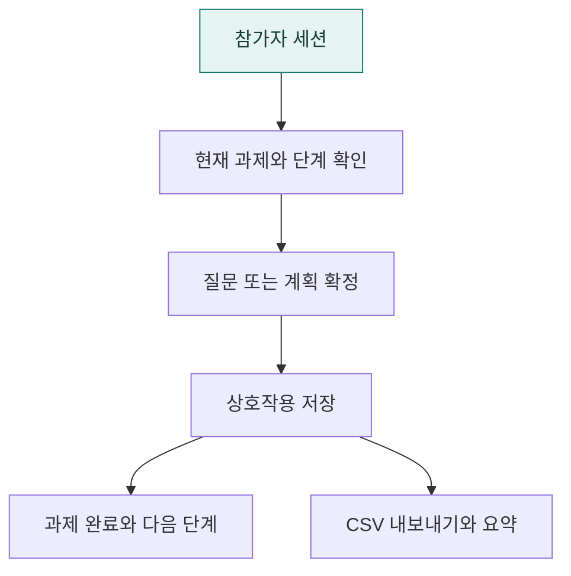

# `app/experiment` · 사용자 실험 진행과 상호작용 기록

참가자 세션·현재 과제·진행 단계를 관리하고 질문·계획·실행 결과를 연구용 상호작용으로 기록합니다.

## 한눈에 보는 흐름

## 주요 파일

| 파일 | 역할 |
|---|---|
| [analysis.py](analysis.py) | 상호작용 CSV를 읽고 입력 방식별 지표·단계를 요약하는 CLI. |
| [context.py](context.py) | 채팅·계획 검토에서 공유하는 활성 실험 과제와 대화 식별자 조회. |
| [interactions.py](interactions.py) | 두 모드의 채팅 결과를 공통 실험 상호작용 기록으로 변환한다. |
| [log.py](log.py) | 실험 상호작용을 공통 필드의 CSV로 기록. |
| [store.py](store.py) | 실험 세션·과제 진행·상호작용의 SQLite 저장과 조회. |
| [tasks.json](tasks.json) | 연구자가 조정하는 과제·질문·평가 기준 설정. |
| [tasks.py](tasks.py) | 과제 설정 로딩과 계획·결과의 기준 검사. |

## 연결 흐름

routes/experiment.py가 세션과 단계를 제어합니다. 채팅은 interactions.py, 확정 실행은 a2ui/interactions.py에서 기록합니다. analysis.py는 수집된 CSV를 요약합니다. 실제 참가자 자료는 로컬에서 관리합니다.

## 하위 폴더 안내

| 폴더 | 역할 |
|---|---|
| [a2ui/](a2ui/README.md) | Agent2UI 확정 실행의 실험 기록 |

## 함께 읽기

- [앱 전체 구조](../README.md)
- [프로젝트 소개](../../README.md)
