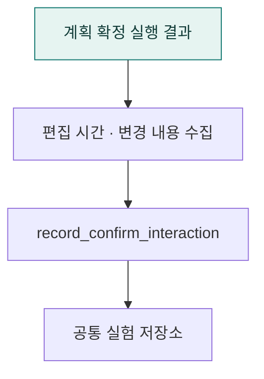

# `app/experiment/a2ui` · Agent2UI 확정 실행의 실험 기록

계획 확정 실행에서 발생한 편집 시간·수정 내역·실행 결과를 실험 상호작용 기록으로 만듭니다.

## 한눈에 보는 흐름

## 주요 파일

| 파일 | 역할 |
|---|---|
| [interactions.py](interactions.py) | A2UI 전용 계획 확정 실행을 실험 상호작용 기록으로 변환한다. |

## 연결 흐름

routes/a2ui/review.py에서 확정 실행 후 record_confirm_interaction을 호출합니다. 공통 experiment/store.py를 통해 기록을 저장합니다.

## 함께 읽기

- [상위 폴더 안내](../README.md)
- [앱 전체 구조](../../README.md)
- [프로젝트 소개](../../../README.md)
