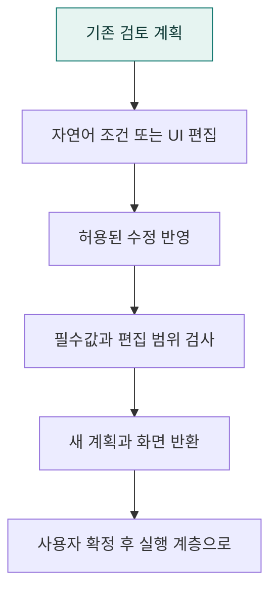

# `app/planning/a2ui` · 계획 검토·추가 조건·편집 검증

Agent2UI 검토 화면 응답을 구성하고 자연어 추가 조건을 계획에 반영하며 허용된 편집 범위를 검사합니다.

## 한눈에 보는 흐름

## 주요 파일

| 파일 | 역할 |
|---|---|
| [models.py](models.py) | A2UI 검토 중 허용되는 추가 조건 수정 패치 모델. |
| [refinement.py](refinement.py) | A2UI 전용 자연어 추가 조건을 제한된 필터 수정 패치로 반영한다. |
| [review.py](review.py) | A2UI 전용 검토 화면 응답 조립과 추가 조건 반영을 담당한다. |
| [validator.py](validator.py) | A2UI 전용 계획 확정 검증과 서버가 허용한 편집 범위 검사. |

## 연결 흐름

review.py가 응답과 수정 흐름을 조합하고 refinement.py가 제한된 수정 패치를 생성합니다. 확정 시 validator.py에서 필수값·미해결 조건과 편집 범위를 검사합니다. 조건 수정 단계에서는 SQL을 실행하지 않습니다.

## 함께 읽기

- [상위 폴더 안내](../README.md)
- [앱 전체 구조](../../README.md)
- [프로젝트 소개](../../../README.md)
