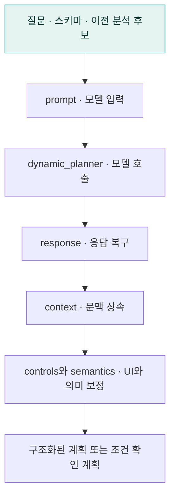

# `app/planning/planner` · 공통 LLM 계획 생성기

질문을 구조화된 분석 계획과 UI 블록으로 바꾸는 모델 호출·응답 복구·문맥 상속·의미 보정을 담당합니다.

## 한눈에 보는 흐름

## 주요 파일

| 파일 | 역할 |
|---|---|
| [context.py](context.py) | 후속 분석의 참조 후보 선택·조건 상속·식별자 필터 근거를 처리한다. |
| [controls.py](controls.py) | 검토용 UI의 선택지·기본 입력·중복·배치와 스키마 근거를 정리한다. |
| [dynamic_planner.py](dynamic_planner.py) | Baseline과 A2UI가 공유하는 LLM 분석 계획 생성 진입점. |
| [models.py](models.py) | 계획 생성 응답과 후속 분석 맥락을 표현하는 모델. |
| [prompt.py](prompt.py) | 질문·스키마·이전 분석 후보를 계획 및 UI 생성 프롬프트로 구성한다. |
| [response.py](response.py) | LLM 응답의 구조·타입·필드·UI 원시 값을 복구하고 모델로 검증한다. |
| [semantics.py](semantics.py) | 분석 지표·관계 범위를 정리하고 분석 의미와 날짜 안내의 일관성을 검증한다. |

## 연결 흐름

외부 서비스는 패키지의 plan_dynamic_analysis를 사용합니다. dynamic_planner.py가 prompt → 모델 호출 → response → context·controls·semantics의 후처리를 조율하고 실패 시 조건 확인 계획을 반환합니다.

## 함께 읽기

- [상위 폴더 안내](../README.md)
- [앱 전체 구조](../../README.md)
- [프로젝트 소개](../../../README.md)
