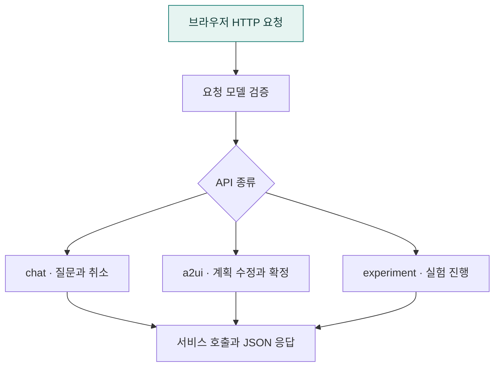

# HTTP API 구조와 Baseline·A2UI의 역할

`app/routes`는 브라우저의 HTTP 요청을 받아 내부 서비스를 호출하고, 결과를 응답하는 계층이다. 공통 API는 폴더 바로 아래에, A2UI 전용 API는 `a2ui/` 아래에 둔다.

사용자 화면에서 부르는 A2UI 모드의 API 필드 값은 `agent2ui`이다. 코드와 요청 예시에서는 이 값을 사용한다.

## 한눈에 보는 흐름



## 폴더 구조

```text
app/
  routes/
    __init__.py
    README.md            # 이 문서
    api.py               # 전체 라우터 연결, 상태 확인, 기본 HTML 응답
    chat.py              # 두 모드의 질문 접수와 실행 취소
    experiment.py        # 두 모드의 실험 세션·과제·단계 관리
    schemas.py           # 공통 채팅·실험 요청·응답과 측정값
    errors.py            # 공통 오류 코드와 오류 본문 생성
    web_ui.py            # 기본 HTML 로딩과 정적 파일 경로
    a2ui/
      __init__.py
      review.py          # A2UI 전용 계획 수정·확정과 화면 버전 검증
      schemas.py         # A2UI 전용 계획 수정·확정 요청·응답

  a2ui/
    adapter.py           # 두 모드의 조회 결과를 공통 화면 형식으로 변환
    review.py            # A2UI 모드 전용 계획 검토 화면 생성
    catalog.py           # 지원하는 UI 컴포넌트 정의
    models.py            # A2UI 화면·컴포넌트 전송 모델
```

`app/routes/a2ui`와 `app/a2ui`는 책임이 다르다. 전자는 A2UI 전용 HTTP 요청을 처리하고, 후자는 계획·결과를 프론트엔드가 표시할 화면 형식으로 만든다. 화면 변환 기능은 공통 채팅의 결과 표시에서도 사용할 수 있다.

## 공통 기능과 모드 전용 기능

| 구분 | 공통 | Baseline | A2UI |
|---|---|---|---|
| 질문 접수 | `POST /api/chat` | `input_source="baseline"` | `input_source="agent2ui"` |
| 질문 유형 판단 | `app/chat`에서 분석·대화·결과 설명 등을 구분 | 분석 요청이면 검토 단계 없이 실행 경로로 전달 | 분석 요청이면 계획 검토 화면을 먼저 반환 |
| 검토 중 자연어 조건 추가 | — | 전용 API 없음 | `POST /api/review/refine` |
| 계획 확정 실행 | — | 전용 API 없음 | `POST /api/review/confirm` |
| 실행 취소·실험 관리·요청 형식·오류 처리 | 두 모드가 공유 | 공통 API 사용 | 공통 API 사용 |

Baseline에도 내부 분석 계획 생성 과정이 있다. 차이는 사용자가 계획을 검토·확정하는 HTTP 단계를 거치는지에 있다. 두 모드 모두 일반 대화, 저장된 결과 요약·설명·표시 변경은 새 SQL 실행 없이 처리할 수 있다. 조건이 불명확하면 확인 질문을 반환할 수 있다.

현재 Baseline 전용 HTTP API는 없으므로 `routes/baseline/`은 만들지 않는다. 공통 파일은 `routes/` 바로 아래에 두고, 모드 전용 API가 생기면 해당 하위 폴더에 둔다.

## 파일별 책임

### api.py

`chat.router`, `a2ui.review.router`, `experiment.router`를 하나의 라우터에 등록한다. `app/server.py`가 이 라우터를 FastAPI 앱에 연결한다. 직접 처리하는 요청은 기본 HTML을 반환하는 `/`와 상태 확인용 `/health`이다.

`/health`는 로컬 자원 상태와 LLM 공급자·모델 이름, 별도 서버 주소 설정 여부를 반환한다. API 키는 응답에 포함하지 않는다.

### chat.py

질문을 받아 `app/chat/service.py`의 `chat_response_payload()`에 전달한다. 활성 실험이면 현재 과제에 맞는 대화·과제 ID를 적용한다. 실행 후에는 소요 시간과 로그를 기록하고, 실제 조회 결과를 후속 질문용 대화 상태에 저장한다.

- `thread_id`: 여러 질문과 결과가 이어지는 대화 식별자.
- `run_id`: 취소할 개별 실행 작업의 식별자.
- `_chat_stage()`: 결과를 계획 생성·실행·대화·요약 등의 로그 단계로 분류한다.
- `_should_record_execution_result()`: 기존 결과 설명·요약 등을 새 조회 결과로 중복 저장하지 않도록 구분한다.

현재 일반 채팅은 `run_id`가 있으면 취소 가능한 워커에서 실행한다. 활성 실험의 채팅은 서비스를 직접 호출한다. 취소 API는 실행 관리자에 등록된 워커를 중단한다.

### a2ui/review.py

`confirm_review()`는 계획을 검증한 뒤 실행 서비스에 전달한다. 실행 결과와 후속 질문용 문맥, 편집 시간·변경 필드·계획 차이 등의 로그를 기록한다. `run_id`가 있으면 취소 가능한 워커를 사용한다.

`refine_review()`는 추가 조건을 계획에 반영하고 화면을 다시 생성한다. SQL은 실행하지 않으며, `revision`과 수정 횟수를 하나씩 올린다.

두 요청은 다음 검증 함수를 공유한다.

- `_validate_surface_revision()`: 화면이 저장되어 있는지, 전달된 계획 ID와 버전이 최신 화면과 맞는지 확인한다. 없거나 맞지 않으면 `409 PLAN_REVISION_CONFLICT`를 반환한다.
- `_with_authoritative_ui_schema()`: 분석 값의 변경이 허용된 편집 범위인지 검증하고, UI 구조·요약·경고·확정 필요 여부 등은 서버가 저장한 값으로 적용한다.

`surface_id`는 검토 화면 식별자, `plan_id`는 계획 식별자, `revision`은 화면 버전이다. 예를 들어 조건 추가 후 서버 버전이 2가 되면, 버전 1로 확정하는 요청은 거절한다.

### experiment.py

참여자 세션 생성·복원, 진행 상태 조회, 과제 완료, 다음 단계 이동, CSV 내보내기를 담당한다. 실제 저장과 단계 이동 규칙은 `app/experiment/store.py`에 있다. 성공한 상호작용 없이 과제를 완료하거나, 과제 완료 전에 다음 단계로 넘어가는 요청은 제한된다.

CSV 내보내기의 `researcher_key`는 `ORDER_UI_RESEARCHER_KEY`와 비교한다. 현재 환경 변수 미설정 시 기본값은 `dev`이다.

### schemas.py / errors.py / web_ui.py

| 파일 | 책임 |
|---|---|
| `schemas.py` | Pydantic 모델로 요청·응답 필드, 자료형, 필수 값, 길이·수치 범위를 정의한다. `ClientMetrics`는 편집 시간과 변경 내역을 담는다. |
| `errors.py` | 오류 코드와 `error.code`, `message`, `field_errors`, `retryable`, `details` 형태를 정의한다. 최종 오류 응답 처리는 `app/server.py`가 담당한다. |
| `web_ui.py` | 기본 HTML을 모듈 로딩 시 읽고, 템플릿·정적 파일 경로를 제공한다. `/static` 연결은 `app/server.py`에서 수행한다. |

요청 형식은 `schemas.py`에서 검사하고, 분석 조건의 의미와 편집 가능 범위는 계획 검증 로직에서 검사한다. A2UI 전용 요청·응답 모델은 `a2ui/schemas.py`에 정의하며, 공통 `ClientMetrics`를 참조한다.

## API 목록

파일 이동은 Python 모듈 경로만 변경한다. 기존 HTTP 주소는 유지한다.

| 메서드 | 주소 | 담당 파일 |
|---|---|---|
| GET | `/` | `api.py` |
| GET | `/health` | `api.py` |
| POST | `/api/chat` | `chat.py` |
| POST | `/api/runs/{run_id}/cancel` | `chat.py` |
| POST | `/api/review/refine` | `a2ui/review.py` |
| POST | `/api/review/confirm` | `a2ui/review.py` |
| POST | `/api/experiment/start` | `experiment.py` |
| GET | `/api/experiment/session/{participant_id}` | `experiment.py` |
| POST | `/api/experiment/task/complete` | `experiment.py` |
| POST | `/api/experiment/step/advance` | `experiment.py` |
| GET | `/api/experiment/export` | `experiment.py` |

## 요청 흐름

### Baseline 분석

1. 브라우저가 `/api/chat`에 `input_source="baseline"`으로 질문을 보낸다.
2. `routes/chat.py`가 `app/chat/service.py`에 전달한다.
3. `app/chat/dispatch.py`에서 질문 유형을 판단한다.
4. 분석이 필요하면 `app/execution/baseline/service.py`에서 계획 생성·검증과 SQL 실행을 진행한다.
5. 라우터가 결과·문맥·로그를 기록하고 응답한다.

### A2UI 분석

1. 브라우저가 `/api/chat`에 `input_source="agent2ui"`로 질문을 보낸다.
2. 채팅 서비스가 분석 요청으로 판단하면 계획과 검토 화면을 반환한다.
3. 사용자가 자연어 조건을 추가하면 `/api/review/refine`에서 계획과 화면을 갱신한다.
4. 사용자가 확정하면 `/api/review/confirm`에서 화면 버전과 편집 내용을 검사한다.
5. 검증된 계획을 실행 서비스에 전달하고, 결과·문맥·로그를 기록해 응답한다.

## 관련 기능의 위치와 수정 기준

| 변경하려는 기능 | 확인할 위치 |
|---|---|
| 두 모드의 공통 채팅 HTTP 처리 | `app/routes/chat.py` |
| A2UI 검토·확정 HTTP 처리 | `app/routes/a2ui/review.py` |
| 질문 유형 판단과 모드별 분기 | `app/chat/dispatch.py`, `app/chat/turn_router.py` |
| 분석 계획 생성·조건 해석 | `app/planning/` |
| SQL 생성·검증·실행 | `app/execution/` |
| 화면·컴포넌트 데이터 변환 | `app/a2ui/` |
| 실험 세션·과제·단계 규칙 | `app/experiment/store.py` |
| 공통 실험 문맥 조회·상호작용 기록 생성 | `app/experiment/context.py`, `app/experiment/interactions.py` (A2UI 확정 기록은 `app/experiment/a2ui/interactions.py`) |
| 취소 가능한 실행·대화 결과·화면 상태 저장 | `app/runtime/` |

새 라우터를 만들면 `api.py`에 등록한다. 라우터에는 HTTP 입출력과 처리 순서의 연결을 두고, 계획 생성·SQL 실행·실험 저장 규칙은 해당 기능 모듈에 둔다.

## 검증

프로젝트 루트에서 실행한다.

```bash
.venv/bin/python -m pytest tests -q
```

`tests/test_baseline_turn_routing.py`와 `tests/a2ui/test_agent2ui_turn_routing.py`는 모드별 질문 처리 경로를 확인한다. `tests/a2ui/test_route_workflows.py`는 통합 라우터에서 계획 수정·오래된 화면 거절·확정 결과 저장·실험 진행·내보내기 권한·취소 응답을 확인한다. 이 테스트들은 LLM의 실제 응답 품질을 평가하는 테스트와는 구분된다.

전체 백엔드의 공통 코드와 모드별 코드 위치는 [백엔드 구조 설명](../README.md)을 참고한다.

## 하위 폴더 안내

| 폴더 | 역할 |
|---|---|
| [a2ui/](a2ui/README.md) | 계획 수정·확정 HTTP API |

## 함께 읽기

- [앱 전체 구조](../README.md)
- [프로젝트 소개](../../README.md)
