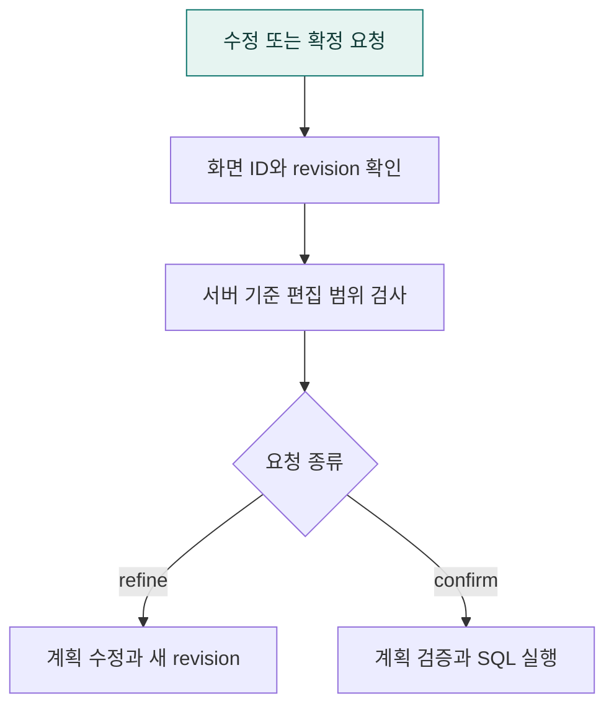

# `app/routes/a2ui` · 계획 수정·확정 HTTP API

브라우저가 보내는 Agent2UI 계획 수정·확정 요청을 받고 서버가 발급한 화면 ID·버전을 확인합니다.

## 한눈에 보는 흐름

## 주요 파일

| 파일 | 역할 |
|---|---|
| [review.py](review.py) | A2UI 전용 분석 계획 확정·수정과 서버 발급 화면 검증 HTTP 라우터. |
| [schemas.py](schemas.py) | A2UI 전용 계획 확정·수정 요청과 응답 모델. |

## 연결 흐름

POST /api/review/refine은 계획 수정 후 revision을 올립니다. POST /api/review/confirm은 검증된 확정 계획을 실행 계층으로 전달합니다. 서버가 저장한 화면과 허용된 편집 범위를 검증합니다.

## 함께 읽기

- [상위 폴더 안내](../README.md)
- [앱 전체 구조](../../README.md)
- [프로젝트 소개](../../../README.md)
