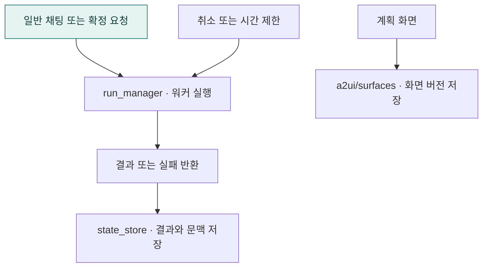

# `app/runtime` · 대화 상태와 취소 가능한 실행

대화 결과·문맥·검토 화면 상태를 보관하고 별도 워커의 취소·시간 제한을 관리합니다.

## 한눈에 보는 흐름

## 주요 파일

| 파일 | 역할 |
|---|---|
| [chat_log.py](chat_log.py) | 접속 모드·입력 방식별 채팅 CSV 기록. |
| [run_manager.py](run_manager.py) | 별도 워커 프로세스에서 요청을 실행하고 취소·시간 제한을 관리한다. |
| [state_store.py](state_store.py) | thread별 실행 결과·대화 문맥·검증된 SQL 예시 저장. |

## 연결 흐름

run_manager.py가 워커를 등록·실행·종료합니다. state_store.py는 thread별 실행 결과와 문맥을 저장하고, a2ui/는 계획 화면 버전과 확정 워커를 담당합니다. 상태 저장 DB는 조회 DB와 구분합니다.

## 하위 폴더 안내

| 폴더 | 역할 |
|---|---|
| [a2ui/](a2ui/README.md) | 계획 화면 저장과 확정 워커 |

## 함께 읽기

- [앱 전체 구조](../README.md)
- [프로젝트 소개](../../README.md)
