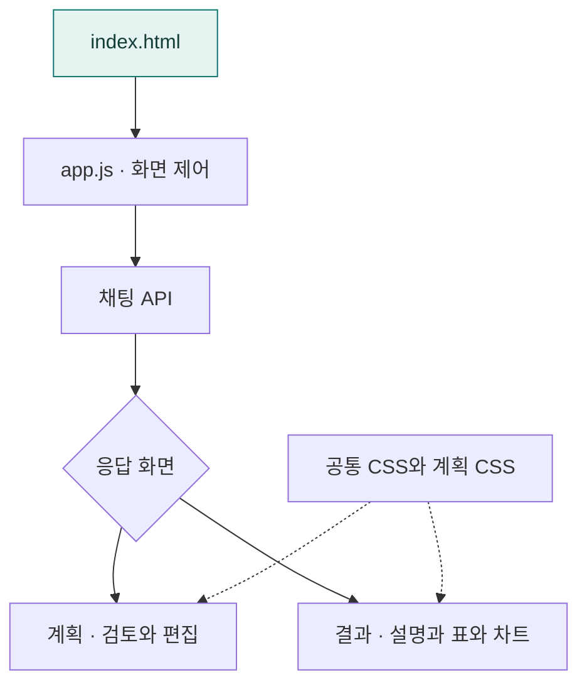

# 프론트엔드 공통·A2UI 코드 배치

`app.js`에는 사용자 모드, 채팅 전송, 결과 표시만 두고, A2UI 계획 검토 본문은 전용 모듈로 위임한다. HTTP 주소와 요청 필드는 유지한다.

## 한눈에 보는 흐름

| 프롬프트 · 조회 결과 | Agent2UI · 계획 검토 |
|---|---|
|  |  |

기존 주문 DB를 이용한 시스템 화면입니다. 왼쪽은 즉시 조회 결과, 오른쪽은 검토 계획의 일부를 보여줍니다.

| 위치 | 역할 |
|---|---|
| `js/app.js` | 공통 진입점, 모드 선택, 채팅과 결과 표시 |
| `js/api.js` | 공통 JSON 전송·HTTP 오류 처리·채팅·실행 취소 |
| `js/state.js` | 사용자·모드별 대화 ID·활성 실행·결과 상태 |
| `js/surfaces/` | 두 모드의 화면 전송 규격 검증과 결과 렌더링, 계획 화면 위임 |
| `js/components/registry.js` | 공통 컴포넌트 등록과 지원 목록 |
| `js/components/components.js` | 공통 결과 텍스트·안내·미지원 컴포넌트 표시 |
| `js/components/a2ui/` | 계획 입력 위젯과 전용 컴포넌트 등록 |
| `js/results/` | 두 모드 공통 결과 정규화·표·차트 |
| `js/results/a2ui/` | A2UI 결과에만 연결하는 후속 분석 버튼 처리 |
| `js/a2ui/review-controller.js` | 검토 화면 표시·추가 조건 수정·확정 실행 흐름 |
| `js/a2ui/api.js` | 계획 수정·확정 HTTP 호출 |
| `js/a2ui/state.js` | 편집 계획·초기 스냅샷·현재 검토 화면·확정 계획 |
| `js/a2ui/surfaces.js` | 계획 화면을 편집 상태에 설치하고 지원 동작 연결 |
| `js/a2ui/plan/` | 계획 정규화·문장·카드·조건·차이·확정 검증 |
| `js/modes/` | 관리자·참여자 프로필과 요청·응답 데이터 처리 |
| `styles.css` | 공통 레이아웃·채팅·결과 표·차트 스타일 |
| `a2ui/review.css` | 계획 카드·편집 입력·확정 상태·후속 버튼 스타일 |

## 화면 처리 흐름

1. `app.js`에서 채팅을 전송한다.
2. 결과 화면은 공통 `surfaces/runtime.js`가 표시한다.
3. 계획 화면은 `a2ui/review-controller.js`가 `a2ui/surfaces.js`와 `a2ui/plan/`을 통해 표시한다.
4. 추가 조건은 전용 API로 전송하고 새 revision의 계획 화면을 설치한다.
5. 확정하면 최초 계획과의 차이·현재 화면 ID·revision을 전송한다. 실행 결과는 다시 공통 렌더러로 표시한다.

`appState.currentSurface`는 공통 결과 화면, `reviewState.currentSurface`는 검토 중인 계획 화면이다. 공통 결과 표시가 계획 편집 상태를 덮어쓰지 않는다.

공통 스타일을 먼저, A2UI 스타일을 나중에 불러온다. 두 모드가 공유하는 카드·결과 규칙은 공통에 유지하며, 전용 선택자의 선언과 반응형 규칙은 A2UI 스타일에 둔다.

## 검증

현재 공개 소스에는 JavaScript 자동 테스트가 포함되어 있지 않습니다. 화면 변경 시 브라우저에서 계획 표시·수정·확정과 결과 렌더링을 확인합니다. Python 실행 검증은 `uv run pytest tests/execution -q`로 실행합니다.

## 하위 폴더 안내

| 폴더 | 역할 |
|---|---|
| [a2ui/](a2ui/README.md) | 계획 검토 화면 스타일 |
| [js/](js/README.md) | 브라우저 앱과 공통 화면 제어 |

## 함께 읽기

- [앱 전체 구조](../README.md)
- [프로젝트 소개](../../README.md)
