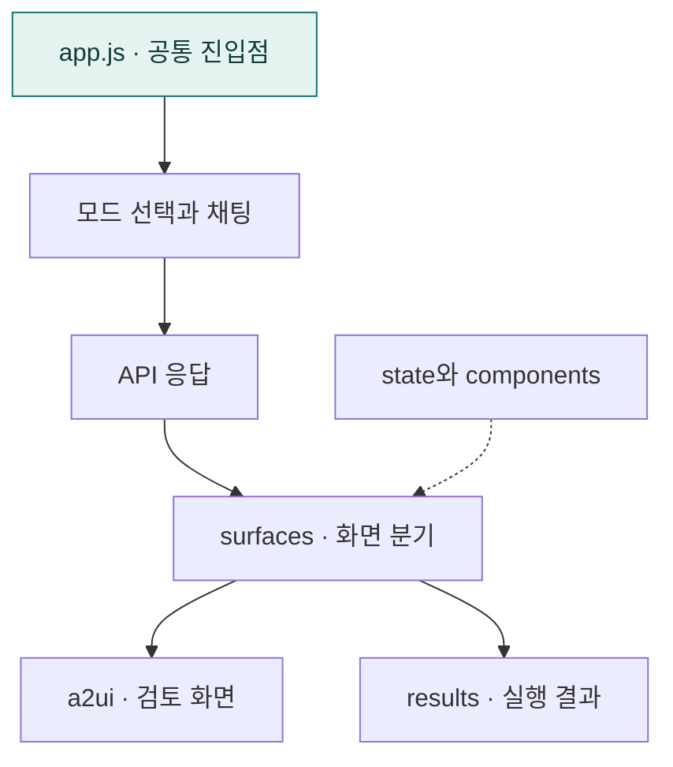

# `app/static/js` · 브라우저 앱과 공통 화면 제어

모드 선택·참가자 입력·채팅 전송·실행 상태·결과 표시를 조합하는 프론트엔드 진입점입니다.

## 한눈에 보는 흐름

## 주요 파일

| 파일 | 역할 |
|---|---|
| [api.js](api.js) | 공통 JSON 요청·채팅 전송·실행 취소·HTTP 오류 처리. |
| [app.js](app.js) | 모드 선택·프로필·채팅 전송·결과 표시와 검토 컨트롤러 연결. |
| [state.js](state.js) | 모드별 대화 ID·현재 실행·결과 화면의 공통 상태. |
| [utils.js](utils.js) | DOM 생성·텍스트 처리·객체 복사·중첩 경로 접근 도구. |

## 연결 흐름

templates/index.html이 app.js를 모듈로 로드합니다. app.js는 공통 컴포넌트를 등록하고, 채팅 응답의 계획 화면을 a2ui 컨트롤러에 전달하며 결과를 공통 렌더러로 표시합니다.

## 하위 폴더 안내

| 폴더 | 역할 |
|---|---|
| [a2ui/](a2ui/README.md) | 계획 검토 전용 프론트엔드 |
| [components/](components/README.md) | UI 컴포넌트 등록과 공통 요소 |
| [modes/](modes/README.md) | 관리자·사용자 접속 모드 |
| [results/](results/README.md) | 조회 결과 정규화와 표시 |
| [surfaces/](surfaces/README.md) | 서버 화면 정의의 검증과 렌더링 |

## 함께 읽기

- [상위 폴더 안내](../README.md)
- [앱 전체 구조](../../README.md)
- [프로젝트 소개](../../../README.md)
