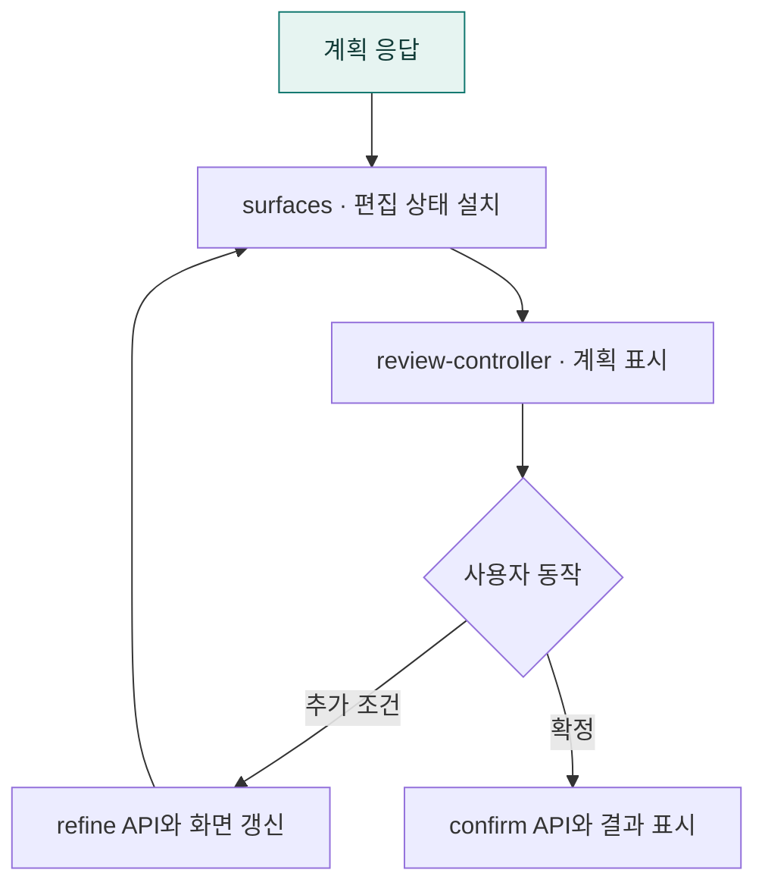

# `app/static/js/a2ui` · 계획 검토 전용 프론트엔드

계획 화면의 설치·표시·추가 조건·확정 요청과 편집 상태를 관리합니다.

## 한눈에 보는 흐름

조회 기간·결과 방식·집계 기준을 표시하는 기존 시스템 화면 일부입니다.

## 주요 파일

| 파일 | 역할 |
|---|---|
| [api.js](api.js) | 계획 수정(refine)·확정(confirm) 요청 전송. |
| [review-controller.js](review-controller.js) | 계획 표시 → 조건 추가 → 확정 실행의 사용자 동작 조정. |
| [state.js](state.js) | 검토 계획·처음 계획·현재 화면·확정 계획의 편집 상태. |
| [surfaces.js](surfaces.js) | 서버 화면 정의를 UiPlan으로 변환하고 검토 화면 설치·표시. |

## 연결 흐름

app.js → createReviewController → surfaces.js·plan/ 순서로 계획을 표시합니다. api.js로 수정·확정 요청을 보내고, 결과는 공통 화면 계층에 전달합니다. reviewState가 검토 중인 계획을 보관합니다.

## 하위 폴더 안내

| 폴더 | 역할 |
|---|---|
| [plan/](plan/README.md) | 분석 계획 편집 UI |

## 함께 읽기

- [상위 폴더 안내](../README.md)
- [앱 전체 구조](../../../README.md)
- [프로젝트 소개](../../../../README.md)
