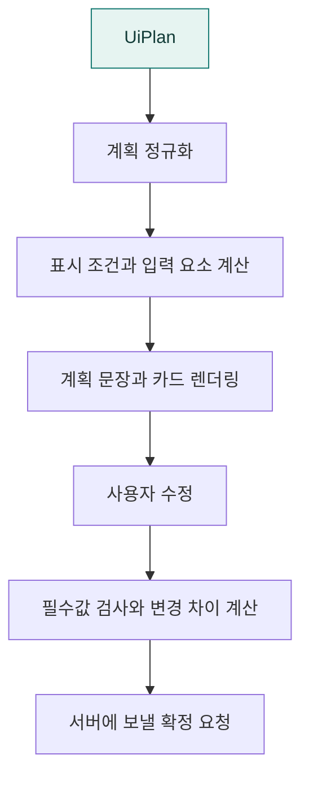

# `app/static/js/a2ui/plan` · 분석 계획 편집 UI

분석 계획을 정규화하고 입력 블록·안내 문장·변경 차이·필수값 검사를 구성합니다.

## 한눈에 보는 흐름

## 주요 파일

| 파일 | 역할 |
|---|---|
| [condition-evaluator.js](condition-evaluator.js) | UI 블록의 표시·필수 입력 조건 평가. |
| [plan-diff.js](plan-diff.js) | 최초 계획과 수정 계획의 변경 값·필드 계산. |
| [plan-labels.js](plan-labels.js) | 단위·지표·기간·집계 기준의 한글 표시 이름과 조사 처리. |
| [plan-normalizer.js](plan-normalizer.js) | 계획·UI 블록·집계 기준·필드 간 의존성 정규화. |
| [plan-renderer.js](plan-renderer.js) | 계획 카드·입력 블록 렌더링과 수정·확정 요청 데이터 구성. |
| [plan-sentence.js](plan-sentence.js) | 현재 계획의 분석 의미를 사용자 안내 문장으로 표현. |
| [plan-validation.js](plan-validation.js) | 확정 전 필수값·미해결 조건·계획 유효성 검사. |

## 연결 흐름

plan-renderer.js가 카드와 요청 payload를 만듭니다. 표시·필수 조건은 condition-evaluator.js, 확정 전 검사는 plan-validation.js, 수정 기록은 plan-diff.js가 담당합니다. 최종 실행 허용 여부는 서버에서도 검증합니다.

## 함께 읽기

- [상위 폴더 안내](../README.md)
- [앱 전체 구조](../../../../README.md)
- [프로젝트 소개](../../../../../README.md)
