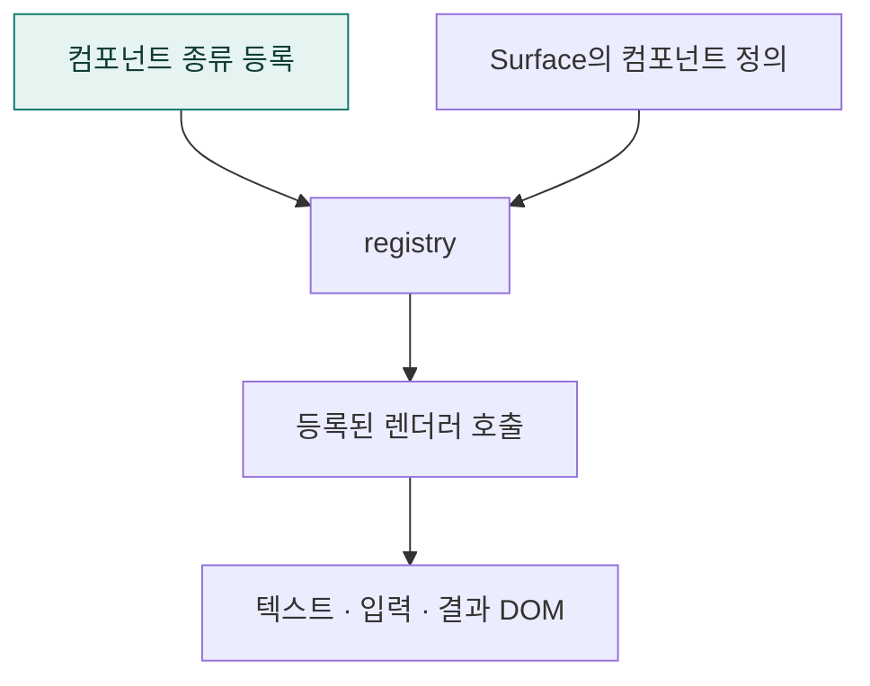

# `app/static/js/components` · UI 컴포넌트 등록과 공통 요소

서버가 보낸 컴포넌트 종류를 브라우저 렌더링 함수에 연결하고 텍스트·안내·미지원 요소를 표시합니다.

## 한눈에 보는 흐름

## 주요 파일

| 파일 | 역할 |
|---|---|
| [components.js](components.js) | 텍스트·안내·미지원 컴포넌트의 공통 표시. |
| [registry.js](registry.js) | 컴포넌트 이름별 렌더러 등록·호출과 지원 목록 제공. |

## 연결 흐름

app.js에서 기본 요소와 a2ui 입력 요소를 등록합니다. surfaces/runtime.js는 등록된 종류에 맞는 renderComponent를 호출합니다. 결과 표·차트 렌더링 함수는 results/에서 제공합니다.

## 하위 폴더 안내

| 폴더 | 역할 |
|---|---|
| [a2ui/](a2ui/README.md) | 계획 입력 위젯 |

## 함께 읽기

- [상위 폴더 안내](../README.md)
- [앱 전체 구조](../../../README.md)
- [프로젝트 소개](../../../../README.md)
