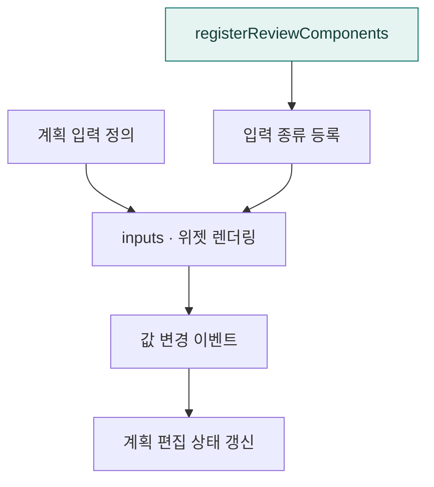

# `app/static/js/components/a2ui` · 계획 입력 위젯

텍스트·숫자·날짜·선택지·체크박스 등 계획 수정에 쓰는 입력 컴포넌트를 렌더링합니다.

## 한눈에 보는 흐름

## 주요 파일

| 파일 | 역할 |
|---|---|
| [inputs.js](inputs.js) | 계획 편집용 입력 위젯 렌더링과 변경 이벤트 처리. |
| [register.js](register.js) | 계획 검토용 컴포넌트를 공통 레지스트리에 등록. |

## 연결 흐름

register.js가 계획 입력 종류를 공통 registry에 등록합니다. inputs.js는 위젯과 사용자 입력 처리를 제공하고 계획 렌더러가 이를 조합합니다.

## 함께 읽기

- [상위 폴더 안내](../README.md)
- [앱 전체 구조](../../../../README.md)
- [프로젝트 소개](../../../../../README.md)
