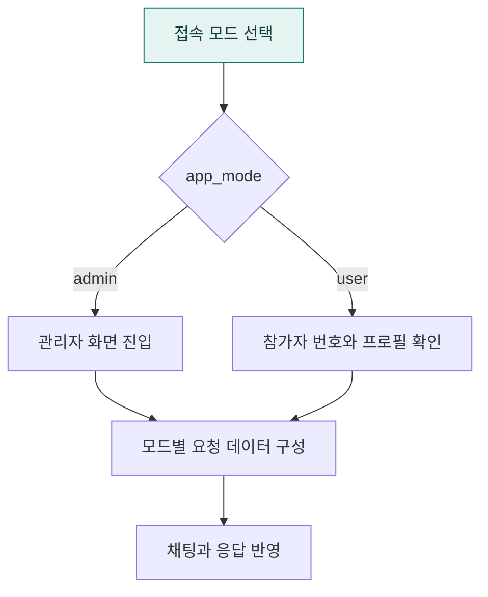

# `app/static/js/modes` · 관리자·사용자 접속 모드

관리자 모드와 사용자 모드의 진입·프로필·요청 데이터·응답 반영 방식을 구분합니다.

## 한눈에 보는 흐름

## 주요 파일

| 파일 | 역할 |
|---|---|
| [admin-mode-data.js](admin-mode-data.js) | 관리자 모드 진입과 요청·응답 데이터 처리. |
| [mode-data.js](mode-data.js) | 접속 모드에 맞는 관리자·사용자 동작 선택. |
| [user-mode-data.js](user-mode-data.js) | 참가자 번호 검증·프로필·세션 저장과 사용자 모드 요청 처리. |

## 연결 흐름

mode-data.js가 app_mode에 맞는 모듈을 선택합니다. user-mode-data.js는 참가자 번호·프로필과 브라우저 세션 저장을 처리합니다. baseline·agent2ui 입력 방식 선택은 공통 앱 상태와 함께 전달합니다.

## 함께 읽기

- [상위 폴더 안내](../README.md)
- [앱 전체 구조](../../../README.md)
- [프로젝트 소개](../../../../README.md)
