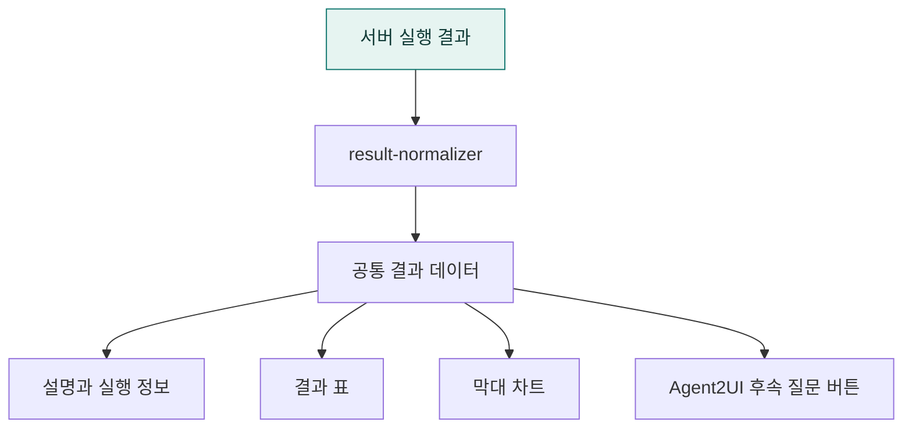

# `app/static/js/results` · 조회 결과 정규화와 표시

두 모드의 분석 결과를 공통 데이터 형태로 정리하고 설명·표·막대 차트로 렌더링합니다.

## 한눈에 보는 흐름

기존 주문 DB를 이용한 결과 화면입니다. 합성 데모 데이터와 조회 숫자는 다릅니다.

## 주요 파일

| 파일 | 역할 |
|---|---|
| [result-normalizer.js](result-normalizer.js) | 서버 실행 결과를 공통 컬럼·행·메타데이터 형태로 정규화. |
| [result-renderer.js](result-renderer.js) | 답변·표·막대 차트·결과 컴포넌트 표시. |

## 연결 흐름

result-normalizer.js로 응답을 정규화한 뒤 result-renderer.js가 DOM을 만듭니다. Agent2UI 결과의 후속 동작 버튼은 a2ui/follow-ups.js로 연결합니다.

## 하위 폴더 안내

| 폴더 | 역할 |
|---|---|
| [a2ui/](a2ui/README.md) | Agent2UI 결과의 후속 분석 동작 |

## 함께 읽기

- [상위 폴더 안내](../README.md)
- [앱 전체 구조](../../../README.md)
- [프로젝트 소개](../../../../README.md)
