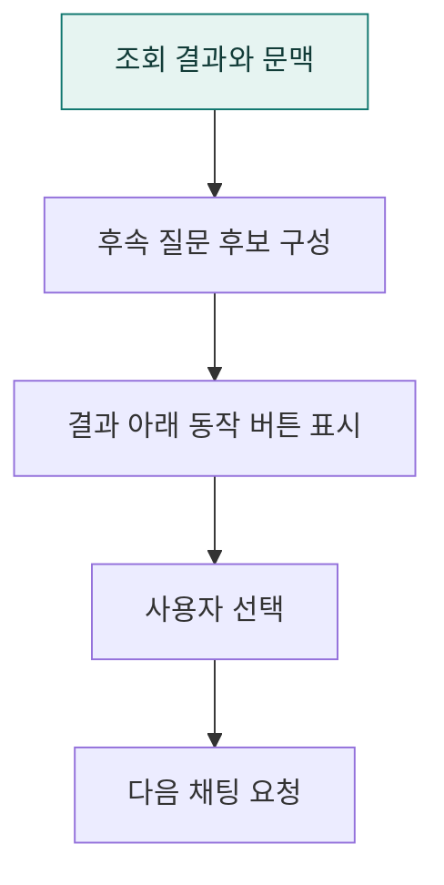

# `app/static/js/results/a2ui` · Agent2UI 결과의 후속 분석 동작

조회 결과에서 이어갈 수 있는 후속 질문과 동작 버튼을 구성합니다.

## 한눈에 보는 흐름

## 주요 파일

| 파일 | 역할 |
|---|---|
| [follow-ups.js](follow-ups.js) | Agent2UI 결과의 후속 질문 문구와 동작 버튼 구성. |

## 연결 흐름

follow-ups.js가 결과와 thread 문맥을 바탕으로 후속 프롬프트를 만들고 핸들러에 연결합니다. 다음 요청은 공통 채팅과 계획 검토 흐름으로 이어집니다.

## 함께 읽기

- [상위 폴더 안내](../README.md)
- [앱 전체 구조](../../../../README.md)
- [프로젝트 소개](../../../../../README.md)
