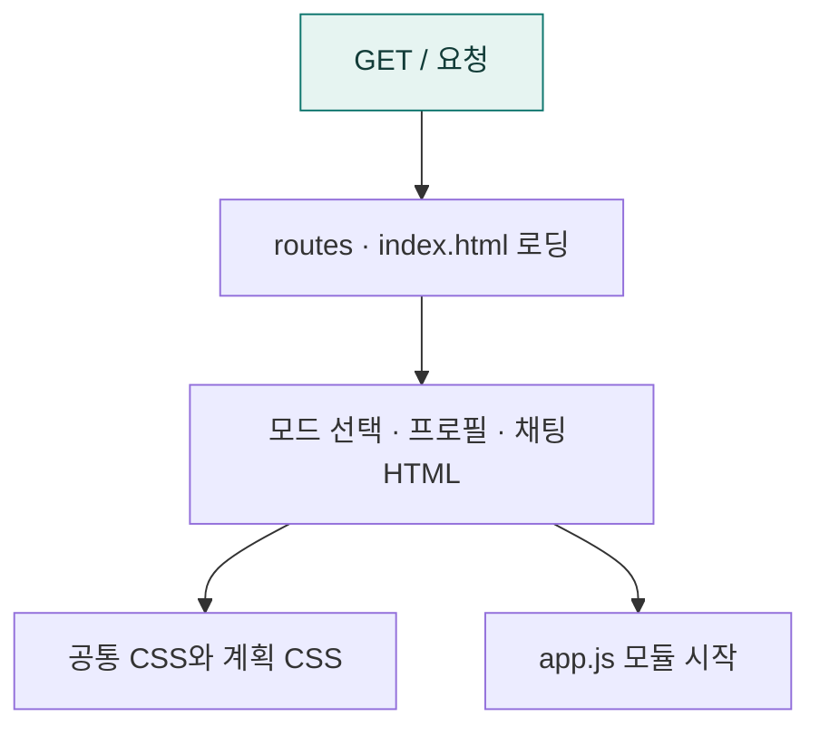

# `app/templates` · 웹 앱 HTML 셸

모드 선택·프로필 입력·채팅 영역의 기본 HTML과 정적 리소스 로딩을 정의합니다.

## 한눈에 보는 흐름

## 주요 파일

| 파일 | 역할 |
|---|---|
| [index.html](index.html) | 모드 선택·사용자 프로필·채팅 영역과 CSS·JS 모듈 로딩. |

## 연결 흐름

routes/web_ui.py가 index.html을 읽고 routes/api.py가 루트 경로에서 반환합니다. JavaScript는 static/js/app.js, 공통·계획 스타일은 static/의 CSS에서 로드합니다.

## 함께 읽기

- [앱 전체 구조](../README.md)
- [프로젝트 소개](../../README.md)
