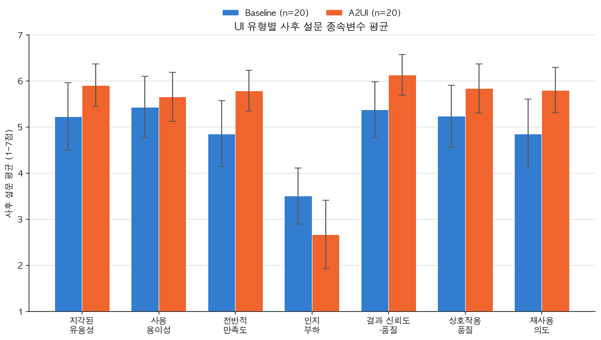
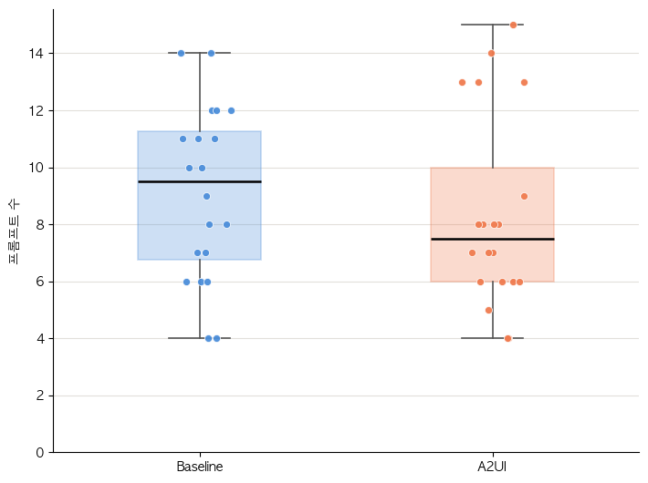

# A2UI 사용자실험 논문용 결과표

> 사용자 제공 Word 원본을 GitHub 열람용으로 변환한 보존본입니다. 수치·문구·절 번호는 원문을 따릅니다. [자료 안내와 확인 사항](README.md) · [Word 원본](originals/study-results.docx)

## 1. 참가자 구성 및 측정도구 검증

### 1.1 UI 유형과 AI 리터러시 수준별 참가자 분포

계산 과정

1) 각 참가자의 사전 AI 리터러시 6문항 점수를 평균하여 개인별 AI 리터러시 점수를 산출하였다.

2) 개인 평균이 6.0 미만이면 낮은 수준, 6.0 이상이면 높은 수준으로 분류하였다.

3) UI 유형(A2UI/Baseline)과 AI 리터러시 수준(낮음/높음)을 교차하여 각 조합의 인원 수를 세고, 행·열 합계를 계산하였다.

AI 리터러시 평균 = (6개 문항 점수의 합) / 6

표 1. UI 유형과 AI 리터러시 수준별 참가자 분포

| UI 유형 | 낮은 수준 n | 높은 수준 n | 전체 N |
| --- | --- | --- | --- |
| A2UI | 10 | 10 | 20 |
| Baseline | 10 | 10 | 20 |
| 전체 | 20 | 20 | 40 |

주. AI 리터러시는 사전 6문항 평균 6.0을 기준으로 구분하였다. 분석자료: 02·04·05번.

표를 통해 알 수 있는 점

1) 전체 표본은 A2UI 20명, Baseline 20명으로 UI 조건 자체는 동일한 크기이다.

2) 각 UI 조건에는 AI 리터러시가 낮은 참가자와 높은 참가자가 각각 10명씩 포함되어, 네 조건의 표본 수가 균형을 이루었다.

3) 이후 표 5에서는 UI 유형과 AI 리터러시 수준의 주효과 및 두 요인의 상호작용을 함께 검토하였다.

### 1.2 측정도구의 내적 일관성

계산 과정

1) 각 구성개념에 포함된 문항들을 한 묶음으로 만들었다. 예를 들어 지각된 유용성은 4문항, AI 리터러시는 6문항으로 구성된다.

2) 각 문항의 분산과 문항 합계점수의 분산을 이용하여 Cronbach’s α를 계산하였다. 문항들이 같은 개념을 비슷한 방향으로 측정할수록 α가 높아진다.

3) &lt;재사용 의도&gt;는 단일 문항이므로 문항 간 일관성을 계산할 수 없어 α를 산출하지 않았다.

Cronbach’s α = k/(k−1) × [1 − (문항별 분산의 합 / 문항 합계점수의 분산)]

표 2. 측정도구의 문항 수와 내적 일관성

| 측정변수 | 문항 수 | N | Cronbach’s α |
| --- | --- | --- | --- |
| AI 리터러시 (사전) | 6 | 40 | .911 |
| 지각된 유용성 (PU) | 4 | 40 | .960 |
| 사용 용이성 (PEU) | 3 | 40 | .828 |
| 전반적 만족도 | 3 | 40 | .892 |
| 인지부하 | 3 | 40 | .824 |
| 결과 신뢰도·품질 | 5 | 40 | .932 |
| 상호작용 품질 | 3 | 40 | .880 |
| 재사용 의도 | 1 | 40 | — |

주. 재사용 의도는 단일 문항이므로 α를 산출하지 않았다. AI 리터러시는 사전 측정, 나머지는 사후 측정이다. 분석자료: 01번.

표를 통해 알 수 있는 점

1) 다문항 척도의 Cronbach’s α는 .824~.960 범위로 나타났다. 즉, 같은 구성개념 안의 문항들이 서로 일관된 방향으로 응답되는 편이었다.

2) 특히 지각된 유용성(.960), 결과 신뢰도·품질(.932), AI 리터러시(.911)는 매우 높은 내적 일관성을 보였다.

3) 다문항 척도는 내적 일관성 측면의 근거를 제공하였다. 각 구성개념의 점수는 해당 문항의 평균으로 산출하였다. 다만 Cronbach’s α만으로 척도의 단일차원성이나 구성타당성이 확인되는 것은 아니다.

## 2. 사후설문 기술통계

### 2.1 UI 유형 및 AI 리터러시 수준별 사후설문 비교

계산 과정

1) 다문항 변수는 먼저 참가자별로 해당 문항의 평균을 구해 한 사람당 하나의 점수로 만들었다. 재사용 의도는 단일 문항 점수를 그대로 사용하였다.

2) 전체 40명에 대해 각 변수의 평균(M)과 표준편차(SD)를 계산하였다.

3) 같은 40명을 UI 유형(A2UI 20명, Baseline 20명)과 AI 리터러시 수준(낮음 20명, 높음 20명)으로 각각 나누어 집단별 평균과 표준편차를 계산하였다.

4) 표의 값은 M (SD) 형태로 제시하였다. 인지부하는 점수가 높을수록 부담이 크므로 다른 긍정적 지표와 해석 방향이 반대이다.

5) UI 유형과 AI 리터러시 수준은 서로 다른 분류 기준으로 같은 참가자 40명을 요약한 것이므로, 두 분류의 열을 서로 독립된 표본처럼 해석하지 않는다.

M = Σx / n,    SD = √[Σ(x−M)² / (n−1)]

표 3. UI 유형 및 AI 리터러시 수준별 사후설문 기술통계

| 측정변수 | 전체 · N = 40 M (SD) | UI 유형 · A2UI n = 20 M (SD) | UI 유형 · Baseline n = 20 M (SD) | AI 리터러시 수준 · 낮은 수준 n = 20 M (SD) | AI 리터러시 수준 · 높은 수준 n = 20 M (SD) |
| --- | --- | --- | --- | --- | --- |
| 지각된 유용성 (PU) | 5.51 (1.24) | 5.76 (0.96) | 5.25 (1.45) | 5.08 (1.27) | 5.94 (1.08) |
| 사용 용이성 (PEU) | 5.49 (1.18) | 5.58 (1.09) | 5.40 (1.29) | 5.25 (1.22) | 5.73 (1.12) |
| 전반적 만족도 | 5.51 (1.30) | 5.88 (0.90) | 5.13 (1.53) | 5.12 (1.46) | 5.90 (0.99) |
| 인지부하 | 3.36 (1.51) | 3.03 (1.66) | 3.68 (1.31) | 3.72 (1.49) | 3.00 (1.49) |
| 결과 신뢰도·품질 | 5.67 (1.08) | 6.05 (0.82) | 5.28 (1.20) | 5.25 (1.28) | 6.08 (0.65) |
| 상호작용 품질 | 5.43 (1.24) | 5.70 (1.10) | 5.17 (1.34) | 5.00 (1.38) | 5.87 (0.92) |
| 재사용 의도 | 5.42 (1.36) | 5.85 (0.93) | 5.00 (1.59) | 4.95 (1.47) | 5.90 (1.07) |

주. 값은 M (SD)이며 7점 척도이다. 전체 열은 N=40, UI 유형과 AI 리터러시 수준의 각 하위집단은 n=20이다. 인지부하는 점수가 높을수록 부담이 크다. UI 유형과 AI 리터러시 수준은 동일한 참가자 40명을 서로 다른 기준으로 나눈 결과이다. 분석자료: 02번.

표를 통해 알 수 있는 점

1) UI 유형을 보면 A2UI는 지각된 유용성, 사용 용이성, 전반적 만족도, 결과 신뢰도·품질, 상호작용 품질, 재사용 의도에서 Baseline보다 평균이 높았고, 인지부하는 더 낮았다. 즉 단순 평균의 방향은 전반적으로 A2UI에 유리하다.

2) 차이가 비교적 크게 나타난 항목은 재사용 의도(+0.85점), 전반적 만족도(+0.75점), 인지부하(−0.65점), 결과 신뢰도·품질(+0.77점)이다. 반면 사용 용이성 차이는 +0.18점으로 상대적으로 작다.

3) AI 리터러시 수준을 보면 높은 수준 집단은 모든 긍정적 지표에서 낮은 수준 집단보다 평균이 높고, 인지부하는 0.72점 낮았다. 특히 재사용 의도(+0.95점)와 지각된 유용성(+0.86점)에서 차이가 크게 나타났다.

4) 전체 평균에서는 긍정적 지표가 모두 7점 척도의 중립점인 4점보다 높고, 인지부하는 3.36점으로 중립점보다 낮다. 따라서 참가자들은 전반적으로 시스템을 긍정적으로 평가한 편이다.

5) 다만 이 표는 평균과 표준편차를 보여주는 기술통계이다. A2UI와 Baseline의 차이 또는 AI 리터러시 수준의 차이가 통계적으로 유의한지는 표 5의 이원분산분석 결과를 함께 확인해야 한다.

그림 1. UI 유형별 사후설문 7개 종속변수 평균 주. 원문 그림을 유지하였다. 막대 높이와 오차막대의 정의는 표 3 및 그림 생성 자료와 대조해야 한다.

## 3. 사후설문 변수 간 상관관계

계산 과정

1) 7개 사후설문 변수에 대해 전체 40명의 참가자 점수를 사용하였다.

2) 두 변수의 공분산을 각 변수의 표준편차로 나누어 Pearson 상관계수 r을 계산하였다. r이 +1에 가까울수록 함께 증가하고, −1에 가까울수록 한 변수가 증가할 때 다른 변수가 감소하는 관계가 강하다.

3) 각 상관계수에 대해 양측검정 p값을 계산했으며, 표에는 \*\* p&lt;.05, \* .05≤p&lt;.10로 표시하였다.

r = Cov(X,Y) / (SDₓ × SDᵧ)

표 4. 사후설문 변수의 기술통계와 Pearson 상관계수

| 변수 | M | SD | 1 | 2 | 3 | 4 | 5 | 6 | 7 |
| --- | --- | --- | --- | --- | --- | --- | --- | --- | --- |
| 1. PU | 5.51 | 1.24 | — |  |  |  |  |  |  |
| 2. PEU | 5.49 | 1.18 | .76\*\* | — |  |  |  |  |  |
| 3. SAT | 5.51 | 1.30 | .80\*\* | .62\*\* | — |  |  |  |  |
| 4. CL | 3.36 | 1.51 | -.35\*\* | -.50\*\* | -.17 | — |  |  |  |
| 5. TQ | 5.67 | 1.08 | .76\*\* | .43\*\* | .73\*\* | -.25 | — |  |  |
| 6. IQ | 5.43 | 1.24 | .83\*\* | .64\*\* | .79\*\* | -.37\*\* | .86\*\* | — |  |
| 7. RI | 5.42 | 1.36 | .72\*\* | .60\*\* | .71\*\* | -.37\*\* | .76\*\* | .69\*\* | — |

주. N=40. PU=지각된 유용성, PEU=사용 용이성, SAT=전반적 만족도, CL=인지부하, TQ=결과 신뢰도·품질, IQ=상호작용 품질, RI=재사용 의도. \*\* p&lt;.05, \* .05≤p&lt;.10; 양측검정, 다중비교 보정 전. 분석자료: 03번.

표를 통해 알 수 있는 점

1) 긍정적 사용자 경험 변수들은 서로 정적 상관을 보였다. 특히 PU–SAT(r=.80), TQ–IQ(r=.86), SAT–RI(r=.71)에서 높은 상관이 나타났다.

2) 인지부하는 지각된 유용성, 사용 용이성, 상호작용 품질 및 재사용 의도와 유의한 음의 상관을 보였다. 전반적 만족도(r=−.17) 및 결과 신뢰도·품질(r≈−.25, p=.118)과의 상관은 통계적으로 유의하지 않았다.

3) 인지부하가 높을수록 일부 사용자 평가가 낮은 방향의 관련성이 관찰되었다. 다만 상관관계는 인과관계를 의미하지 않으며, 이 결과는 다중검정 보정 전의 탐색적 결과이다.

## 4. UI 유형 × AI 리터러시 이원분산분석

계산 과정

1) 각 종속변수에 대해 UI 유형(A2UI/Baseline)과 AI 리터러시 수준(낮음/높음)을 동시에 투입한 2×2 이원분산분석을 실시하였다. TQ와 RI는 Box–Cox 변환 후 ANOVA 결과이며, 나머지 다섯 변수는 원자료 ANOVA 결과이다.

2) 네 조건의 표본 수는 각각 10명으로 동일하였다. 분석에는 UI 유형, AI 리터러시 수준 및 두 요인의 상호작용을 포함하고, Type III 제곱합을 사용하였다.

3) Factor는 UI 유형, AI 리터러시, UI×AI 리터러시의 세 효과이다. 각 효과는 2수준 요인에서 나온 1 자유도 효과이므로 NumDF=1이다.

4) 오차 자유도는 N=40에서 절편, UI, AI 리터러시, 상호작용의 4개 모수를 제외하여 DenDF=40−4=36이다. 따라서 모든 효과는 F(1,36)으로 검정하였다.

5) 각 효과의 평균제곱을 오차 평균제곱으로 나누어 F값을 구하고, F(1,36) 분포에서 p값을 계산하였다.

Y = β₀ + β₁(UI) + β₂(AI 리터러시) + β₃(UI×AI 리터러시) + ε    /    F = MS효과 / MS오차

계산 예시. 표 5의 PU에 대한 AI 리터러시 주효과는 F(1, 36)=5.325이다. 이 F값을 F분포에 대입하면 p≈.02688로, 소수 셋째 자리에서 p=.027로 표시된다. F값은 효과 평균제곱을 오차 평균제곱으로 나눈 값이다.

표 5. UI 유형과 AI 리터러시 수준에 따른 사후설문 이원분산분석(Type III)

| Factor | NumDF | DenDF | PU · F | PU · p | PEU · F | PEU · p | SAT · F | SAT · p | CL · F | CL · p | TQ · F | TQ · p | IQ · F | IQ · p | RI · F | RI · p |
| --- | --- | --- | --- | --- | --- | --- | --- | --- | --- | --- | --- | --- | --- | --- | --- | --- |
| UI 유형 | 1 | 36 | 1.880 | .179 | 0.234 | .632 | 4.122 | 0.049\*\* | 2.141 | .152 | 6.771 | .013\*\* | 2.100 | .156 | 3.664 | .064\* |
| AI 리터러시 | 1 | 36 | 5.325 | .027\*\* | 1.625 | .211 | 4.497 | .041\*\* | 2.603 | .115 | 6.589 | .015\*\* | 5.546 | .024\*\* | 5.602 | .023\*\* |
| UI 유형 × AI 리터러시 | 1 | 36 | 0.055 | .816 | 0.017 | .896 | 3.422 | .073\* | 4.574 | .039\*\* | 0.013 | .909 | 0.525 | .473 | 0.625 | .434 |

주. N=40. NumDF=효과 자유도, DenDF=오차 자유도. 모든 효과는 F(1, 36)으로 검정하였다. PU=지각된 유용성, PEU=사용 용이성, SAT=전반적 만족도, CL=인지부하, TQ=결과 신뢰도·품질, IQ=상호작용 품질, RI=재사용 의도. \*\* p&lt;.05, \* .05≤p&lt;.10. p값은 다중검정 보정 전 값이다. TQ와 RI는 Box–Cox 변환 후 ANOVA 결과이며, 나머지 다섯 변수는 원자료 ANOVA 결과이다.

표를 통해 알 수 있는 점

1) UI 유형의 주효과는 전반적 만족도(SAT)와 결과 신뢰도·품질(TQ)에서 유의하였다. SAT는 F(1, 36)=4.122, TQ는 F(1, 36)=6.771이었다. 두 변수의 전체 평균은 A2UI가 Baseline보다 높았다. 나머지 다섯 변수의 UI 주효과는 .05 기준에서 유의하지 않았다.

2) AI 리터러시 수준의 주효과는 지각된 유용성(F=5.325, p=.027), 전반적 만족도(F=4.497, p=.041), 결과 신뢰도·품질(F=6.589, p=.015), 상호작용 품질(F=5.546, p=.024), 재사용 의도(F=5.602, p=.023)에서 유의하였다. 해당 변수의 전체 평균은 높은 수준 집단에서 더 높았다.

3) UI 유형×AI 리터러시 수준 상호작용은 인지부하에서 유의하였다(F=4.574, p=.039). 따라서 인지부하는 네 조건의 평균과 단순효과를 함께 검토해야 한다. 현재의 주변평균만으로 어느 AI 리터러시 집단에서 UI 차이가 나타났는지 판단할 수 없다. 나머지 6개 변수의 상호작용은 유의하지 않았다.

4) 위 유의성 판단은 다중검정 보정 전 결과이다. 효과크기 및 신뢰구간을 함께 검토해야 하며, 비유의한 결과가 두 조건의 동등성을 입증하는 것은 아니다.

5) 이 문서에는 잔차 정규성 및 등분산성 검정 결과가 제시되어 있지 않다. 최종 보고 전 분석 출력에서 가정 검증 결과와 모형 설정을 확인하고, 필요한 경우 근거에 따라 강건성 분석을 별도로 보고해야 한다.

## 5. 행동 로그 분석

### 5.1 참가자별 두 과제 합산 수행시간과 프롬프트 수

계산 과정

1) 참가자마다 Task 1과 Task 2의 로그 기반 수행시간을 각각 산출한 뒤 합산하였다. 각 과제의 시간 범위는 스레드의 첫 요청부터 마지막 로그 시각까지이며, 스레드 사이 휴지시간은 제외하였다. 이 값은 로그에 기록된 수행 구간의 길이로 해석하며, 정답 도달까지의 완료시간과 일치하는지는 별도 확인이 필요하다.

2) 프롬프트 수는 두 과제의 사용자 요청 수를 합산하였다. A2UI의 계획 생성과 실행 확인(plan→confirm)은 한 번의 요청으로 집계하였으며, 확인 동작에 해당하는 confirmed_execution은 별도 프롬프트로 세지 않았다. 따라서 프롬프트 수는 전체 클릭 수나 전체 상호작용 횟수를 의미하지 않는다.

3) 합산된 참가자 단위 값을 UI 유형과 AI 리터러시 수준으로 각각 묶어 평균과 표준편차를 계산하였다.

참가자 총 수행시간 = T1 수행시간 + T2 수행시간    /    참가자 총 프롬프트 수 = T1 + T2 사용자 프롬프트 수

표 6. 참가자별 두 과제 합산 수행시간과 프롬프트 수

| 집단 | n | 수행시간(분) M (SD) | 프롬프트 수(회) M (SD) |
| --- | --- | --- | --- |
| A2UI | 20 | 11.21 (7.19) | 8.35 (3.39) |
| Baseline | 20 | 11.46 (9.53) | 9.10 (3.06) |
| AI 리터러시 낮음 | 20 | 13.04 (9.10) | 9.30 (3.18) |
| AI 리터러시 높음 | 20 | 9.63 (7.32) | 8.15 (3.22) |

주. 동일 참가자의 Task 1과 Task 2를 합산한 값이다. A2UI confirmed_execution은 프롬프트 수에서 제외하였다. 분석자료: 05번.

표를 통해 알 수 있는 점

1) UI 기준으로 수행시간은 A2UI 11.21분, Baseline 11.46분으로 거의 비슷했다. 프롬프트 수는 A2UI 8.35회, Baseline 9.10회로 A2UI가 평균 0.75회 적었다.

2) AI 리터러시가 높은 집단은 낮은 집단보다 수행시간이 9.63분 vs 13.04분으로 짧고, 프롬프트 수도 8.15회 vs 9.30회로 적었다.

3) 그러나 이 표는 기술통계이다. UI나 AI 리터러시 수준 차이가 통계적으로 유의한지는 표 8의 3요인 F 검정 결과를 함께 확인해야 한다.

### 5.2 UI 유형별 프롬프트 수

계산 과정

1) 각 참가자에 대해 Task 1과 Task 2에서 실제 사용자가 입력한 프롬프트 수를 합산하였다.

2) A2UI의 confirmed_execution 및 기존 로그 정제 기준에 따라 제외된 행은 프롬프트 수에 포함하지 않았다. 재현 가능한 보고를 위해 제외 사유별 기준과 제외 건수를 분석 기록에 명시해야 한다.

3) UI 유형별로 평균, 표준편차, 중앙값, 최솟값, 최댓값을 계산하여 분포의 중심과 범위를 함께 확인하였다.

평균 = Σ프롬프트 수 / n    /    중앙값 = 정렬했을 때 가운데 위치한 값

표 7. UI 유형별 프롬프트 수 기술통계 (전체, N = 40)

| UI 유형 | N | M | SD | Median | Min | Max |
| --- | --- | --- | --- | --- | --- | --- |
| A2UI | 20 | 8.35 | 3.39 | 7.5 | 4 | 15 |
| Baseline | 20 | 9.10 | 3.06 | 9.5 | 4 | 14 |

주. 참가자별 두 과제 프롬프트 수를 합산하였다. 분석자료: 05번 3-1.

표를 통해 알 수 있는 점

1) A2UI의 평균(8.35)과 중앙값(7.5)은 Baseline의 평균(9.10)과 중앙값(9.5)보다 낮아, A2UI가 더 적은 프롬프트로 진행된 방향은 확인된다.

2) 두 집단의 최솟값과 최댓값으로 나타낸 범위가 겹쳤다. 집단 평균만으로 UI에 따른 차이를 확정할 수 없으며, 추론통계 결과를 함께 확인해야 한다.

3) 표 8의 프롬프트 수에 대한 UI 주효과는 F(1, 39)=0.254, p=.617로 유의하지 않았다. 따라서 “A2UI가 프롬프트 수를 유의하게 줄였다”라고 결론내리지 않는다.

그림 2. UI 조건별 프롬프트 수 분포

주. 참가자별 두 과제 프롬프트 수 합산 분포이다. 점은 개별 참가자 값을 나타내며 A2UI confirmed_execution은 제외하였다. 분석자료: 05번.

### 5.3 행동지표에 대한 3요인 F 검정

계산 과정

1) 40명이 각각 두 과제를 수행했으므로 총 80개의 과제 수준 관측값을 사용하였다. 같은 참가자에게서 나온 두 관측값은 서로 독립이 아니므로 참가자 ID로 군집화한 강건 표준오차를 적용하였다.

2) 모형에는 UI, AI 리터러시 수준, Task와 이들의 모든 2원 및 3원 상호작용을 포함하였다. 과제 순서는 모형에서 제외하였다.

3) 각 효과는 소표본 보정을 적용한 F 검정으로 평가하였다. 각 효과의 분자 자유도는 1, 분모 자유도는 39이며 p&lt;.05를 유의성 기준으로 보았다.

분석식: 프롬프트 수(또는 수행시간) ~ UI × AI 리터러시 수준 × Task

표 8. 행동지표에 대한 3요인 F 검정 결과

| 효과 | NumDF | DenDF | 수행시간 · F | 수행시간 · p | 프롬프트 수 · F | 프롬프트 수 · p |
| --- | --- | --- | --- | --- | --- | --- |
| UI | 1 | 39 | 0.035 | .852 | 0.254 | .617 |
| AI 리터러시 수준 | 1 | 39 | 2.128 | .153 | 0.940 | .338 |
| Task | 1 | 39 | 32.246 | &lt;.001 | 19.361 | &lt;.001 |
| UI × AI 리터러시 수준 | 1 | 39 | 0.608 | .440 | 0.663 | .420 |
| UI × Task | 1 | 39 | 1.986 | .167 | 1.115 | .297 |
| AI 리터러시 수준 × Task | 1 | 39 | 0.398 | .532 | 0.627 | .433 |
| UI × AI 리터러시 수준 × Task | 1 | 39 | 1.416 | .241 | 2.238 | .143 |

주. 40명×2개 과제의 반복측정 자료. 참가자 ID로 군집화한 강건 표준오차와 소표본 보정 F 검정을 사용하였다. NumDF=효과 자유도, DenDF=분모 자유도. 모든 효과는 F(1, 39)로 검정하였다. 과제 순서는 모형에서 제외하였다. p값은 다중검정 보정 전. 분석자료: 05번.

표를 통해 알 수 있는 점

1) 가장 분명한 결과는 Task의 주효과이다. 수행시간은 F(1, 39)=32.246, p&lt;.001, 프롬프트 수는 F(1, 39)=19.361, p&lt;.001로 두 지표 모두 유의했다.

2) UI 주효과는 수행시간 p=.852, 프롬프트 수 p=.617로 유의하지 않았다. 즉 행동 효율성 측면에서 A2UI가 Baseline보다 확실히 빠르거나 프롬프트가 적다고 입증되지는 않았다.

3) AI 리터러시 수준 주효과도 수행시간 p=.153, 프롬프트 수 p=.338로 유의하지 않았고, UI×AI 리터러시 수준, UI×Task, AI 리터러시 수준×Task 상호작용도 모두 .05 기준에서 유의하지 않았다.

4) UI×AI 리터러시 수준×Task의 3원 상호작용은 수행시간 p=.241, 프롬프트 수 p=.143으로 유의하지 않았다. 따라서 과제에 따른 차이가 UI와 AI 리터러시 수준의 조합에 따라 달라진다는 통계적 근거는 확인되지 않았다.

### 5.4 UI 유형별 두 과제 최종 완료 여부

계산 과정

1) 각 참가자가 Task 1과 Task 2를 모두 최종 완료했는지를 이분형으로 분류하였다.

2) UI별 완료 인원과 미완료 인원을 세고, 각 UI의 20명을 분모로 완료율과 미완료율을 계산하였다.

3) A2UI와 Baseline의 완료 여부가 서로 다른지 2×2 분할표에 Fisher 정확검정을 적용하였다.

완료율(%) = 두 과제 모두 완료한 인원 / 해당 UI 전체 인원 × 100

표 9. UI 유형별 두 과제 최종 완료 여부

| UI 유형 | N | 두 과제 모두 완료 n (%) | 한 과제 이상 미완료 n (%) |
| --- | --- | --- | --- |
| A2UI | 20 | 16 (80.0) | 4 (20.0) |
| Baseline | 20 | 17 (85.0) | 3 (15.0) |
| 전체 | 40 | 33 (82.5) | 7 (17.5) |

주. 30분 제한을 적용하지 않은 최종 재분류 기준이며 시스템 오류 및 후속 완료 사례 재분류가 반영되었다. Fisher 정확검정 p=1.000. 분석자료: 05번.

표를 통해 알 수 있는 점

1) 최종 완료율은 A2UI 80.0%, Baseline 85.0%로, Baseline이 5%p 높았다. 완료 인원은 각각 16명과 17명으로 1명 차이였다.

2) Fisher 정확검정 p=1.000이므로 현재 자료에서 UI 유형에 따른 완료율 차이는 통계적으로 확인되지 않았다.

3) 따라서 “A2UI가 성공률을 향상시켰다” 또는 “Baseline이 더 우수했다”고 결론내리기보다, 두 UI의 완료율 차이가 확인되지 않았다고 보고하는 것이 맞다.

4) 이 완료율은 30분 제한을 적용하지 않은 최종 재분류 결과이다. 제한시간 내 완료율과 구분하여 보고하고, 완료의 판정 기준 및 시스템 오류·후속 완료 사례의 재분류 기준을 명시해야 한다.

## 6. 종합 해석

본 연구에서 A2UI는 Baseline에 비해 긍정적 사용자 평가 변수의 평균이 높고 인지부하의 평균이 낮았다. 표 5의 다중검정 보정 전 결과에서 UI 유형의 주효과는 전반적 만족도(SAT)와 결과 신뢰도·품질(TQ)에서 유의하였다. AI 리터러시 수준의 주효과는 지각된 유용성, 전반적 만족도, 결과 신뢰도·품질, 상호작용 품질 및 재사용 의도에서 유의하였다. 인지부하에서는 UI 유형과 AI 리터러시 수준의 상호작용이 나타나 네 조건의 평균과 단순효과에 대한 추가 검토가 필요하다. 행동지표에서는 과제 유형의 주효과가 수행시간과 프롬프트 수 모두에서 유의하였으나, UI 주효과는 유의하지 않았다. 최종 완료율에서도 UI 간 차이는 통계적으로 확인되지 않았다. 이 결과는 일부 주관적 평가에서 UI와 관련된 차이가 관찰되었지만, 수행시간·프롬프트 수·최종 완료율의 개선까지 일관되게 확인된 것은 아님을 보여준다.

해석 범위. 비유의한 결과를 효과가 없다는 증거 또는 두 UI가 동등하다는 증거로 해석하지 않는다. AI 리터러시와 주관적 평가의 관련성을 인과관계로 단정하지 않으며, 한 효과의 유의성과 다른 효과의 비유의성만으로 효과크기의 우열을 판단하지 않는다. 추가 분석은 목적과 근거를 명시하고 기존 분석과 구분하여 보고한다.

자료 기준: 01 측정도구 신뢰도, 02 기술통계, 03 Pearson 상관분석, 04 이원분산분석, 05 로그분석

## 7. 최종 보고 전 확인 사항

1) AI 리터러시 분류: 6.0을 기준으로 나눈 근거와 기준 선정 시점을 명시한다. 상대적 분류인지 절대적 수준 판단인지 구분하고, 연속 점수를 이분화한 데 따른 정보 손실을 한계로 설명한다.

2) 측정도구: 척도의 출처, 구성개념별 문항 배정, 역문항 처리 및 결측값 처리 기준을 확인한다. AI 리터러시 수준과 별도로 측정한 숙련도가 있다면 두 변수를 구분하여 기술한다.

3) 사후설문 분석: 표 5의 수치와 원출력을 대조한다. 효과 코딩, 잔차 정규성·등분산성, 효과크기 및 신뢰구간을 확인한다. 다중검정의 범위와 보정 또는 탐색적 해석 방침을 명시한다.

4) 인지부하 상호작용: 네 조건의 평균과 표준편차를 제시하고, 단순효과 검정 및 필요한 다중비교 보정을 통해 상호작용의 방향을 검토한다.

5) 행동 로그: 첫 요청과 마지막 로그의 이벤트 정의, 미완료 참가자의 시간 처리, 정제 제외 사유 및 건수를 명시한다. 표 8의 군집 강건 표준오차와 소표본 보정 방식은 실제 코드와 대조하고, 과제 순서 제외의 근거를 설명한다.

6) 완료 판정: 두 과제 완료의 구체적 기준, 판정 절차, 시스템 오류와 후속 수행의 처리 기준을 명시한다. 제한시간 내 완료와 제한시간을 적용하지 않은 최종 완료를 구분한다.

7) 그림 검증: 그림 1의 막대 높이와 오차막대가 표 3의 최신 수치 및 통계량과 일치하는지 그림 생성 자료에서 확인한다. 그림 2의 개별 점과 분포 요약도 표 7 및 정제된 참가자별 로그와 대조한다.
