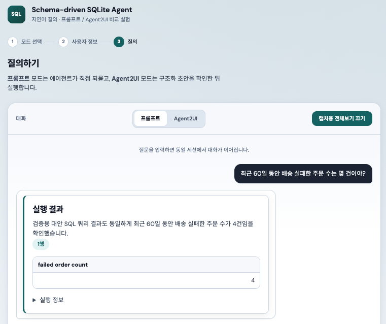
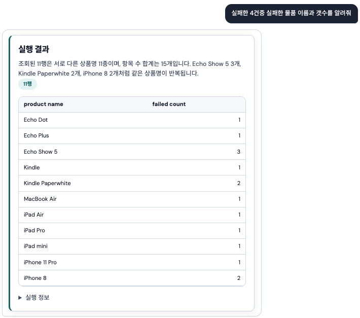
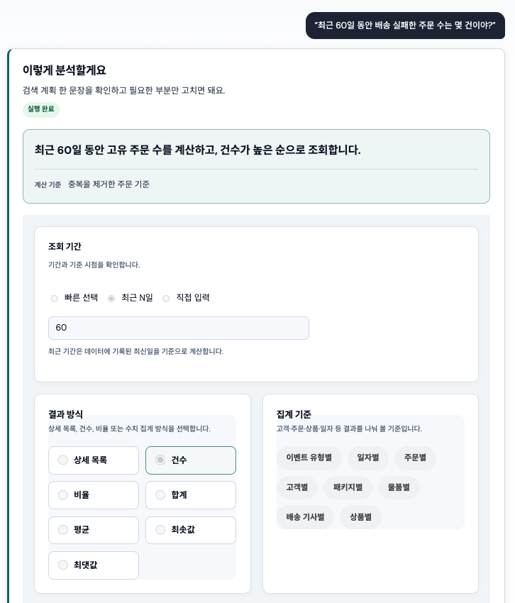
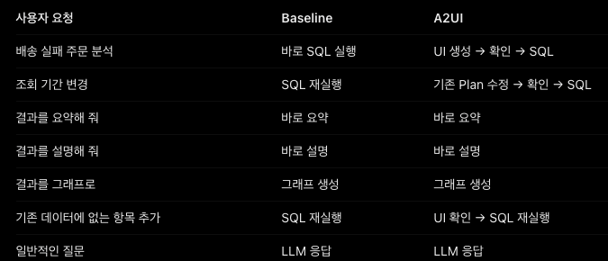
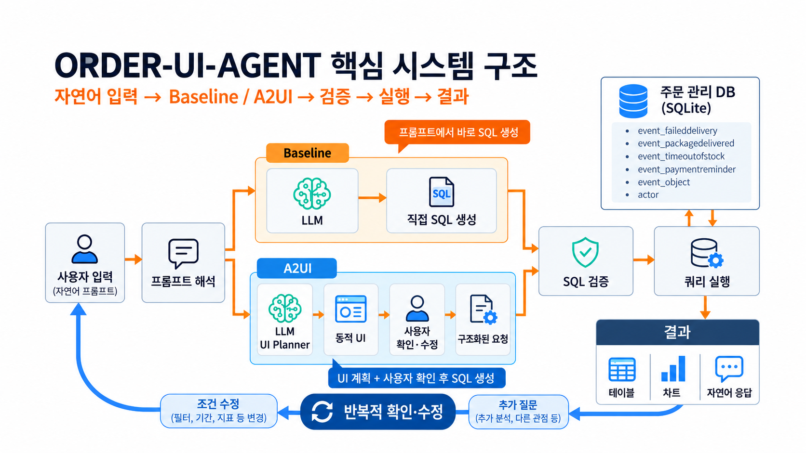
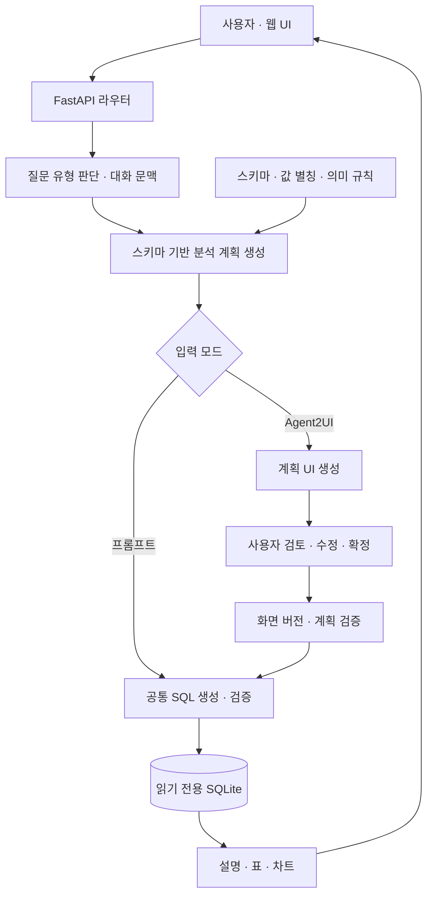
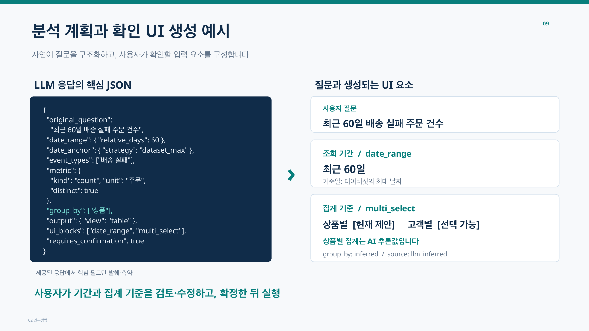
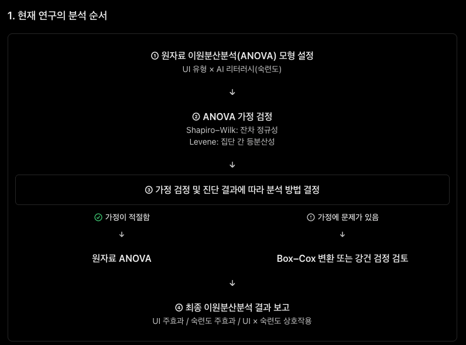

# 시스템 상세 설명과 화면 갤러리

자연어 질문을 **편집 가능한 분석 계획 UI**로 변환하고, 사용자가 확정한 계획에 따라 SQLite 데이터를 조회하는 웹 시스템입니다.

SQL을 직접 작성하지 않아도 기간·필터·집계 기준을 확인하고 수정할 수 있습니다. 같은 분석 요청을 즉시 실행하는 **프롬프트 모드(Baseline)**와, 실행 전에 계획을 검토하는 **Agent2UI 모드**를 제공합니다. 패키지 이름은 `order-ui-agent`입니다.

## 개발 배경

자연어 데이터 조회에서는 AI가 사용자의 의도를 어떻게 해석했는지 결과만으로 파악하기 어렵습니다. 기간이나 집계 단위를 다르게 해석하면 사용자는 질문을 다시 작성해야 합니다.

이 시스템은 AI가 해석한 분석 조건을 입력 필드와 선택지로 보여줍니다. 사용자는 SQL 대신 분석 계획을 수정하고, 확정한 내용과 생성 SQL의 일치 여부를 검증한 뒤 결과를 확인합니다.

## 두 가지 사용 방식

| 구분 | 프롬프트 모드 | Agent2UI 모드 |
|---|---|---|
| 입력 | 자연어 질문 | 자연어 질문 |
| 분석 계획 | 내부에서 생성 | 편집 가능한 UI로 표시 |
| 조건 수정 | 후속 질문으로 요청 | 계획 UI 수정 또는 자연어 조건 추가 |
| 실행 시점 | 계획 생성 후 즉시 실행 | 사용자가 계획을 확정한 뒤 실행 |
| 결과 | 설명·표·차트 | 설명·표·차트 |

두 모드는 계획 생성기와 SQL 실행 계층, 결과 표시 체계를 공유합니다. 주요 차이는 실행 전 사용자 검토 단계입니다.

## 사용 화면

### 프롬프트 모드 · 질문과 조회 결과

자연어 질문을 입력하면 조회 결과를 설명과 표로 표시합니다. 아래 예시는 최근 60일 동안의 배송 실패 주문 건수를 조회한 화면입니다.



### 후속 질문 · 이전 결과의 상세 조회

이전 질문에 이어 상품 이름과 수량을 요청하고, 상세 결과를 표로 확인하는 예시입니다. 주문 건수와 상품 수량은 서로 다른 집계 단위입니다.



### Agent2UI 모드 · 분석 계획 확인과 수정

질문을 해석한 계획을 문장과 입력 UI로 표시합니다. 사용자는 조회 기간, 결과 방식, 집계 기준 등을 검토하고 수정할 수 있습니다. 아래 캡처는 계획 화면의 일부이며, 화면에 표시된 실행 완료 상태를 포함합니다.



### 요청별 처리 흐름 비교

분석 실행, 기간 변경, 요약, 설명, 그래프 요청 등에서 두 방식이 어떤 경로로 처리되는지 정리한 자료입니다. 이미지의 A2UI는 이 프로젝트의 Agent2UI 모드를 뜻합니다.



## 핵심 기능

### 자연어 질문과 스키마 탐색

실제 SQLite 테이블과 컬럼을 탐색하고, 질문과 관련된 스키마와 관계를 이용해 분석 계획과 SQL을 생성합니다. 스키마 설명·값 별칭·분석 의미 규칙을 함께 활용합니다.

### 분석 계획 검토와 수정

기간, 대상 조건, 지표, 그룹 기준, 정렬, 결과 개수, 출력 형식을 구조화합니다. Agent2UI에서는 사용자가 입력 필드와 선택지로 계획을 수정하거나 자연어로 추가 조건을 요청할 수 있습니다. 필수 조건 누락과 허용되지 않은 편집을 검사하며, 화면 ID와 revision을 비교해 오래된 계획의 실행을 막습니다.

### 확정 계획과 SQL 검증

사용자가 확정한 계획을 실행 기준으로 사용합니다. SQL 구문 트리(AST)를 분석해 지표·필터·그룹·정렬·결과 제한 등 계획과의 일치 여부를 검사합니다. 스키마 확인과 SQL 검사 도구를 거친 쿼리만 실행하도록 제어합니다.

### 읽기 전용 데이터 조회

조회 DB를 SQLite 읽기 전용 연결로 열고, 허용된 단일 조회문만 실행합니다. SQL 검사와 SQLite authorizer를 함께 사용해 데이터 변경 작업을 차단합니다. 상대 기간은 데이터셋의 최신 날짜를 기준으로 해석합니다.

### 결과 표시와 연속 대화

조회 결과를 자연어 설명·표·막대 차트로 표시합니다. 실행 SQL과 처리 정보도 확인할 수 있습니다. 대화별 결과 문맥을 유지해 후속 질문을 처리하고, 저장된 결과를 요약할 수 있습니다.

### 실행 상태 관리

요청 취소와 시간 제한, 계획 검증 실패, revision 충돌 등을 처리합니다. 사용자·관리자 화면과 비교 실험 운영 코드도 포함하며, 참가자 자료와 수집 로그는 공개 배포에서 제외합니다.

## 시스템 구조

발표 자료의 구조도는 자연어 입력에서 모드별 처리, SQL 검증·실행, 결과 표시와 후속 질문까지의 흐름을 보여줍니다. 그림의 Baseline 경로는 사용자 검토가 없는 즉시 실행을 요약한 것으로, 현재 구현에서는 Baseline도 내부 분석 계획을 생성하고 공통 SQL 실행 계층을 사용합니다.



<details>
<summary>코드 계층별 상세 처리 흐름</summary>



- **계획 계층:** 질문·스키마·대화 문맥을 구조화된 계획과 UI 정의로 변환합니다.
- **실행 계층:** 계획을 기준으로 SQL을 생성하고 안전성과 의미를 검증해 실행합니다.
- **UI 계층:** 서버가 만든 화면 정의를 입력 컴포넌트와 결과 화면으로 렌더링합니다.
- **상태 계층:** 대화 결과, 계획 화면 버전, 실행 상태를 관리합니다. 조회용 DB와 런타임 상태 DB를 구분합니다.

</details>

## 분석 계획에서 확인 UI로

LLM이 생성한 구조화된 계획에서 기간, 기준일, 지표, 집계 기준 등을 추출하고, 해당 조건을 검토할 입력 UI를 구성합니다. 아래 발표 예시는 AI가 추론한 상품별 집계를 사용자가 확인·수정하는 방식을 보여줍니다. JSON은 설명을 위해 핵심 필드만 축약한 예시이며, 현재 API의 전체 스키마는 코드의 계획 모델을 참고하세요.



두 이미지는 [발표 자료](https://docs.google.com/presentation/d/1XerZx9VrFKOlFERvFDZslF--kM_b6DQY/edit)의 9번째 슬라이드(UI 생성 예시)와 10번째 슬라이드(시스템 구조도)에서 가져왔습니다. 구조도는 포함된 원본 이미지를 추출하고, UI 생성 예시는 슬라이드를 이미지로 변환했습니다.

## 기술 구성

| 영역 | 기술 |
|---|---|
| 백엔드 | Python 3.13+, FastAPI, Pydantic, Uvicorn |
| 모델 연결 | LangChain OpenAI 연동, 설정을 통한 모델 선택 |
| SQL 처리 | SQLite, SQLGlot |
| 프론트엔드 | HTML, CSS, JavaScript ES Modules |
| 의존성·검증 | uv, pytest, GitHub Actions |

## 프로젝트 구성

```text
app/
  routes/       # HTTP API와 입력 검증
  chat/         # 질문 분기와 대화 문맥
  planning/     # 분석 계획·편집 UI 생성과 검증
  execution/    # SQL 생성·계획 계약·안전성·실행
  a2ui/         # 계획·결과를 화면 정의로 변환
  runtime/      # 실행 취소·상태·화면 버전 저장
  data/         # SQLite 경로와 연결
  core/         # 모델 설정과 시작 점검
  static/       # 프론트엔드와 UI 렌더러
  templates/    # 기본 HTML
  experiment/   # 비교 실험 운영 코드와 과제 설정
  eval/         # 정답 SQL 기반 평가 코드
Data/
  docs/         # 주문 도메인 스키마·별칭·의미 규칙
  migrations/   # 주문 도메인 분석 뷰 SQL
docs/images/    # 시스템 사용 화면과 설명 이미지
scripts/        # 공개용 소스 압축파일 생성
tests/         # 격리된 SQLite 기반 실행 검증
```

세부 책임과 처리 경로는 [백엔드 구조](../app/README.md), [API 구조](../app/routes/README.md), [프론트엔드 구조](../app/static/README.md)를 참고하세요.

## 실행과 검증

[설치·합성 데이터 데모·문제 해결](getting-started.md)을 참고하세요.

## 연구 평가 절차

시스템의 두 UI 방식을 비교하기 위한 연구 분석 절차입니다. UI 유형과 AI 리터러시(숙련도)를 요인으로 설정하고, 가정 검정과 진단에 따라 분석 방법을 결정하는 흐름을 보여줍니다. 이 이미지는 평가 절차를 설명하며, 통계 결과나 성능 향상을 입증하는 자료는 아닙니다. 참가자별 원자료는 공개 소스에 포함하지 않습니다.



## 공개용 소스 만들기

```bash
python3 scripts/export_public.py
```

`dist/order-ui-agent-public.zip`에 현재 시스템 코드와 설정·문서·테스트만 담습니다. Git 이력, API 키, 조회 DB, 실행 상태, 참가자 목록, 설문 원자료, 실험 로그, 분석 결과와 임시 파일은 포함하지 않습니다. 기존 연구 작업 폴더의 파일은 삭제하지 않습니다.

새 GitHub 저장소에는 압축을 푼 소스를 사용하세요. 기존 로컬 Git 이력에는 과거 데이터가 남아 있을 수 있으므로, 이 공개용 압축파일에는 `.git/`을 포함하지 않습니다.
